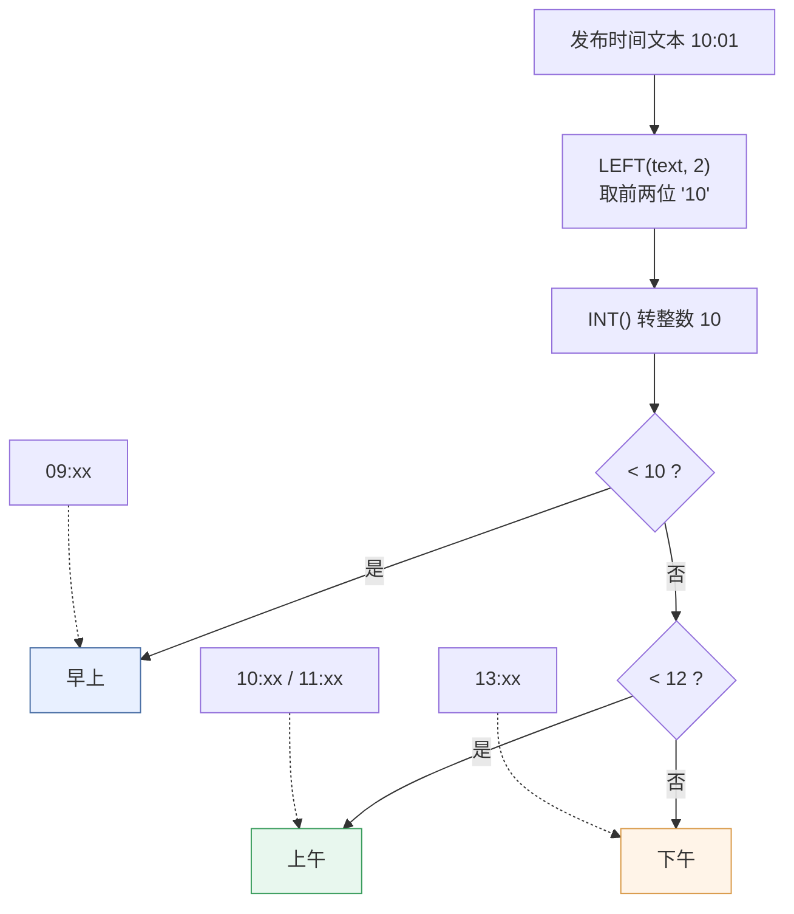

把北上广深四个单元格点选出来求和，得到 332，看起来没问题。**但只要对这张表做一次升序/降序排序，这个数字就会悄悄变成别的东西**——因为 `SUM` 记的是单元格坐标，不是城市。这一节从逻辑值讲到 `IF` 嵌套，再用「排序前后对照」把条件聚合为什么必须用 `SUMIF` / `COUNTIF` 讲透。

## 纲要

- 逻辑值只有真/假二元，可写作 `TRUE/FALSE`、`是/否` 或 `1/0`；**三类基本运算**是 AND 交集、OR 并集、NOT 求反
- `IF` 对逻辑式判真假并返回对应数值或文本；多分支靠**嵌套 IF**，由严到松逐层收敛
- 文本型时间不能直接比大小，要 `LEFT` 取前两位 + `INT` 转整数后再判断「早上/上午/下午」
- `SUM` 手点单元格有两个致命缺点：**城市一多极慢**、**排序后坐标对应的城市变了，结果错误且不报错**
- `SUMIF` 是「逻辑函数 + 数据函数」的合体：**按条件匹配值**，怎么筛选排序都不影响结果
- 条件写成数组常量 `{"北京","上海",...}` 时，`SUMIF` 返回**多个结果**，必须外层再套 `SUM` 才是总和
- `COUNTIF` 做单条件计次，用来从去重后的城市清单反推每个城市的职位数量；作业里的 `*开发工程师` 用通配符做归类

## 读前须知（名词与环境）

| 名词 | 在这篇里指什么 |
| --- | --- |
| Python | 示例代码使用的编程语言，本文按 Python 3 运行 |
| pandas | Python 的数据处理库，把表格读成二维对象再做运算 |
| numpy | Python 的数值计算库，提供数学函数与数组运算 |
| DataFrame | pandas 里的二维表格对象：有行、有列、每列有类型 |
| Excel 内置函数 | 全大写英文词都是 Excel 的函数名，正文表格里逐条给了中文用途 |

> **运行环境**：Python 3 + pandas（数据处理库） + numpy（数值计算库）；安装命令 `pip install pandas numpy`。代码块各自自包含，可单独复制运行。表格里的全大写词是 Excel 或 SQL 的函数名，紧随其后都给了中文用途。
>
> **材料来源**：本文依据一套数据分析课程讲义整理，文中「讲义」指课程原文，「口述」指讲师在课上口头给出的数字。讲义说法与软件实际行为不一致时，本文按可复算的结果或软件官方语义改写，并在正文注明。

## 一、逻辑值与三类基本运算

「外面在下雨」这个陈述要么真要么假，这种二元的判断结果就是**逻辑值**。它天然对应计算机底层的 1 和 0。

| A | B | `AND(A,B)` 交集 | `OR(A,B)` 并集 | `NOT(A)` 求反 |
| --- | --- | --- | --- | --- |
| 1 | 1 | 1 | 1 | 0 |
| 1 | 0 | 0 | 1 | 0 |
| 0 | 1 | 0 | 1 | 1 |
| 0 | 0 | 0 | 0 | 1 |

规则一句话：**AND 只有全真才真，OR 只有全假才假，NOT 直接取反**。参数既可以是 `TRUE()` / `FALSE()` 这样的逻辑值，也可以是**能推出真假的逻辑式**（如 `1=2` 得到 `FALSE`）。

`IF(logical_test, value_if_true, value_if_false)` 是日常使用最多的逻辑函数，返回值不限于 1/0，也可以是文本或空值。

## 二、嵌套 IF：给发布时间打时间段标签

需求：发布时间**10 点以前 = 早上，12 点以前 = 上午，12 点之后 = 下午**。

难点在于 `10:01` 是文本，没法直接和 10、12 比大小。解决办法：



公式骨架是 `=IF(INT(LEFT(A2,2))<10,"早上", IF(INT(LEFT(A2,2))<12,"上午","下午"))`。**条件要由严到松**：先判 `<10`，剩下的再判 `<12`，最后兜底。把后面那层 `IF` 删掉、只保留两分支，也能得到「`<12` 上午 / 否则下午」，取决于需要几个条件。

> 自动填充同样是写首行后双击右下角绿色方块。验证时挑边界值看：`09:xx` 早上、`10:xx` 上午、`13:xx` 下午。

## 三、条件聚合：SUM 为什么会错

想统计一线城市（北上广深）的职位数，最直觉的做法是 `SUM` 里点选北京、上海、广州、深圳四个单元格，得到 **125 + 93 + 48 + 66 = 332**。但这条路有两个缺点：

| 缺点 | 表现 | 后果 |
| --- | --- | --- |
| 速度慢 | 城市少时点四下还行，几百上千个城市就不能靠手点 | 不可规模化 |
| **引用按坐标，不按内容** | `SUM` 永远锁定选中的那几个单元格；一排序，原来位置上的城市变成了别的城市 | **结果静默变错，没有任何报错** |

第二点是致命的。工作表经常要按工作地点、职位数量排序，顺序一变，`SUM` 引用的坐标没变、里面的城市却换了，统计值就与标签对不上。

**条件聚合函数 = 数据函数 + 逻辑函数的合体**：先判断「符合条件吗」，再决定「计不计入、以什么方式计入」。求和用 `SUMIF`，计次用 `COUNTIF`。

```text
work/target/data-analysis/
├── _PROGRESS.md
├── cleaning/
│   ├── 01_logic_if.py        # AND/OR/NOT 真值表 + 嵌套 IF 时间段
│   ├── 02_sumif.py           # SUM 坐标错位 vs SUMIF 条件稳定 对照
│   └── 03_countif.py         # 去重城市清单 + 计次 + 通配符归类
└── output/
    ├── city_demand.csv       # 城市 × 职位数量
    └── city_tier_summary.csv # 一线/二线/三线汇总
```

## 四、SUMIF：三个参数与数组常量

`SUMIF(range, criteria, [sum_range])`：

| 参数 | 含义 | 本例 |
| --- | --- | --- |
| `range` | 条件所在列 | 工作地点 |
| `criteria` | 判定条件 | `"北京"` 或数组常量 |
| `sum_range` | 实际求和列 | 职位数量 |

**多条件的正确写法**是把多个城市放进花括号当数组常量：

`=SUM(SUMIF(工作地点列, {"北京","上海","广州","深圳"}, 职位数量列))`

这里有个高频坑：内层 `SUMIF` 会返回 **4 个数字**（125、93、48、66），不加外层 `SUM` 时单元格只显示第一个 125，看起来像「只统计了北京」。**必须外层再套 SUM** 才得到 332。

> **别和 `SUMIFS` 搞混**：`SUMIFS(sum_range, criteria_range1, criteria1, ...)` 是「同时满足多个不同条件」，是**且**关系；这里的数组常量是「满足其中任意一个」，是**或**关系，本质仍是 `SUMIF` + 外层 `SUM`。

改成 `SUMIF` 后再对工作地点反复升序降序，职位数量**原封不动**——因为它是按城市名去匹配对应的数值，而不是按单元格位置。

## 五、COUNTIF：从去重清单反推每个城市的职位数

那张「工作地点 × 职位数量」的汇总表是怎么来的？分三步：

- 复制工作地点列 → **删除重复项**，得到唯一城市清单
- 新增「职位数量」列，用 `=COUNTIF(原始工作地点列, 本行城市)` 计次
- 双击自动填充全部城市

为什么用 `COUNTIF` 而不是带数组常量的 `SUMIF`？因为这里**每行只有一个条件**（本行的城市），单条件计次正好；北京算出来 125，与前面 `SUMIF` 的结果一致，互为校验。

作业里的 `*开发工程师` 用的是**通配符**：星号匹配任意前缀，于是「大数据开发工程师」「文本挖掘开发工程师」都算开发类；非开发工程师总量 = 职位总数 − 开发工程师总量，不必再单独统计一次。

## 能力速览（要做什么 → 用哪个函数或写法）

| 能力 | Excel | pandas / Python | 说明 |
| --- | --- | --- | --- |
| 逻辑值 | `TRUE()` / `FALSE()` | `True` / `False` | 参与运算时等价 1/0 |
| 交集 / 并集 / 取反 | `AND` / `OR` / `NOT` | `&` / `\|` / `~` | pandas 里需括号包住每个条件 |
| 条件分支 | `IF(cond,a,b)` | `np.where(cond,a,b)` | 多分支用 `np.select` |
| 取左两字符 | `LEFT(t,2)` | `s.str[:2]` | 文本型时间先切再转整数 |
| 文本转整数 | `INT(x)` | `.astype(int)` | — |
| 无条件求和 | `SUM(单元格…)` | `df.iloc[[1,2,4,7]]["n"].sum()` | **按位置**，排序即错 |
| 单条件求和 | `SUMIF(range,c,[sum_range])` | `df.loc[df.city==c,"n"].sum()` | 按值匹配 |
| 多值「或」求和 | `SUM(SUMIF(r,{a,b},s))` | `df[df.city.isin([a,b])]["n"].sum()` | `isin` 天然返回标量总和 |
| 多条件「且」 | `SUMIFS` | `df[(c1)&(c2)]["n"].sum()` | 语义不同，别混 |
| 单条件计次 | `COUNTIF(range,c)` | `(df.city==c).sum()` | — |
| 通配符计次 | `COUNTIF(r,"*开发工程师")` | `s.str.contains("开发工程师$")` | `$` 锚定结尾 |
| 去重清单 | 删除重复项 | `.unique()` / `.drop_duplicates()` | — |

## 可运行示例

三段各自独立可运行。第一段做真值表与嵌套 IF 时间段，第二段用真实数字对照 SUM 与 SUMIF，第三段做 COUNTIF 与通配符归类。

```python
from __future__ import annotations

import itertools

import numpy as np
import pandas as pd

# ① AND / OR / NOT 真值表
rows = []
for a, b in itertools.product([1, 0], repeat=2):
    rows.append((a, b, int(a and b), int(a or b), int(1 - a)))
truth = pd.DataFrame(rows, columns=["A", "B", "AND", "OR", "NOT_A"])
print("逻辑运算真值表:"); print(truth.to_string(index=False))
assert truth["AND"].tolist() == [1, 0, 0, 0]
assert truth["OR"].tolist() == [1, 1, 1, 0]
assert truth["NOT_A"].tolist() == [0, 0, 1, 1]

# ② 嵌套 IF: 发布时间 -> 早上/上午/下午
t = pd.Series(["09:15", "10:01", "13:30", "08:00", "12:00"], name="发布时间")
hour = t.str[:2].astype(int)          # LEFT + INT
label = np.select([hour < 10, hour < 12], ["早上", "上午"], default="下午")
print("\n时间段判定:"); print(pd.DataFrame({"时间": t, "小时": hour, "标签": label}).to_string(index=False))
assert label.tolist() == ["早上", "上午", "下午", "早上", "下午"]
```

```python
from __future__ import annotations

import pandas as pd

city = pd.DataFrame([
    ("北京", 125), ("上海", 93), ("广州", 48), ("深圳", 66),
    ("杭州", 41), ("成都", 26), ("武汉", 19),
], columns=["city", "n"])
TIER1 = ["北京", "上海", "广州", "深圳"]

# 错误做法：SUM 记住的是「第 0/1/2/3 行」这几个坐标
pos = [0, 1, 2, 3]
print("排序前 SUM(按坐标) =", city.iloc[pos]["n"].sum())
sorted_city = city.sort_values("city").reset_index(drop=True)
print("排序后 SUM(按坐标) =", sorted_city.iloc[pos]["n"].sum(), "<- 已经不是一线城市了")
print("排序后坐标 0~3 变成:", sorted_city.iloc[pos]["city"].tolist())

# 正确做法：SUMIF 按城市名匹配
sumif_arr = [city.loc[city.city == c, "n"].sum() for c in TIER1]   # 数组常量: 4 个结果
print("\nSUMIF 数组常量结果:", sumif_arr, "(只显示第一个会误以为只统计了北京)")
total = sum(sumif_arr)                                             # 外层 SUM
print("外层 SUM 后总数 =", total)
for c in TIER1:
    assert city.loc[city.city == c, "n"].sum() == sorted_city.loc[sorted_city.city == c, "n"].sum()
assert sumif_arr == [125, 93, 48, 66] and total == 332
assert sorted_city.iloc[pos]["n"].sum() != 332, "排序后按坐标求和必须已经错掉"
```

```python
from __future__ import annotations

import pandas as pd

raw = pd.DataFrame({
    "city": ["北京"] * 125 + ["上海"] * 93 + ["广州"] * 48 + ["深圳"] * 66 + ["成都"] * 26,
    "岗位": (["数据分析师"] * 100 + ["大数据开发工程师"] * 25 +
             ["数据分析师"] * 93 +
             ["数据分析师"] * 48 +
             ["文本挖掘开发工程师"] * 40 + ["数据分析师"] * 26 +
             ["产品经理"] * 26),
})
assert len(raw["岗位"]) == len(raw["city"])

# COUNTIF: 去重城市清单 + 单条件计次
cities = raw["city"].unique()
countif = {c: int((raw["city"] == c).sum()) for c in cities}
print("COUNTIF 各城市职位数:", countif)
assert countif["北京"] == 125 and countif["深圳"] == 66

# 通配符 *开发工程师: 星号匹配任意前缀
dev = raw["岗位"].str.contains(r"开发工程师$").sum()
non_dev = len(raw) - dev
print(f"\n*开发工程师 = {dev} | 非开发工程师 = {non_dev} | 总数 = {len(raw)}")
print("命中的岗位种类:", raw.loc[raw["岗位"].str.contains(r"开发工程师$"), "岗位"].unique().tolist())
assert dev == 65 and non_dev == len(raw) - 65
```

## 📎 文本↔代码关联

| 文中结论 | 代码位置 | 怎么看 |
| --- | --- | --- |
| AND 全真才真 / OR 全假才假 | 第一段真值表 3 个断言 | 四行输出逐列核对 |
| 文本时间要先 `LEFT`+`INT` | 第一段 `t.str[:2].astype(int)` | `10:01` → 10 → 判为「上午」 |
| 嵌套 IF 由严到松 | 第一段 `np.select` | 断言五个时间点的标签序列 |
| `SUM` 按坐标，排序后静默出错 | 第二段 `sorted_city.iloc[pos]` | 断言排序后按坐标求和 **≠ 332** |
| `SUMIF` 按值，排序不影响 | 第二段逐城市 `loc` 断言 | 排序前后每个城市数值一致 |
| 数组常量返回 4 个结果 | 第二段 `sumif_arr` | `[125,93,48,66]`，外层 `sum` 才得 332 |
| `COUNTIF` 单条件计次 | 第三段 `countif` 字典 | 北京 125、深圳 66 与 SUMIF 互证 |
| `*开发工程师` 是前缀通配 | 第三段 `str.contains(r"开发工程师$")` | 命中两类岗位，共 65 条 |

## 常见坑

- **`SUM` 点选单元格后去排序**：引用不随内容走，结果静默变错且没有报错；这是本节最值得记住的一条。
- **数组常量忘套外层 `SUM`**：`SUMIF` 返回四个数字，单元格只显示第一个，容易误判成「只统计了北京」。
- **混淆 `SUMIF` 数组常量与 `SUMIFS`**：前者是「满足其中任意一个」的或关系，后者是「同时满足多个条件」的且关系。
- **直接拿 `10:01` 和 10 比大小**：文本型时间必须先 `LEFT` 截取再 `INT` 转换，否则判断结果不可预期。
- **嵌套 IF 条件顺序写反**：先判 `<12` 再判 `<10`，后者永远进不去；一定由严到松。
- **`IF` 嵌套过深**：超过三四层就该换查找表（如 Excel 的 `VLOOKUP`）或 `np.select` 式的映射，可读性和维护性好得多。
- **通配符方向搞错**：`*开发工程师` 匹配任意**前缀**；要匹配含关键词的任意位置应写 `*开发工程师*`，两个语义不同。
- **用 `COUNTIF` 做多条件计次**：单条件用 `COUNTIF`，多条件要用 `COUNTIFS`；别靠多次相减硬凑。

## 面试官会问什么

> 面试官通常用「排序一次结果就变了」这个现象，看你能不能定位到引用方式而不是怀疑数据。

| # | 面试官会问 | 回答要点（可直接口述） | 常见追问 |
| --- | --- | --- | --- |
| 1 | AND、OR、NOT 的运算规则？ | AND 只有全真才真，OR 只有全假才假，NOT 直接取反。参数既可以是逻辑值，也可以是能推出真假的逻辑式。 | 逻辑值和 1、0 是什么关系？ |
| 2 | 嵌套 IF 的条件为什么要由严到松？ | 先判最紧的条件，剩下的再逐级放宽，最后兜底。顺序写反会让后面的条件永远进不去。层数太多应改查表或映射。 | 文本型时间怎么参与比较？ |
| 3 | SUM 和 SUMIF 在排序后表现不同的根因？ | SUM 锁定单元格坐标，排序后坐标没变但内容换了，结果静默变错；SUMIF 按条件匹配值，不依赖位置。 | 这是数据问题还是公式问题？ |
| 4 | 条件写成数组常量时，为什么还要外层再套一层 SUM？ | 内层返回多个结果，单元格只显示第一个，容易误判成只统计了一个城市；外层求和才是总数。 | 这跟 SUMIFS 是一回事吗？ |
| 5 | COUNTIF 的通配符「星号开发工程师」匹配什么？ | 匹配任意前缀，于是大数据开发工程师、文本挖掘开发工程师都算开发类。要匹配任意位置得前后都加星号。 | 非开发类怎么算最省事？ |

**红旗答案**（说出来基本就停在这一档）：

- 把「星号开发工程师」说成任意位置匹配。
- 把数组常量的或关系与 SUMIFS 的且关系混为一谈。
- 忘套外层 SUM，把第一个结果当成总数。

**加分点**：

- 用 125、93、48、66 精确复算 332，并证明排序后按坐标求和必然偏离。
- 指出统计口径应从写死城市清单改成按类别汇总，字典表新增城市才能自动计入。

## 总结

- 逻辑值二元，AND / OR / NOT 分别对应交集、并集、求反；`IF` 把判断结果映射成数值或文本。
- 多分支靠**嵌套 IF 由严到松**；文本型时间先 `LEFT` + `INT` 再比较。
- `SUM` 按坐标、`SUMIF` 按条件；**排序是检验口径的最好办法**。
- 数组常量让 `SUMIF` 一次返回多个结果，**外层必须套 `SUM`**；别与 `SUMIFS` 混用。
- `COUNTIF` 从去重清单反推计次，`*开发工程师` 用通配符归类，非该类 = 总数 − 该类。
- 讲义四个城市职位数 125 / 93 / 48 / 66 相加精确等于 332，是可复算的校验锚点。