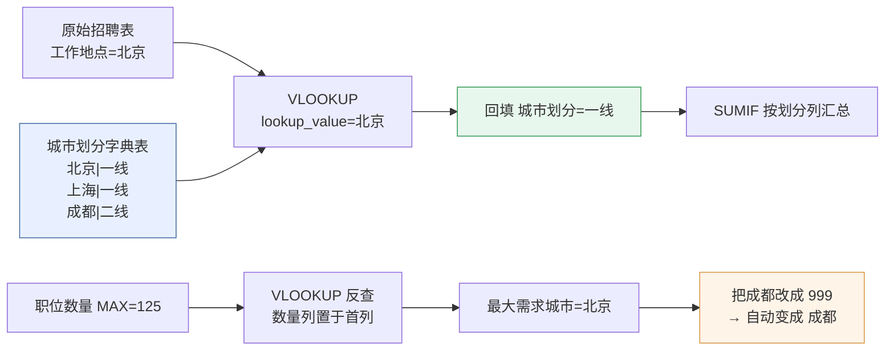

想给每条招聘记录补上「一线 / 二线 / 三线」这个字段，最笨的办法是拿着城市名去字典表里查，再一行行复制回来。**手工复制意味着数据一变就要重做一遍**。这一节用 `VLOOKUP` 把这件事变成自动化的：字典表改了、职位数量改了，报表里的类别与「最大需求城市」会自己跟着变。

## 纲要

- 查找与引用函数解决的是：从**关系链完整的数据样本**里，按数据间的关系提取对应项；典型载体是「城市 → 城市划分」的字典表
- `VLOOKUP` 四参数：`lookup_value`（拿什么找）、`table_array`（去哪找）、`col_index_num`（取第几列，**从 1 数**）、`range_lookup`（精确 / 近似）
- **硬约束：查找依据所在列必须是 `table_array` 的第一列**，否则公式直接失效
- 反向查「最大需求数对应的城市」时，要把「职位数量」列**挪到第一列**再查找
- 第四参数 `0` / `FALSE` = **精确匹配**，`1` / `TRUE` / **省略** = 近似匹配（要求首列升序）；讲义口述把这组语义说反了
- 与 `SUMIF` 联动时，用 `LEFT` 把「一线城市」截成「一线」去匹配划分列，统计口径就不再写死城市名
- 全链路用函数与引用之后，把某城市职位数从 26 改成 999，报表的「最大需求城市」自动变成该城市——这就是**自动化报表**

## 读前须知（名词与环境）

| 名词 | 在这篇里指什么 |
| --- | --- |
| Python | 示例代码使用的编程语言，本文按 Python 3 运行 |
| pandas | Python 的数据处理库，把表格读成二维对象再做运算 |
| DataFrame | pandas 里的二维表格对象：有行、有列、每列有类型 |
| Excel 内置函数 | 全大写英文词都是 Excel 的函数名，正文表格里逐条给了中文用途 |

> **运行环境**：Python 3 + pandas（数据处理库）；安装命令 `pip install pandas`。代码块各自自包含，可单独复制运行。表格里的全大写词是 Excel 或 SQL 的函数名，紧随其后都给了中文用途。
>
> **材料来源**：本文依据一套数据分析课程讲义整理，文中「讲义」指课程原文，「口述」指讲师在课上口头给出的数字。讲义说法与软件实际行为不一致时，本文按可复算的结果或软件官方语义改写，并在正文注明。

## 一、查找与引用在解决什么

描述性分析里除了求和计次，还要**提取类别数据**：统计职位需求量时，需要按工作地点、招聘岗位、工作经验三个维度算数量，并回填它们对应的类别。数值型的最大值可以用 `MAX` 直接取；类别型就得靠查找与引用从字典表里引回来。



> 之所以不用「筛选排序找到最大值再手工复制」，是因为报表**本该随数据变化自动更新**。学习工具的目的就是用自动化替代人工，维度的复杂度上升时，也只是把更多步骤这样一步步设好。

## 二、四个参数逐条拆开

`=VLOOKUP(lookup_value, table_array, col_index_num, [range_lookup])`

| # | 参数 | 含义 | 本例取值 |
| --- | --- | --- | --- |
| 1 | `lookup_value` | 拿什么值去搜索 | 同行的「工作地点」（如北京） |
| 2 | `table_array` | 去哪张关系表里搜 | 城市划分**字典表**区域 |
| 3 | `col_index_num` | 目标值在选区第几列 | `2`（城市划分在第二列），**从 1 开始数** |
| 4 | `range_lookup` | 精确还是近似 | `0` 精确匹配 |

讲义小结里把参数名念作 `tableray` / `calonindexnumber` / `range，lookup`，都是语音转写造成的错字，对应上面三个英文参数名。

**首列硬约束**：第 1 个参数的查找依据，在 `table_array` 中**必须位于第一列**。这不是建议，是 `VLOOKUP` 的结构性前提——它只在选区首列做搜索，再向右取第 N 列。字典表因此要按「城市 | 划分」的顺序组织，不能反过来。

## 三、反查：从最大需求数定位城市

`MAX(职位数量列)` 得到 125，但 125 是数值，怎么知道它对应哪个城市？照样用 `VLOOKUP`，只是要**换一下二维表的列顺序**：把「职位数量」放到第一列、「工作地点」放到第二列，然后

`=VLOOKUP(MAX(职位数量列), 换序后的二维表, 2, 0)`

得到「北京」。若把成都的职位数从 26 改成 999，`MAX` 变成 999，查找结果随之变成「成都」——**这就是自动化报表**，不需要改任何公式。

## 四、精确匹配 vs 近似匹配（讲义口述说反，此处按官方语义）

> ⚠️ 讲义讲的是「默认模糊查询，零精确查询需要填入一选择模糊查询」，自相矛盾且与 Excel 实际行为相反。**以官方语义为准**：

| `range_lookup` | 匹配方式 | 前提 | 找不到时 |
| --- | --- | --- | --- |
| `0` / `FALSE` | **精确匹配** | 无 | 返回 `#N/A` |
| `1` / `TRUE` / **省略** | 近似匹配：取**首列中 ≤ 查找值的最大值** | 首列必须升序 | 返回最接近的小值，容易静默给错 |

所以做字典表回填一律**显式写 `0`**（或 `FALSE`）。省略第四参数会默认走近似匹配，在无序字典表上返回看似合理、实则错误的结果，而且不报错。

## 五、和 SUMIF 联动：别再把城市名写死

如果按城市名写死条件来统计一线城市，有了「城市划分」列之后，可以改成按**划分列**汇总：

`=SUMIF(城市划分列, LEFT("一线城市", 2), 职位数量列)`

这里 `LEFT` 的作用是消掉「城市」两个字——报表里的类别叫「一线城市」，字典表里的值叫「一线」，不处理就匹配不上。这样统计口径从「写死四个城市」变成「按类别自动归类」，字典表里新增城市也会自动计入。

```text
work/target/data-analysis/
├── _PROGRESS.md
├── cleaning/
│   ├── 01_vlookup.py        # 字典表回填 + 首列约束 + 精确/近似对照
│   ├── 02_reverse.py        # MAX 反查最大需求城市 + 数据改动自动更新
│   └── 03_sumif_tier.py     # LEFT 归一化类别 + 按划分列汇总
└── output/
    ├── city_dict.csv        # 城市 | 城市划分
    ├── jobs_with_tier.csv   # 回填后的招聘表
    └── tier_summary.csv     # 各线职位总数
```

## 能力速览（要做什么 → 用哪个函数或写法）

| 能力 | Excel | pandas / Python | 说明 |
| --- | --- | --- | --- |
| 字典表回填 | `VLOOKUP(k, dict, 2, 0)` | `df["city"].map(dict_series)` | `map` 天然精确匹配、缺失给 `NaN` |
| 多列回填 | 多次 VLOOKUP | `df.merge(dict_df, on="city", how="left")` | 关系表思路 |
| 取最大值 | `MAX(区域)` | `.max()` / `.idxmax()` | — |
| 反查类别 | VLOOKUP + 换序 | `df.loc[df["n"].idxmax(), "city"]` | 无需换列，但语义相同 |
| 左侧截取 | `LEFT(t,2)` | `s.str[:2]` | 类别名归一化 |
| 按类别汇总 | `SUMIF(划分列, 条件, 数量列)` | `df.groupby("tier")["n"].sum()` | — |
| 精确匹配 | `range_lookup=0` | `map` / `merge` 默认行为 | 找不到 → `NaN` |
| 近似匹配 | `range_lookup=1` / 省略 | `pd.merge_asof` | 要求有序，易静默出错 |
| 刷新引用 | 公式自动重算 | 重新执行表达式 | 与透视表需手动「刷新」不同 |

## 可运行示例

三段各自独立可运行。第一段做字典表回填与精确/近似对照，第二段做 `MAX` 反查与自动更新，第三段做类别归一化汇总。

```python
from __future__ import annotations

import pandas as pd

# 字典表：查找依据「城市」必须在首列
city_dict = pd.DataFrame([
    ("北京", "一线"), ("上海", "一线"), ("广州", "一线"), ("深圳", "一线"),
    ("杭州", "二线"), ("南京", "二线"), ("成都", "二线"),
    ("武汉", "三线"), ("合肥", "三线"),
], columns=["city", "tier"])

jobs = pd.DataFrame({
    "city": ["北京", "成都", "上海", "合肥", "未知市"],
    "岗位": ["数据分析师", "产品经理", "数据开发", "商业分析", "数据分析师"],
})

# VLOOKUP(k, dict, 2, 0) 等价于 map：精确匹配、找不到给 NaN
jobs["tier"] = jobs["city"].map(city_dict.set_index("city")["tier"])
print("回填结果:"); print(jobs.to_string(index=False))
assert jobs.loc[0, "tier"] == "一线" and jobs.loc[1, "tier"] == "二线"
assert pd.isna(jobs.loc[4, "tier"]), "精确匹配找不到应返回空值, 而非最近似值"


def vlookup_approx(key, table):
    """模拟 range_lookup=1：首列升序时取 <= key 的最大值对应行。"""
    ordered = table.sort_values("key")
    eligible = ordered[ordered["key"] <= key]
    return None if eligible.empty else eligible.iloc[-1]["value"]


approx = pd.DataFrame({"key": [10, 20, 30], "value": ["A", "B", "C"]})
print("\n近似匹配 key=25 ->", vlookup_approx(25, approx), "(精确匹配本应返回 #N/A)")
assert vlookup_approx(25, approx) == "B", "近似匹配会静默返回 <=25 的最大项 B"
```

```python
from __future__ import annotations

import pandas as pd

demand = pd.DataFrame([
    ("北京", 125), ("上海", 93), ("广州", 48), ("深圳", 66), ("成都", 26),
], columns=["city", "n"])

# MAX + 反查：Excel 需把 n 挪到首列再用 VLOOKUP；pandas 用 idxmax 直接定位
top_n = demand["n"].max()
top_city = demand.loc[demand["n"].idxmax(), "city"]
print(f"MAX = {top_n} -> 最大需求城市 = {top_city}")
assert top_n == 125 and top_city == "北京"

# 数据变更后报表自动更新（无需改公式）
demand.loc[demand["city"] == "成都", "n"] = 999
new_city = demand.loc[demand["n"].idxmax(), "city"]
print(f"成都改为 999 后 -> 最大需求城市 = {new_city}")
assert new_city == "成都"
```

```python
from __future__ import annotations

import pandas as pd

city_dict = pd.DataFrame([
    ("北京", "一线"), ("上海", "一线"), ("广州", "一线"), ("深圳", "一线"),
    ("杭州", "二线"), ("成都", "二线"), ("武汉", "三线"),
], columns=["city", "tier"])
counts = pd.DataFrame([
    ("北京", 125), ("上海", 93), ("广州", 48), ("深圳", 66),
    ("杭州", 41), ("成都", 26), ("武汉", 19),
], columns=["city", "n"])

df = counts.merge(city_dict, on="city", how="left")
# LEFT("一线城市", 2) -> "一线"，用于把报表类别名归一到字典表的值
report_categories = pd.Series(["一线城市", "二线城市", "三线城市"])
keys = report_categories.str[:2]
summary = (df.groupby("tier")["n"].sum()
             .reindex(keys.tolist())
             .set_axis(report_categories.tolist()))
print("按城市划分汇总:"); print(summary.to_string())
print("总计:", int(summary.sum()))

assert summary["一线城市"] == 332, "北上广深 125+93+48+66=332"
assert summary.sum() == df["n"].sum()
```

## 📎 文本↔代码关联

| 文中结论 | 代码位置 | 怎么看 |
| --- | --- | --- |
| 字典表首列必须是查找依据 | 第一段 `set_index("city")` | 用 city 作索引，等价于 VLOOKUP 首列约束 |
| 精确匹配找不到给空值 | 第一段 `pd.isna(...)` 断言 | 「未知市」→ `NaN`，不是 `#N/A` 也不是近似值 |
| 近似匹配会静默给错 | 第一段 `vlookup_approx(25)` | 返回 `B`，而精确匹配本应找不到 |
| `MAX` 反查最大需求城市 | 第二段 `idxmax` | 125 → 北京，被断言 |
| 数据改了报表自动更新 | 第二段把成都改成 999 | 断言结果变为「成都」 |
| `LEFT` 消掉「城市」二字 | 第三段 `str[:2]` | 「一线城市」→「一线」才能对上字典表 |
| 按划分列汇总不写死城市 | 第三段 `groupby("tier")` | 一线合计 332 与条件求和的结果互证 |
| 口径换成类别后仍对得上 | 第三段总计断言 | `summary.sum() == df["n"].sum()` |

## 常见坑

- **查找列不在 `table_array` 首列**：`VLOOKUP` 只在首列搜索，字典表列顺序反了必然失效；这一条讲义专门强调过。
- **省略第四参数**：默认走近似匹配，在无序字典表上返回一个看似合理却错误的值，且**不报错**。回填类需求一律写 `0` / `FALSE`。
- **把 0 和 1 的语义记反**：`0` 是精确、`1` 是近似。讲义口述把这组说反了，别照抄。
- **`col_index_num` 从 0 数**：它是**从 1 开始**的选区内列号，不是工作表列号，也不是 0-based 下标；写 0 会报错。
- **用近似匹配却不保证首列升序**：结果不可预期，是「看起来对了」的高发区。
- **报表类别名与字典值不统一**：「一线城市」与「一线」直接匹配会全部落空，需要 `LEFT` 或统一命名。
- **把城市名写死在 `SUMIF` 条件里**：字典表新增城市后统计不会自动扩展；改用划分列汇总才是可维护的做法。
- **忘记公式与透视表的更新机制不同**：公式自动重算，但**数据透视表必须手动「刷新」**，行数变了还要「更改数据源」重新锁定区域（数据透视表需手动刷新，与公式不同）。

## 面试官会问什么

> 四个参数里，面试官最常追的是第四参数。答不清精确与近似，基本就停在这一档。

| # | 面试官会问 | 回答要点（可直接口述） | 常见追问 |
| --- | --- | --- | --- |
| 1 | VLOOKUP 的四个参数分别是什么？ | 查找值、字典表区域、目标值在选区的第几列、匹配方式。列号从 1 开始数，不是工作表列号，也不是从 0 开始。 | 第三参数写 0 会怎样？ |
| 2 | 为什么查找依据必须在选区第一列？ | 函数只在选区首列做搜索，再向右取第 N 列，这是结构性前提，不是使用习惯。字典表因此要按「依据在前」组织。 | 要反查怎么办？ |
| 3 | 第四参数 0 和 1（或省略）分别是什么语义？ | 0 或 FALSE 是精确匹配，找不到返回错误值；1、TRUE 或省略是近似匹配，取首列中不超过查找值的最大项，且要求首列升序。省略会静默给错。 | 所以回填字典表该怎么写？ |
| 4 | 怎么从最大需求数反查它对应的城市？ | 先用 MAX 取最大数值，再把数值列换到选区第一列、城市列放第二列，用这个最大值作查找值精确匹配。 | 数据变了结果会自己更新吗？ |
| 5 | 把城市名写死在 SUMIF 条件里有什么问题？ | 字典表新增城市不会自动计入，维护成本高；改成先回填划分列，再按划分列汇总即可，类别名不一致时用 LEFT 归一化。 | 公式重算和透视表刷新是一回事吗？ |

**红旗答案**（说出来基本就停在这一档）：

- 把 0 和 1 的精确、近似语义说反。
- 省略第四参数，在无序字典表上拿到一个看似合理却错误的值。
- 把列号从 0 开始数，或误当成工作表列号。

**加分点**：

- 把某城市职位数改成 999，报表的「最大需求城市」自动更新，且不需要改任何公式。
- 能按软件官方语义准确说出 0 与 1 的区别，并点明省略第四参数会静默给错；同时说明公式自动重算与透视表需手动刷新的区别。

## 总结

- 查找与引用是从**关系链完整的字典表**里按关系回填类别，替代手工复制。
- `VLOOKUP` 四参数：查找值、字典表区域、目标列号（**1-based**）、匹配方式；**查找依据必须在首列**。
- `0`/`FALSE` 精确、`1`/`TRUE`/省略近似 —— 精确匹配找不到返回 `#N/A`，近似匹配会静默取最接近的小值。
- 反查最大需求城市：把数值列挪到首列，用 `MAX` 作查找值；数据一改结果自动更新，这就是自动化报表。
- 与 `SUMIF` 联动时按「城市划分」列汇总，用 `LEFT` 归一化类别名，口径不再写死城市清单。
- 公式自动重算，透视表要手动刷新，两者更新机制不同，别混为一谈。