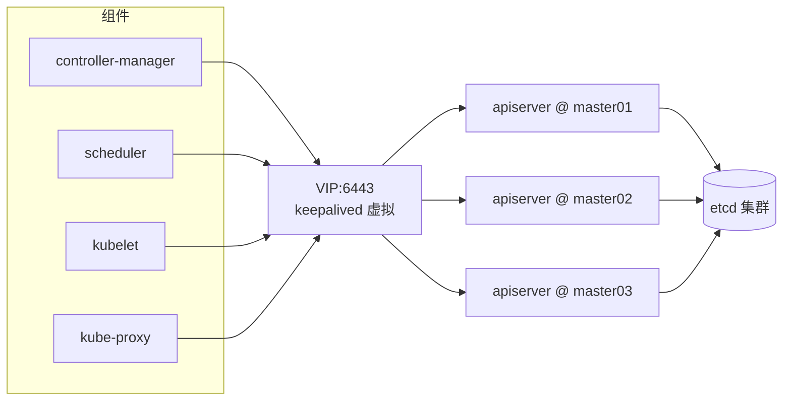

# Kubernetes 集群部署: K8s 高可用架构解析 —— etcd 集群、三 master 与 VIP 负载均衡

动手安装之前，先把高可用架构看清楚。本课程面向生产，所以**不讲单 master 集群怎么装**，直接讲高可用——这正是生产与"跑个 demo"的分水岭。

结论先摆：

1. **先装的是 etcd 集群**——它是 K8s 的数据库，所有资源和变更都存在里面；
2. **etcd 可以和三台 master 装在一起，也可以分开**——演示环境（笔记本）合在一起，**生产规模大时强烈建议分开**；
3. **master 三大组件**：`kube-apiserver`（控制单元，所有流量都过它）、`kube-controller-manager`（集群控制器）、`kube-scheduler`（调度器）；
4. **三台 master 靠负载均衡组成集群**：软件方案用 **keepalived + haproxy**，有硬件负载均衡（F5）就用它，省掉这两个；
5. **VIP 不占机器资源**——它是 keepalived 虚拟出来的一个 IP，会挂到某个 master 节点的网卡上（一块网卡两个 IP）；
6. **所有组件都连 VIP，不直连某一台 apiserver**——否则那台挂了就全断了；
7. **只有 apiserver 直连 etcd**，其他任何组件都不直连，一律走 apiserver。

## 纲要

- 为什么先装 etcd：它是集群的数据库
- etcd 与 master 合设还是分离
- master 三大组件与 node 两大组件
- 三 master 怎么组成集群：负载均衡
- VIP 是什么、不占机器、如何挂载到网卡
- 通信链路：所有组件 → VIP → apiserver
- apiserver 是唯一与 etcd 交互的组件
- 本节用到的机器规划

## 一、为什么先装 etcd

架构上**最先安装的是 etcd 集群**。

- **etcd 是一个键值（key-value）数据库**，主要用来存放 K8s 的数据；
- 我们创建的资源、做的变更，最终都会存到 etcd 里。

所以后面所有组件的状态都以它为准，它必须先就绪。

## 二、etcd 与 master：合设还是分离

课程演示环境里，**etcd 和三台 master 部署在一起**——因为笔记本配置有限，没有单独再找三台机器专门跑 etcd。

生产怎么选：

```text
etcd 与 master 的部署取舍
├── 合设（master01/02/03 上各跑一个 etcd）
│      适用: 机器配置够高、规模不大
│      好处: 省机器
│      风险: master 与 etcd 一起挂，故障域重合
└── 分离（独立的三台 etcd）
       适用: 集群规模比较大
       好处: 故障域隔离，etcd 性能不受业务组件影响
       成本: 多三台机器
```

> 一句话：**机器配置够高、规模不大可以合设；规模上来了，务必把 etcd 拆出来。**

## 三、master 与 node 各自跑什么

K8s 节点分两类：**master（控制节点）** 和 **node（工作节点）**。

### master 节点：控制整个集群

| 组件 | 作用 |
| --- | --- |
| **kube-apiserver** | **整个 K8s 的控制单元，所有流量都会经过它** |
| **kube-controller-manager** | 集群的控制器（各类 controller 的合集） |
| **kube-scheduler** | 调度器，决定 Pod 调度到哪个 node 上 |

### node 节点：跑 Pod 和容器

| 组件 | 作用 |
| --- | --- |
| **kubelet** | 节点上的代理，管理 Pod 生命周期 |
| **kube-proxy** | 维护网络规则，实现 Service 转发 |

> 注意：**Docker 不属于 K8s 的组件**，它是容器运行时，本架构图里不列入 K8s 组件。

**master 能不能也跑业务 Pod？** 可以。测试环境机器不够、想充分利用资源时，可以在 master 上也部署 node 的组件（kubelet + kube-proxy），让 master 同时当工作节点。生产上一般避免，master 只做控制面。

## 四、三台 master 怎么组成集群：负载均衡

三台 master 要变成一个"整体"，靠的是**在前面加一层负载均衡**。常见组合：

```text
负载均衡选型
├── 软件方案（本课程采用）
│   ├── keepalived + haproxy   ← 课程用这个，haproxy 配 TCP 反向代理比较简单
│   └── nginx + keepalived
└── 硬件方案
    └── F5（或其他硬件 LB）
        有它就不需要自己搭 keepalived + haproxy 了
        F5 的那个 IP 就是 VIP
```

关键要求：**这个反向代理要基于 TCP**——因为 apiserver 走的是 HTTPS/TCP，不是 HTTP 七层路由。

## 五、VIP：虚拟出来的一个 IP

VIP（Virtual IP）是本架构的关键，但也是最容易被误解的一点。

```text
VIP 的三个事实
├── ① 不占机器资源
│     它是 keepalived（+ haproxy）虚拟出来的，不是一台独立的机器
├── ② 会挂到某个 master 节点的网卡上
│     一块网卡上绑两个 IP：
│       - 虚拟机自己的 IP
│       - VIP
└── ③ 后端挂着三台 apiserver
     VIP:6443 → master01:6443 / master02:6443 / master03:6443
```

### 通信链路（重点）

所有组件连接 apiserver 时，**连的都是 VIP，不是某一台的 IP**：



**为什么必须经过负载均衡？** 因为如果组件直接连某一台的 apiserver，**那台 apiserver 挂了怎么办**——整个控制链路就断了。走 VIP 才能自动避开故障的那台。

## 六、只有 apiserver 直连 etcd

这是架构上非常关键的一条隔离规则：

```text
etcd 的访问边界
├── ✅ kube-apiserver  →  直连 etcd（唯一）
└── ❌ controller-manager / scheduler / kubelet / kube-proxy
       一律不直连 etcd，全部通过 apiserver 交互
```

因此 **apiserver 极其重要，生产环境必须部署高可用，一般是三个节点以上**。

## 七、本节的机器规划

```text
课程用到的机器（共 5 台 + 1 个虚拟 IP）
├── master01   ← master 组件 + etcd
├── master02   ← master 组件 + etcd
├── master03   ← master 组件 + etcd
├── node01     ← kubelet + kube-proxy
├── node02     ← kubelet + kube-proxy
└── VIP        ← 不占机器，keepalived 虚拟出来
```

## 总结

- **先装 etcd**：它是 K8s 的键值数据库，所有资源与变更都存在这里；etcd 与 master 可合设（配置够高/规模不大）也可分离（**规模大时建议分离**）；
- **master 三组件**：apiserver（**控制单元，所有流量都过它**）、controller-manager（控制器）、scheduler（调度器）；**node 两组件**：kubelet、kube-proxy（Docker 不算 K8s 组件）；
- **三 master 靠负载均衡成集群**：软件用 **keepalived + haproxy**（TCP 反向代理），有 F5 就用 F5 并省掉这两个；
- **VIP 不占机器**，由 keepalived 虚拟，挂到某台 master 的网卡上（**一块网卡两个 IP**），后端挂三台 apiserver 的地址+端口；
- **所有组件连 VIP，不直连单台 apiserver**——否则那台挂了控制链路就断；
- **只有 apiserver 直连 etcd**，其余组件全部经由 apiserver，所以 **apiserver 生产必须高可用，一般三个节点以上**。
