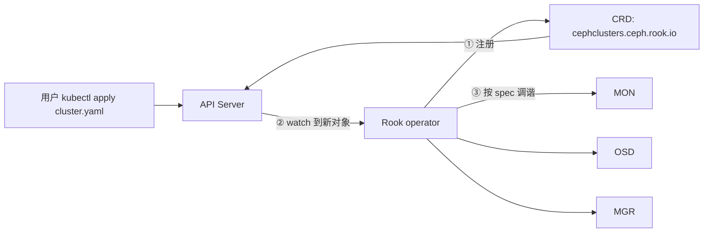

# Kubernetes 集群部署: 使用 Rook 部署 Ceph 集群（上）—— operator 拉镜像的等待期与 CRD 自定义资源

上一节把 operator 先装起来了。这一节进入真正的等待期：operator 一直在拉镜像，而 Ceph 集群还没创建。借着这段等待，我们要搞清楚一件更重要的事——**为什么 `kubectl apply` 一个 CephCluster 就能拉起一整套 Ceph？答案是 CRD。**

结论先摆：

1. **operator 起不来，后面全部卡住**：它是一个 CRD 控制器，镜像拉不下来就一直 `Pending`/`ImagePullBackOff`；
2. 等待期间可以先恢复练习环境——把刚才停掉的 **kube-apiserver、controller-manager、scheduler（以及 etcd）重新拉起来**；
3. **K8s 默认没有 `cephclusters` 这种资源**，它是 Rook 自己定义的 **CRD（CustomResourceDefinition，自定义资源）**；
4. operator 把 CRD **注册到 K8s 上**，之后你创建一个 `CephCluster` 资源，operator 就会去启动 **MON / OSD / MGR** 这些 Ceph 组件；
5. 所以 Rook 的本质是：**用 K8s 的声明式 API 去描述"我想要一个 Ceph 集群"**。

## 纲要

- 恢复练习环境：把停掉的 apiserver / controller-manager / scheduler / etcd 拉回来
- operator 的等待期：镜像一直在拉，急不得
- **CRD 是什么**：K8s 默认没有的类型，由第三方自己定义并注册
- operator = 注册 CRD + 监听该资源的控制器
- 创建 CephCluster 之后会发生什么：MON / OSD / MGR 依次起来
- 一句话总结 Rook 的工作原理

## 一、先把练习环境恢复回来

上一节为了演示，我们把几个核心组件停掉了。现在继续之前，先把它们拉起来：

```bash
# 在对应的 master 节点上把静态 Pod 或 systemd 服务恢复
systemctl start kubelet          # 由 kubelet 拉起静态 Pod
# 被停过的组件:
#   kube-apiserver          ← 集群的唯一入口
#   kube-controller-manager ← 控制器
#   kube-scheduler          ← 调度器
#   etcd                    ← 集群数据库
```

恢复后确认组件状态：

```bash
kubectl get cs                        # 旧版本: 看 ComponentStatus
kubectl -n kube-system get pod -o wide | grep -E 'apiserver|controller|scheduler|etcd'
```

> 提示：apiserver 是**唯一**直接和 etcd 打交道的组件，它起不来整个集群就不可写；controller-manager 和 scheduler 都要通过它工作。停过这些组件之后务必确认全部回到 `Running`。

## 二、operator 的等待期：镜像一直在拉

此刻 operator 一直在拉镜像。这是正常现象，能做的只有等：

```bash
kubectl -n rook-ceph get pod -w
# rook-ceph-operator-xxx   0/1   ImagePullBackOff / ContainerCreating
```

**operator 不起来的话，后面就一直卡在这一步**。原因很直接：operator 是一个 CRD 控制器，它没起来就没人去处理你后面创建的 `CephCluster` 资源。

镜像拉取慢时的排查顺序：

```text
镜像拉不下来?
├── kubectl describe pod 看 Events 里的具体报错
├── 镜像仓库可达吗? (内网环境常缺外部 registry)
├── 镜像 tag 与 operator.yaml 里写的一致吗?
└── 节点磁盘/网络是否正常
```

## 三、CRD：K8s 里本来没有这个类型

这一步是本节的核心。我们可以验证一下——**K8s 默认是没有 `cephclusters` 这种资源的**：

```bash
kubectl get cephclusters
# error: the server doesn't have a resource type "cephclusters"
```

它是 **Rook 自己定义的一种资源**，全称是 **CRD（CustomResourceDefinition，自定义资源定义）**，也可以理解成 **Custom Resource Definition —— 用户自定义的资源类型**。

CRD 的作用是把一种新类型"教"给 K8s，教完之后：

```bash
kubectl api-resources | grep -i ceph
# cephclusters    cephcluster.ceph.rook.io   ...
# cephblockpools  cephblockpool.ceph.rook.io ...
# cephfilesystems cephfilesystem.ceph.rook.io ...
```

于是你就可以像用内置类型一样用它：

```bash
kubectl -n rook-ceph get cephcluster
kubectl -n rook-ceph describe cephcluster rook-ceph
```

## 四、operator = 注册 CRD + 监听并调谐

Rook 的 operator 做了两件事，理解这两件事就理解了所有 operator 类项目（包括后面要讲的中间件 operator）：



1. **注册**：operator 起来后，把 `CephCluster`、`CephBlockPool`、`CephFilesystem` 这些 CRD **注册到 K8s 上**（课程原话是"以注册的形式注册到 operator 上面"）；
2. **调谐（reconcile）**：operator 持续 watch 这些资源。一旦你 `apply` 了一个 `CephCluster`，它就按 `spec` 去把真实组件拉起来。

## 五、创建 CephCluster 之后会发生什么

用这个自定义资源创建一个 Ceph 集群之后，operator 会依次把 Ceph 的组件启动起来：

```text
kubectl apply -f cluster.yaml
        │
        ▼
  CephCluster 对象被创建
        │
        ▼  operator 接管
  ┌─────┼─────────────────┬─────────────────┐
  ▼     ▼                 ▼                 ▼
 MON   OSD               MGR             (MDS: 文件存储时才需要)
 监控   对象存储守护进程   管理守护进程/dashboard
  quorum 保证副本位置     提供集群状态与指标
```

对应课程里说的那句：**"创建一个 ceph 的集群，然后这个 Ceph 就会启动 monitor、OSD、或者是 MGR 这些东西。"**

组件职责速记：

| 组件 | 全称 | 作用 |
| --- | --- | --- |
| **MON** | Monitor | 维护集群地图（cluster map）与 quorum，通常 3 个且要分散在不同节点 |
| **OSD** | Object Storage Daemon | 真正存数据的进程，**一块盘一个 OSD** |
| **MGR** | Manager | 提供集群状态、指标与 dashboard |
| **MDS** | Metadata Server | 只有文件存储（CephFS）才需要 |

## 六、一句话讲清 Rook 在做什么

把整条链路收成一句话：

> **Rook 把"Ceph 集群"抽象成 K8s 的一个自定义资源（CRD），由 operator 负责把这个声明式的 YAML 翻译成真实的 MON / OSD / MGR 进程。**

所以你不需要手工去装 Ceph、去初始化 MON、去加 OSD——**你只需要声明"我要一个 Ceph 集群"**，剩下的由 operator 调谐出来。下一节我们看它真正起来之后的组件启动顺序。

## 总结

- **operator 是前置依赖**：它一直在拉镜像，起不来后面全部卡住，只能等；先把停掉的 apiserver / controller-manager / scheduler / etcd 恢复回来；
- **K8s 默认没有 `cephclusters`**——它是 Rook 定义的 **CRD（CustomResourceDefinition）**；
- **operator 的两件事**：① 注册 CRD 到 K8s；② watch 这些资源并**按 spec 调谐**出真实组件；
- **创建 CephCluster 后**，operator 启动 **MON（集群地图/quorum）、OSD（真正存数据）、MGR（管理/dashboard）**，文件存储时再加 MDS；
- **Rook 的本质**：把 Ceph 变成声明式 API——你声明"要一个集群"，它负责把进程拉起来。
