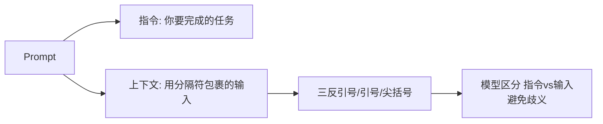

# 15. 原则一：使用明确且具体的指令（四大策略）

## 纲要

- **原则一（吴恩达）**：提出**明确而清晰**的指令——把任务描述清楚、把上下文表述清楚。
- **四大策略**：
 1. **分隔符**清晰区分「指令」与「输入/上下文」（三反引号 / 引号 / 尖括号 / 特殊符号），避免歧义（如 `print "hello world in javascript"` 与打印 hello 的歧义）。
 2. **要求结构化输出**：表格 / Markdown 大纲（一二级标题）/ 代码格式，按场景要。
 3. **注意边界情况**：在指令中涵盖输出长度、格式等要求，让模型自检。
 4. **提供少量示例（少样本）**：给格式样例，模型更贴合预期。
- **正例 vs 反例**：清晰「解释 React 组件生命周期」vs 模糊「谈一谈机器学习」；具体「Python 合并两列表+场景」vs 宽泛「提供科技内容」；带数据来源的「近五年前端趋势」vs 笼统「前端趋势」。

> 本章按课程口径重构；剥离营销与课程群引流。

## 一、什么是明确具体的指令

- 指令 = 发给机器、告诉它完成什么任务。
- 模型不知屏幕前的你是谁、无背景，且大多**不联网**——只在已有知识库搜素输出。所以必须提供任务上下文。
- 不要像「领导和下属谈话」让模型猜；要把任务与目标描述得越具体越好。

## 二、策略一：分隔符区分指令与上下文



- 示例：「请帮我提炼如下内容的大纲：```背景资料```」——反引号内是输入，外是指令。
- 无分隔符时模型可能混淆，歧义句（如打印 hello world in javascript）输出偏离。

## 三、策略二：结构化输出

- 办公族 → 表格；大纲 → 一二级目录；编程族 → 代码格式（如 diff）。
- 可直接要求「以表格展示」「以 Markdown 输出」；Markdown 配在线工具（minishow 类）转 PPT。

## 四、策略三：边界情况

- 在指令中写明输出长度、格式要求，让模型自我检查边界。

## 五、策略四：少量示例（少样本）

- 提供期望格式样例（如「不要英文大写标题、子标题用有序列表」），模型按样输出。
- 可让模型基于基础 Prompt 反举正/反例巩固理解。

## 六、FAQ

**Q1：为什么模型总答非所问？**
指令模糊、缺上下文、无分隔符导致混淆；按四大策略补全。

**Q2：分隔符必须用三反引号？**
不，引号/尖括号/特殊符号均可，关键是明确区分指令与输入。

**Q3：结构化输出有什么用？**
便于统计、转 PPT、落地；让结果可控可复用。

**Q4：少样本示例越多越好？**
适量即可；给 1–2 个格式样例就能显著校准输出。

## 七、面试高频问答

**1. 原则一的核心？**
发送明确清晰的指令——任务与上下文都要描述清楚。

**2. 四大策略是什么？**
分隔符区分指令/上下文、要求结构化输出、注意边界、提供少量示例。

**3. 分隔符解决什么问题？**
避免模型混淆「指令」与「输入」，消除歧义句（如打印语句）。

**4. 为什么模型不联网也要写清上下文？**
模型只在已有知识库搜素，无背景则只能通识泛答，非专家角度。

## 八、ops 提示（实践）

> **必加分隔符**：凡含长背景资料，用三反引号包裹，防止指令/输入混淆。
>
> **要格式就要明说**：表格/Markdown/代码直接在 Prompt 点明，别指望模型默认。
>
> **少样本校准**：输出不合预期，先给 1 个格式样例再发，比反复改措辞高效。

