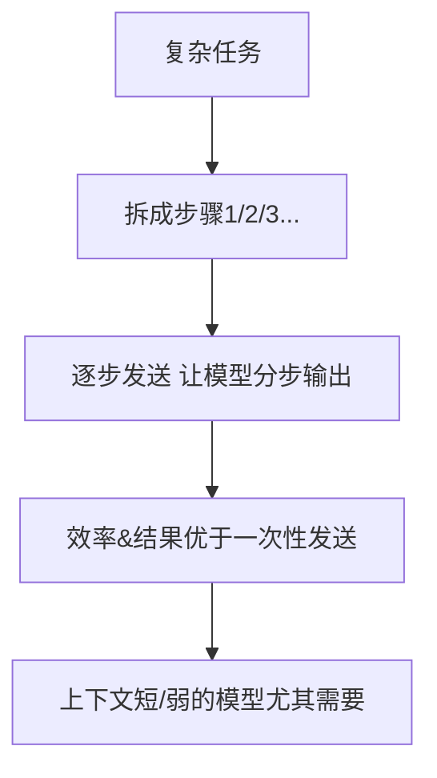

# 16. 原则二：给模型时间去思考（拆解 + 限定范围）

## 纲要

- **原则二（吴恩达）**：给模型**思考时间**——机器处理快，但复杂/超长多任务指令会「干懵」（像一段绕口令）。
- **两大策略**：
 1. **拆解复杂任务**：不要一次塞多个限制；分步骤让模型逐步输出（绝大多数场景比一次性发送好）。
 2. **提供限定范围/具体指引**：限定选择方向，输出更精准——模型特别适合**垂类应用**。
- **联网限制**：模型知识有截止（如 GPT 截止 2021-09），缺最新数据；用 NewB/Perplexity 作**联网知识库**（bingeverywhere 插件，可 CIXDL 离线下载），先搜素提炼前置数据再喂模型。
- **案例：电动车分析五步拆解**：查近五年全球热门五款销量 → 比占有率 → 列优劣势 → 结合背景（30+、年收入 50w+、六口之家、长途）推荐 → 补充约束（敏感部门禁特斯拉、限比亚迪）再推荐，最终得比亚迪唐 EV。

> 本章按课程口径重构；工具以当前为准；剥离营销与课程群引流。

## 一、为什么需要思考时间

- 极端场景：完美主义者写超长、多任务指令 → 模型难一次处理好。
- 像人与人沟通，一段话塞太多任务对方会懵；给模型分步空间即「思考时间」。

## 二、策略一：拆解复杂任务

- 模型上下文能力有限（短上下文模型无法一次输出长内容），需多次拆解发送。

## 三、策略二：限定范围/具体指引

- 给模型具体指引与范围，输出更精准；模型适合**特定领域垂类应用**。

## 四、联网限制与知识库

- 模型知识截止，缺实时/最新数据（如近期销量）。
- **方案**：用 NewB/Perplexity 联网聊天，提炼带引用链接的前置数据；bingeverywhere 插件（Chrome 商店或 CIXDL 离线下载）辅助。

## 五、案例：电动车分析五步拆解

1. 查近五年全球热门五款电动车销量（模型无数据→自行搜素或借 NewB 提供）。
2. 据销量比市场占有率。
3. 列五款优劣势。
4. 结合背景（30+、年收入 50w+、六口之家、长途）推荐一款。
5. 补约束（敏感部门禁特斯拉、限定比亚迪车系）再推荐 → **比亚迪唐 EV**（续航/配置好、性价比高）。

## 六、FAQ

**Q1：为什么一次发长指令反而差？**
模型像被塞绕口令会懵；分步拆解效率与结果更好。

**Q2：限定范围有什么用？**
缩小选择方向，输出更精准，且利于垂类应用。

**Q3：模型没最新数据怎么办？**
用联网工具（NewB/Perplexity）先搜素提炼，再喂模型。

**Q4：拆解到什么粒度？**
到单步模型能清晰输出为止；弱上下文模型拆解更细。

## 七、面试高频问答

**1. 原则二的核心？**
给模型思考时间——复杂任务要拆解，别一次塞多限制。

**2. 拆解 vs 一次性发送？**
绝大多数场景拆解后效率与结果更优，尤其上下文短弱的模型。

**3. 模型知识截止如何应对实时需求？**
联网工具（NewB/Perplexity）作知识库，先提炼再喂。

**4. 限定范围的意义？**
让模型在指定领域/方向作答，输出精准，契合垂类应用。

## 八、ops 提示（实践）

> **长指令先拆**：遇到多任务 Prompt，先拆步骤再分步发，别硬塞。
>
> **实时数据外挂**：模型无最新数据，联网工具补，再让模型分析。
>
> **垂类优先**：限定领域+范围，模型表现显著更专业。

