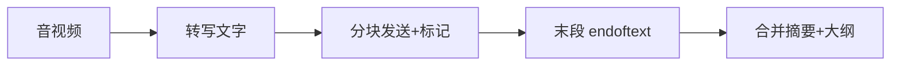

# 24. 会议纪要自动化：语音转文字 + LLM 摘要（扩展场景）

## 纲要

- **完整链路**：会议音/视频 → 转写文字 → 丢给 LLM 摘要/纪要。核心是「先把声音变成文本，再让模型提炼」。
- **转写工具**：剪映（音画分离导出音频，免费）、网易见外（语音转写免费）、讯飞听见（付费较贵）、Whisper（开源，支持麦克风录入/上传/YouTube 链接提取）。
- **长文对策**：超长转写稿用「特殊字符串分块 + 合并指令 + `endoftext` 收尾」法，避免一次性超上下文。
- **进阶（Plus）**：用 Code Interpreter / Advanced Data Analysis / askyourPDF / chatwithPDF 直接上传文件，模型自动拆工序（纠错→精简→大纲）。
- **模型差异**：同任务 GPT-4 比 3.5 更贴合、更细；3.5 需多轮提示纠偏。

> 本章按课程口径重构；剥离营销与课程群引流，保留工具链与分块范式。

## 一、音视频 → 文字

- **剪映**：音画分离 → 导出音频 → 上传转写平台。
- **网易见外**：免费，上传音频即转写。
- **讯飞听见**：付费、偏贵，新媒体工作者熟悉。
- **Whisper（开源）**：麦克风实时录入 / 上传音频 / 直接给 YouTube 链接提炼字幕；网页端录入务必先本地备份，防刷新丢失。

## 二、文字 → 摘要/纪要

- **基础指令**：`把上面内容摘要并形成大纲，markdown 输出；修正错别字、精简口语化内容`。
- **长文分块**（超上下文时）：
 1. 把输出要求置顶（纠错+精简+大纲）。
 2. 正文按 `"""第一部分"""` / `"""第二部分"""` 分 4~5 次发送，每段后带标记。
 3. 末段加 `endoftext` 收尾。
 4. 最后发「合并以上几部分，形成中文摘要+大纲」。

## 三、Plus 进阶：直接传文件

- ChatGPT Plus 选 Advanced Data Analysis / 插件（askyourPDF、chatwithPDF），上传转写 txt，指令 `生成详细中文摘要，纠错+精简+大纲，markdown`。
- 模型自动拆工序（编码处理），结果更稳；GPT-4 明显优于 3.5。

## 四、常见误区

- 网页端实时录入不备份 → 刷新全丢；先本地录好再上传。
- 长稿硬塞一次 → 模型报「内容太多处理不了」；必须分块。
- 迷信 3.5 一次出彩 → 长摘要需多轮纠偏，或直接上 4/Plus 工具。

## 五、FAQ

**Q1：免费转写用什么？**
剪映音画分离 + 网易见外，均可免费拿到文字稿。

**Q2：长转写稿模型处理不了？**
用特殊字符串分块 + `endoftext` 收尾 + 末条合并指令。

**Q3：Plus 有什么更省事的办法？**
Advanced Data Analysis / askyourPDF 直接传文件，模型自动拆工序出摘要。

**Q4：3.5 和 4 差多少？**
长摘要场景 4 更贴合详细，3.5 需反复提示纠偏。

## 六、面试高频问答

**1. 会议纪要自动化链路是什么？**
音视频→转写文字（剪映/见外/Whisper）→ LLM 摘要+大纲（纠错精简）。

**2. 超长转写稿怎么不让模型截断？**
分块发送带标记，末段 `endoftext`，最后发合并摘要指令。

**3. 有哪些免费/开源转写方案？**
剪映音画分离、网易见外免费；Whisper 开源支持麦克风/上传/YouTube。

**4. Plus 用户怎么一步出纪要？**
用 Advanced Data Analysis 或 askyourPDF 插件直接上传文件，模型自动处理。

## 七、ops 提示（实践）

> **先备份再转写**：网页实时录入前务必本地存音频，防刷新丢失。
>
> **长稿必分块**：分块+标记+endoftext 是处理超长文本的标准姿势。
>
> **按预算选模型**：重要长摘要优先 4/Plus 工具，3.5 留作轻量场景。

