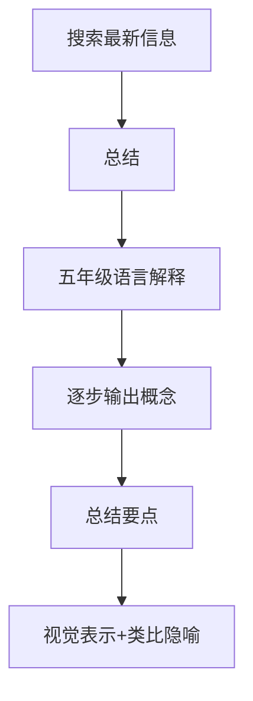

# 25. 学习效率提升：名词解释与费曼学习法（技巧落地）

## 纲要

- **痛点**：直接问「SWOT 是什么」模型答得泛；只加角色仍偏「有偏好但不够发散」。
- **百晓生范式**：`你是百晓生/最好的研究与解释代理；以各种方式用中文解释后续主题，使其易懂；用五年级学生语言简化；分享一个最现实类比 + 两个隐喻`。
- **完全体（费曼学习法）**：角色 + 工作 + 学习者简介（初学者/专家，影响深度）+ **七步法**（搜最新信息→总结→五年级语言解释→逐步完整输出→总结要点→视觉表示→数据类比隐喻）。
- **进阶（Plus）**：配合 voiceScript + diagrams + copilot 插件 + 联网搜索，可出思维导图、带来源链接。
- **心法**：把「解释概念」也当成结构化 Prompt（指令+输入+背景+输出要求），可复用到任何生僻名词。

> 本章按课程口径重构；剥离营销与课程群引流，保留解释类 Prompt 范式。

## 一、基础：加角色 + 背景

- 裸问名词 → 通识且可能偏题；补角色（CEO/产品经理/学者）与背景才对症。
- 但要「发散」：不仅解释，还要给具体案例、现实类比、隐喻，做到举一反三。

## 二、百晓生角色

- 句式：`你是百晓生，世界上最好的研究与解释代理；工作=以各种方式用中文解释后续主题使其易懂；用五年级学生语言简化；分享 1 个最现实类比 + 2 个隐喻`。
- 示例：黑天鹅事件 → 「放风筝突遇强风把风筝吹到完全不同的地方」+ 掷骰子掷出 13 的类比。

## 三、完全体：费曼学习法七步

1. 在知识库/网络搜索该主题最新信息。
2. 总结找到的内容。
3. 用五年级学生语言解释该方法。
4. 逐步完整输出概念。
5. 给出总结、分享要点。
6. 提供视觉表示（图/思维导图）。
7. 数据类比与隐喻。
- **学习者简介**决定深度：写「完全初学者」→ 通俗；写「某领域专家」→ 更专业。

## 四、进阶：Plus 插件

- 开启 voiceScript + diagrams + copilot，结合联网搜索，输出可下载思维导图、带来源链接的摘要。
- 注意：把「在知识库搜索」改成「在网络搜索」以结合最新信息。

## 五、FAQ

**Q1：直接问名词为什么答不好？**
缺角色与背景，模型只能给通识且可能偏题；补角色+学习者简介才对症。

**Q2：费曼学习法 Prompt 关键在哪？**
七步法 + 学习者简介（定深度）+ 五年级语言 + 视觉/类比，而非一句话解释。

**Q3：怎么拿到最新信息？**
Plus 版把「知识库搜索」改为「网络搜索」，结合实时资料。

**Q4：思维导图怎么来？**
配 diagrams 插件，Plus 环境可生成可下载流程图/脑图。

## 六、面试高频问答

**1. 怎么让模型把概念讲透？**
百晓生角色 + 五年级语言 + 现实类比 + 隐喻，而非裸问定义。

**2. 费曼学习法 Prompt 怎么写？**
角色+工作+学习者简介+七步法（搜→总→解释→逐步→总结→视觉→类比）。

**3. 初学者和专家模式下输出差异？**
学习者简介写「初学者」→通俗；写「专家」→更专业深入。

**4. 如何结合最新信息？**
Plus 联网 + 改搜索范围为网络，输出带来源链接。

## 七、ops 提示（实践）

> **解释类也套公式**：指令+输入+背景+输出要求，名词解释不例外。
>
> **深度靠简介**：一句话写清「我是初学者/专家」即可调输出深浅。
>
> **Plus 善用插件**：diagrams/联网能出图与来源，普通版靠分块替代。

