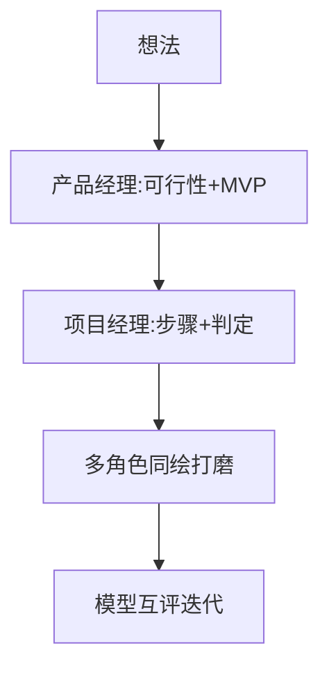

# 34. 想法变产品：多角色 AI 协作（产品经理 + 项目经理）

## 纲要

- **设产品经理角色**：今后对话中论证想法、规划最小闭环、给代码建议——不必从零造轮子，多基于已有开源方案优化。
- **用公式生成角色 Prompt**：`角色 + 专业技能 + 任务背景 + 目标 + 判定条件 + 输出格式`；让模型据此产出并优化（如目标加「一月 1000 付费用户」、技能加「开发背景」）。
- **多角色同绘**：在一个对话中声明「同时扮演产品+项目经理」，回复加前缀（「产品经理：」/「项目经理：」），必要时才回；可扩展到测试/Java/前端/设计。
- **模型互评**：让项目经理评判产品经理输出缺漏，两人持续对话打磨 MVP 功能列表。
- **前置固化**：结尾「明白了请回 OK，今后不再重复角色信息」。

> 本章按课程口径重构；剥离营销与课程群引流，保留多角色协作范式。

## 一、从想法到最小闭环

- 示例：远程桌面项目 → `设产品经理角色；熟悉技术栈；论证可行性、推荐开源方案、最小闭环`。
- 思路：别从零造轮子，基于别人已实现的功能做优化（如 iPhone 前已有触屏）。

## 二、用公式生成角色 Prompt

- 公式：`角色 + 专业技能 + 任务背景 + 目标 + 判定条件 + 输出格式`。
- 让模型基于公式产出示例，再人工调：目标加「上线后一月内 ≥1000 付费用户」，技能加「开发背景」。
- 不满意可 `重新生成` 或在原 Prompt 上扩展后重提。

## 三、多角色同绘

- 准备两个角色 Prompt（产品经理 + 项目经理），声明「同时扮演，回复加前缀，必要时才回」。
- 问「团队只有产品与开发，第一步？」→ 项目经理回「精益启动/MVP」→ 再问产品经理「MVP 功能列表」。
- 可扩展测试/后端/前端/设计角色；GPT 能出设计理念图但非可直接用稿。

## 四、模型互评与持久对话

- 让项目经理评产品经理输出：「哪些缺漏/可优化」→ 产品经理据此重列功能。
- 只要网络与 GPT-4 额度在，可一直让多角色对话下去，逼近可落地 MVP。

## 五、FAQ

**Q1：怎么快速论证产品想法？**
设产品经理角色，问可行性+开源方案+最小闭环，基于现有方案优化而非造轮子。

**Q2：角色 Prompt 公式？**
角色+专业技能+任务背景+目标+判定条件+输出格式，让模型生成再调。

**Q3：多角色怎么同绘？**
声明同时扮演、回复加前缀、必要时才回；可扩测试/前端/设计。

**Q4：模型互评有用吗？**
让项目经理评产品经理输出缺漏，持续迭代打磨 MVP，逼近落地。

## 六、面试高频问答

**1. 怎么用 AI 把想法变产品？**
产品经理角色论证+开源选型+最小闭环；多角色同绘打磨 MVP。

**2. 角色 Prompt 怎么写才专业？**
套「角色+技能+背景+目标+判定+格式」公式，让模型生成并人工加量化目标。

**3. 多角色协作的价值？**
模拟真实团队（产品/项目经理/测试/开发）对话，补个人视角盲区。

**4. 判定条件怎么设？**
除「正常运行」外加业务指标（如一月 ≥1000 付费用户），让目标可衡量。

## 七、ops 提示（实践）

> **别造轮子**：先问开源方案，基于成熟功能做优化最快。
>
> **目标要量化**：判定条件加业务指标，避免空泛「成功」。
>
> **多角色扩展**：产品/项目/测试/开发同绘，让模型互评收敛 MVP。

