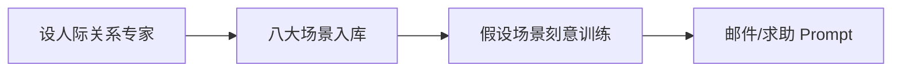

# 35. 职场交际与回复技术邮件（程序员软技能）

## 纲要

- **模型的价值**：丰富语料让它在人际关系/组织语言上考虑得更全，比临时翻书快、比人前试错安全。
- **两个示例**：中国式「意思」幽默逐句解析；六领导敬酒词（按职位大小给排场与尊重）；再加三客户扩写。
- **程序员常见场景**：团队内部 / 跨部门 / 客户 / 上级 / 周报 / 项目汇报 / 公开演讲 / 网络社交 / 酒桌 / 娱乐社交。
- **角色 + 刻意训练**：设「人际关系专家」；假设场景模拟，模型纠错你的表达（如突被老大问进展、同事情感/借钱尴尬）。
- **八场景进 Prompt**：把 8 场景放进 Prompt，针对特定场景（如酒桌/娱乐）给专业设计。
- **职场邮件 Prompt**：重格式（标题/正式称呼/书面语气/作证据）；可建团队 GPT 分享。同事求助 Prompt 覆盖借钱/随礼/拒非工作请求。

> 本章按课程口径重构；剥离营销与课程群引流，保留交际与邮件方法论。

## 一、模型帮你说好话

- 示例一：八句「意思」逐句解析——送礼目的/象征/调侃/谦虚/赞赏/谦卑，体现中国式含蓄。
- 示例二：六领导敬酒词按职位给不同排场；再加三客户扩写，体现热情与延续合作。
- 国内无 Plus 语音也可文字对话练习。

## 二、程序员八大交际场景

团队内部沟通、跨部门合作、客户沟通、上级沟通（周报）、项目汇报、公开演讲展示、网络社交、酒桌文化、娱乐社交（团建释放压力）。理科生常忽视，模型可补。

## 三、角色 + 刻意训练

- 基础：`你是处理人际关系的专家` 一句话即可前置。
- 进阶：假设场景模拟（被老大突问/同事借钱），模型纠错表达；引用《刻意训练》——没人天生会说话，都在试错中习得。

## 四、八场景进 Prompt + 邮件

- 把 8 场景写入 Prompt，针对某场景（如酒桌）提供专业话术设计。
- **职场邮件**：标题 + 正式称呼 + 书面语气（非微信式）+ 作后续证据；可建 GPT 分享全团队。
- **同事求助**：覆盖借钱/随礼/拒非工作请求；先列常见场景再套公式设计 Prompt。

## 五、FAQ

**Q1：程序员为什么要用模型练交际？**
模型语料全、考虑周，比翻书快、比人前试错安全，补足理科生软技能盲区。

**Q2：邮件 Prompt 注意什么？**
标题+正式称呼+书面语气+作证据，别用微信式随意。

**Q3：刻意训练怎么用？**
假设场景（被领导突问/同事借钱）让模型纠错表达，反复打磨。

**Q4：八场景指哪些？**
团队/跨部门/客户/上级/汇报/演讲/网络/酒桌/娱乐社交。

## 六、面试高频问答

**1. 大模型在职场交际的价值？**
语料全、考虑周，模拟场景纠错表达，补程序员软技能短板。

**2. 职场邮件怎么让模型写好？**
设邮件专家 + 格式要求（标题/称呼/书面/证据），可团队 GPT 复用。

**3. 怎么刻意训练表达？**
假设尴尬场景让模型评你的回复并给更好表达，反复练。

**4. 八场景 Prompt 怎么组织？**
把场景列表写入 Prompt，针对具体场景要专业话术设计。

## 七、ops 提示（实践）

> **交际也能练**：把尴尬场景丢模型模拟，安全试错。
>
> **邮件重书面**：标题/称呼/语气到位，它是沟通证据。
>
> **场景入库**：八大场景写进 Prompt，针对要话术。

