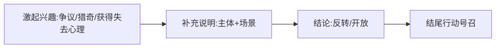

# 36. 短视频脚本编写：爆款公式与风格定制

## 纲要

- **平台价值**：短视频影响力超传统图文，但脚本编写（创意/结构/演绎）是核心门槛；模型可帮创意构思、脚本、润色，省时提效。
- **无定制 Prompt 偏泛**：模型默认输出「理解观众/策划/制作/互动/个人风格/合作」六点通识，需定制才贴账号背景。
- **爆款公式**：`激起兴趣（争议/感官刺激/获得心理/失去心理/猎奇/引发思考）→ 补充说明（主体+场景）→ 结论（反转/开放）`；黄金三秒留人，结尾加行动号召（硬植入会限流）。
- **定制 Prompt**：角色（短视频达人）+ 公式 + 个人上下文注入（如科技博主）+ 风格拆解（用 Whisper 拆优秀视频结构，提炼口头禅/转场/音乐）+ 扩展元素（开场/互动/视觉）+ 目标 + 固化「明白了回 OK」。

> 本章按课程口径重构；剥离课程自推与营销引流，保留脚本方法论。

## 一、从通识到定制

- 裸问「注意事项」→ 模型给六点泛泛而谈（观众/策划/制作/互动/风格/合作）。
- 真正要的是**贴合自己账号背景**的脚本，必须注入角色与风格。

## 二、爆款公式

- **黄金三秒**：前 3 秒决定是否留存，做好钩子。
- **行动号召**：结尾引导点赞/评论/分享；广告植入要「润物细无声」，硬植入会被限流甚至封号。

## 三、风格定制

- 用 Whisper 等把优秀视频转文字 → 拆结构 → 提炼个性化元素（如某博主「问题不大」口头禅、特定 BGM、固定开场）。
- 把这些元素作为风格输入，要求模型在脚本中复现。

## 四、示例与坚持

- 热点示例：以「奥特曼被董事会开除」主题，按公式出脚本（开场+旁白+镜头+结论+号召）。
- **量变引起质变**：先仿写、再演绎、收反馈、调方向，长期坚持才出风格。

## 五、FAQ

**Q1：模型默认写的脚本为什么不好用？**
缺账号背景与风格，输出六点通识；要注入角色+公式+风格才贴。

**Q2：爆款公式是什么？**
激起兴趣→补充说明→结论/反转，黄金三秒留人，结尾号召。

**Q3：风格怎么定制？**
拆优秀视频结构（Whisper 转写），提炼口头禅/BGM/转场作风格输入。

**Q4：广告怎么植入不违规？**
润物细无声嵌入剧情，硬植入会被限流封号。

## 六、面试高频问答

**1. 怎么用 AI 写短视频脚本？**
角色+爆款公式+个人上下文+风格拆解+元素扩展，固化成常驻指令。

**2. 爆款公式三段是什么？**
激起兴趣（钩子）→ 补充说明（主体）→ 结论（反转/开放）+ 行动号召。

**3. 怎么形成个人风格？**
拆优秀视频提炼口头禅/BGM/转场，让模型复现；长期坚持仿写迭代。

**4. 黄金三秒与限流？**
前三秒留人；广告硬植入违反规则会被限流封号，须软植入。

## 七、ops 提示（实践）

> **先公式后风格**：结构（公式）打底，风格（拆解）加成。
>
> **Whisper 拆结构**：转写优秀视频是提炼风格的捷径。
>
> **坚持出风格**：仿写→演绎→反馈→迭代，量变质变。

