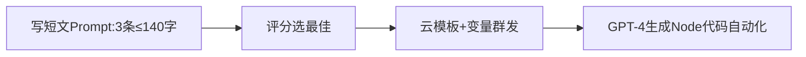

# 38. 营销短信：编写与群发自动化

## 纲要

- **短文原则**：润物细无声、突出重点，≤140 字；模型按「背景 + 分步骤输出 3 条」产出。
- **评分选优**：让模型对 3 条按主题认知评分并理由，选最佳；可加幽默/疑问勾好奇心。
- **群发落地**：腾讯云/阿里云短信（约 5 分/条，量大更便宜），需建模板 + 变量 `{1}`=用户名；sendcloud 建群发任务。
- **代码群发**：GPT-4 据文档生成 Node 群发示例代码（几十行），国内模型编码力弱于 GPT-4；极简云等平台可做「收邮件→模型回邮件」自动化客服。

> 本章按课程口径重构；剥离营销与课程群引流，保留短信营销与自动化要点。

## 一、短文 Prompt

- 结构：`你是<角色>；课程/产品名+描述；大纲如下；请输出 3 条推荐短信，≤140 字`。
- 模型出 3 条（用 emoji、结构简短），再让其对每条评分（如 9/10、8/10、8.5/10）选最佳。

## 二、评分与增强

- `按主题认知给每条评分并说理由，选最佳` → 选「突出独有价值」那条。
- 可要求 `加幽默元素/设疑问勾好奇` 重生成。

## 三、群发平台

- 腾讯云/阿里云：买短信包、建模板（变量 `{1}`=用户名）、选签名、上传手机号标准模板。
- sendcloud 等建群发任务，定时/立即发送。

## 四、自动化代码

- GPT-4 据平台文档生成 Node 群发示例（含 `phoneNumberSet`、模板参数、`sendSms` 方法），几十行即可。
- 极简云类平台：监视邮件→调模型生成回复→自动回邮件，近似客服。
- 注意：国内模型编码力普遍弱于 GPT-4，复杂代码优先 GPT-4。

## 五、FAQ

**Q1：营销短信怎么写不惹厌？**
润物细无声、突出核心点、≤140 字；硬广易被屏蔽。

**Q2：多条怎么选？**
让模型评分+理由选最佳，或加幽默/疑问增强。

**Q3：群发用什么平台？**
腾讯云/阿里云建模板+变量，sendcloud 建任务；量大单价更低。

**Q4：代码群发可行吗？**
GPT-4 生成 Node 示例几十行即可；国内模型编码弱，复杂代码优先 GPT-4。

## 六、面试高频问答

**1. 营销短信 Prompt 怎么写？**
角色+产品/课程名+大纲，分步骤输出 3 条≤140 字，再评分选优。

**2. 云短信变量怎么用？**
模板中 `{1}` 等占位用户名/参数，群发时填充。

**3. 自动化群发怎么落地？**
GPT-4 据文档生成 Node 代码；或用极简云做邮件触发自动回复。

**4. 模型编码力差异？**
GPT-4 远强于多数国内模型，复杂代码优先 GPT-4。

## 七、ops 提示（实践）

> **短文至上**：≤140 字、润物无声，别硬广。
>
> **评分兜底**：多选一让模型打分，省人工纠结。
>
> **编码用 GPT-4**：群发/自动化代码优先 GPT-4，国内模型谨慎。

