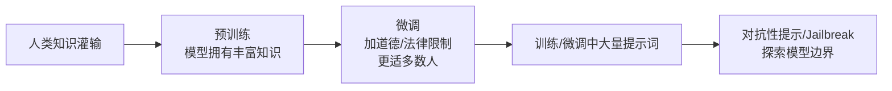

# 4. Prompt Engineering 概念、技术与提示词聚合网站

## 纲要

- **定义**：提示工程 = 指导 AI 完成某项任务的提示的过程；精心设计提示，指导强大语言模型实现想要的结果。
- **作用**：提示词质量直接决定输出质量；最大限度从模型中挖掘重用价值。
- **技术底座**：预训练（人类知识灌输）→ 微调（调得更适合大多数人，加道德/法律限制）；训练与微调中大量出现提示词。
- **敬畏心**：对抗性提示 / jailbreak（如已修复的「扮演过世主人泄露密钥」漏洞）；Copilot 预置约 30 条限制（人格/范围/must 红线）被扒出——提示词工程并不简单。
- **聚合网站（学会自己写更重要）**：AIshort（角色扮演分类）、Prompt 精选（GitHub 开源）、提示精灵 PromptGenius（分类 + 投稿 + 使用次数标识）。
- **术与道**：术 = 怎么做；道 = 理解精髓；想走远须懂背后原理，告别对新事物的恐惧。

> 本章按课程口径重构；剥离营销与课程群引流，聚焦概念、技术与工具甄别。

## 一、什么是提示工程

- **核心概念**：提示工程主要指导 AI 完成某项任务；通过精心设计提示，指导强大的语言模型实现想要的结果。
- **重要作用**：
 1. 提示词质量直接决定输出质量——写好提示词非常重要。
 2. 通过提示工程，最大限度从大模型挖掘重用价值（如有人卖效率、用 AI 批量创文案开店铺）。
- **学习定位**：提示工程偏「人工领域」，与 Python 关联；非编程人员重应用、轻原理即可；应用层面覆盖文字→文字/语音/图片/视频等，最终落地为特定方向的特定提示词。

## 二、技术底座：预训练与微调

- **预训练**：人类知识「灌」给模型，使其拥有丰富知识。
- **微调**：训练完成后，对突破道德/法律限制等不好用的部分做调整，使模型更适合绝大多数人使用。
- **敬畏不可控**：模型存在被攻击边界的环节（漏洞），如早期「扮演已过世主人 → 泄露 Windows 密钥」已被修复；这类探索提醒我们对不可控之物保持敬畏。

## 三、对抗性提示与预置 Prompt 泄露

- **对抗性提示（Adversarial Prompt）**：诱导模型吐出事先被预置的提示词。
- **Copilot Prompt 泄露案例**：约 30 条预置提示被扒出——限制人格、限定回复范围、用大量 `must` 设红线（问编程外问题直接不回）。
- **启示**：Copilot 本质是「普通大模型 + 大量预置限制」；提示词工程远比表面复杂。

## 四、应用示例

模型可落地方向：问答系统、聊天机器人、语音识别、自然语言生成（NLG）等——可在这些方向上用现有模型沟通，体会提示词工程。

## 五、提示词聚合网站

> **总原则**：网站/客户端内置 Prompt 可参考，但**最终要自己会写**——自己写的才对味、才契合需求。

| 网站 | 特点 | 注意 |
|---|---|---|
| AIshort | 按分类（文章报告/IT 编程/工具/旅游/取名字/Excel/论文）提供 Prompt，多角色扮演式；可切语言、收藏、复制 | 简历优化、求职信用得多 |
| Prompt 精选（GitHub） | 开源项目海量 Prompt；搜 `prompt engineering`/`提示词`/`chatgpt` 关键字 | 中文站多从英文翻译；小红书爆款标题生成器类需调教 |
| 提示精灵 PromptGenius | 按分类（简历/论文/代码/角色扮演/礼物/Office/语言学习）；有「用户投稿专区」与**使用次数标识**（如小红书标题 5649 人用） | 好 Prompt 有基础结构：任务内容/要求/输出/探讨 |

**基础结构拆解**（好 Prompt 通常含）：具体任务内容 + 任务要求 + 输出内容 + 探讨。

## 六、术与道

- **术**：告诉大家怎么做（工具、技巧）。
- **道**：理解其中的精髓（背后工作原理）。
- 若只做应用，看用即可；若想走得远、站到技术前沿挖商业/深层价值，须懂原理——既告别恐惧，也掌握先机。

## 七、FAQ

**Q1：提示工程和「写提示词」区别？**
写提示词只是动作；提示工程是系统工程——含设计、优化、领域知识、对抗边界，故称「工程」。

**Q2：非程序员要学原理吗？**
不必深究；重应用、了解原理足够。程序员可深入技术本身。

**Q3：聚合网站 Prompt 能直接用？**
可作参考，但自己写的更契合需求；且需调教避免「全是同一种风格的水文」。

**Q4：为什么要敬畏对抗性提示？**
模型有预置限制与可被攻击的边界，暴露出提示词工程复杂且不可控的一面。

## 八、面试高频问答

**1. 一句话定义提示工程？**
通过精心设计提示，指导强大语言模型实现想要结果的过程；提示词质量直接决定输出质量。

**2. 预训练与微调？**
预训练=人类知识灌输使模型有知识；微调=加道德/法律限制让模型更适合多数人；二者都大量用到提示词。

**3. 对抗性提示说明什么？**
模型有预置限制与可被攻击的边界（如 Copilot 30 条红线被扒），提示词工程远比表面复杂，须敬畏。

**4. 怎么看待提示词聚合网站？**
可参考但须自己会写；好 Prompt 有通用结构（任务/要求/输出/探讨），最终靠自己调教契合场景。

## 九、ops 提示（工具甄别）

> **信息差**：聚合站多数从英文翻译，质量参差；优先用「使用次数高 + 有基础结构」的 Prompt 作种子再调教。
>
> **自主能力**：把网站当「灵感库」，别当「答案库」；脱离网站仍能写 Prompt 才是真掌握。
>
> **合规**：下载 GitHub 开源 Prompt 时注意仓库许可与内容合规。

