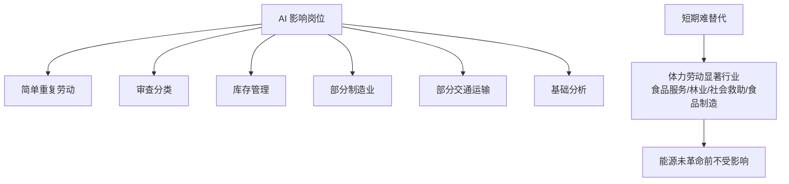

# 5. AI 时代机遇与挑战：哪些工作可能会消失

## 纲要

- **总判断**：近 5–10 年不必过度担心，但影响渐深，部分工作会消失。
- **影响面**：美国约 19% 岗位受严重影响（文章/营销/编程/财报总结）；可能颠覆口译笔译、诗人、作家、公关、数学家、报税员、工程师、会计师、审计、记者。
- **程序员**：未来绝大多数受影响，部分基础岗被替代，**能与 AI 协同者保留**；GPT-4V 多模态（图→界面/代码）已炸裂。
- **不会被替代**：体力劳动显著行业（食品服务/林业/社会救助/食品制造）——能源未革命前不受影响。
- **中国招聘报告**：网络招聘 175 亿（+9.2%，≠岗位变多，是降本提效）；通用人才饱和「一毕业就失业」；AI 引入招聘做人才精确匹配（简历造假识别/面试精准定位）。
- **会消失的工作**：简单重复 / 审查分类 / 库存管理 / 部分制造 / 部分交通运输 / 基础分析。
- **个人准备**：提升技能（逆水行舟）/ 跨领域学习 / 保持新技术关注 / 建立个人品牌（量变到质变）/ 适应性思维 / 寻找与 AI 合作（信息差）/ 理财抗风险（10%花·20%抗风险·30%投资·40%固定）。

> 本章按课程口径重构；报告数据为课程引用口径（2023 年），以最新权威来源为准；剥离课程群引流。

## 一、影响面与程序员处境

- **美国数据**：AI 可能严重影响约 19% 工作岗位，主要影响文章、营销方案、编程代码、财报总结。
- **可能颠覆行业**：口译笔译、诗人/词作者/创作家、公共关系专家、作家、数学家、报税员、工程师、会计师、审计员、记者。
- **程序员**：现阶段看，未来绝大多数程序员受 AI 影响，部分基础程序员被替代；**只有能与 AI 协同的程序员被保留**。
- **GPT-4V 多模态**：可根据一张图片实现对应界面效果或生成代码，拷贝到运行环境即得真实页面——基础重复劳动未来或将被替代。

## 二、中国招聘市场观察

- **规模**：网络招聘市场规模同比 +9.2% 达 175 亿；注意这是「招聘形式变化」≠ 岗位变多，主因是降本提效（线上沟通替代线下面试）。
- **结构性矛盾**：新职业人才与制造业人才需求矛盾突出；通用型人才极度饱和 →「一毕业就失业」（学的太雷同、无专长）。
- **供需**：超千万应届生涌入 + 部分行业裁员潮；16–24 岁青年失业率显著高于去年。
- **心态**：求职者明显求稳（往事业/国企靠）；但「覆巢之下焉有完卵」——大环境不好国企也可能受影响。
- **趋势**：招聘行业引入 AI，用行业专家知识图谱做人才精确匹配；AI 可快速识别简历造假、精准定位面试者优缺点与成长空间。

## 三、未来会消失 / 被冲击的工作

1. **简单重复**：数据录入、基础客服（自动回复/短信助手）；专业机器人（法律/翻译/语言学习）背后都是大模型驱动。
2. **审查分类**：金融/法律/医疗等语料稳定的领域，AI 帮专家快速审查大量文件数据。案例：MedGPT 综合得分比人类医生低 0.3，问诊一致性达 96%；DoNotPay 用 AI 与大公司打官司（法律咨询）。
3. **库存管理**：零售/制造业 AI 自动追踪预测库存，保供应链顺畅。
4. **部分制造业**：特斯拉擎天柱（纯视觉）、国内制源机器人（视觉）；出生率下降使人口成本优势丧失，自动化水平提升（参考德国）。
5. **部分交通运输**：无人驾驶出租车（杭州试点）、无人机自动巡航运输——成本低于人工即淘汰大量人工。
6. **基础分析**：初级数据分析、市场调研、财务报告、CRM——固定流程规则，AI 可快速学会准确完成；Microsoft Copilot / Google Duet 办公套件深度集成。

## 四、个人准备策略

| 策略 | 说明 |
|---|---|
| 提升技能 | 逆水行舟不进则退，没有学习没有成长 |
| 跨领域学习 | 了解最前沿技术，本身就是榜样 |
| 保持关注 | 关注新技术动态与行业报告 |
| 建立个人品牌 | 量变引起质变；方向不对就换账号/换方向 |
| 适应性思维 | 37 岁失业摆摊月入过万 vs 被裁卖房无抗风险能力——要适应新环境 |
| 寻找 AI 合作 | 提示词工程本身就有大量机会，生意本质是卖信息差 |
| 理财抗风险 | 10% 花 · 20% 抗风险 · 30% 投资钱生钱 · 40% 固定收益，给自己买「保险」 |

## 五、FAQ

**Q1：AI 会让我失业吗？**
近 5–10 年大概率不会，但影响渐深；基础重复岗被冲击，**能与 AI 协同的人保留**。

**Q2：哪些行业短期安全？**
体力劳动显著行业（食品服务/林业/社会救助/食品制造），能源未革命前不受显著影响。

**Q3：程序员怎么办？**
从「写代码」转向「与 AI 协同设计/审查/优化」，提升不可替代的系统与领域能力。

**Q4：普通人抗风险？**
跨领域学习 + 建立个人品牌 + 寻找 AI 合作机会 + 理财分散风险，多给自己买几份「保险」。

## 六、面试高频问答

**1. AI 对就业的总体判断？**
近 5–10 年影响渐深但非即刻替代；美国约 19% 岗位受严重影响，基础重复/审查/分析类首当其冲。

**2. 程序员会被替代吗？**
基础程序员部分被替代；能与 AI 协同（设计/审查/优化）者保留，GPT-4V 多模态已能图生代码。

**3. 为什么体力劳动短期安全？**
需体验劳动为特征，且能源（电池/能源行业）未革命前机器难以全面替代。

**4. 个人如何准备？**
提升技能、跨领域学习、建个人品牌、适应性思维、找 AI 合作（信息差）、理财抗风险——核心是「与 AI 协同」而非对抗。

## 七、ops 提示（趋势研判）

> **数据时效**：文中市场/失业率/报告均为课程引用口径（2023），引用时请以最新权威来源（如人社部、招聘平台年报）复核。
>
> **行动优先级**：先把本职工作的 AI 协同做起来（提效），再谈转型/副业，比焦虑「失业」更务实。
>
> **信息差**：很多机会稍纵即逝，关键是打开思路、持续关注，而非等「完美时机」。

