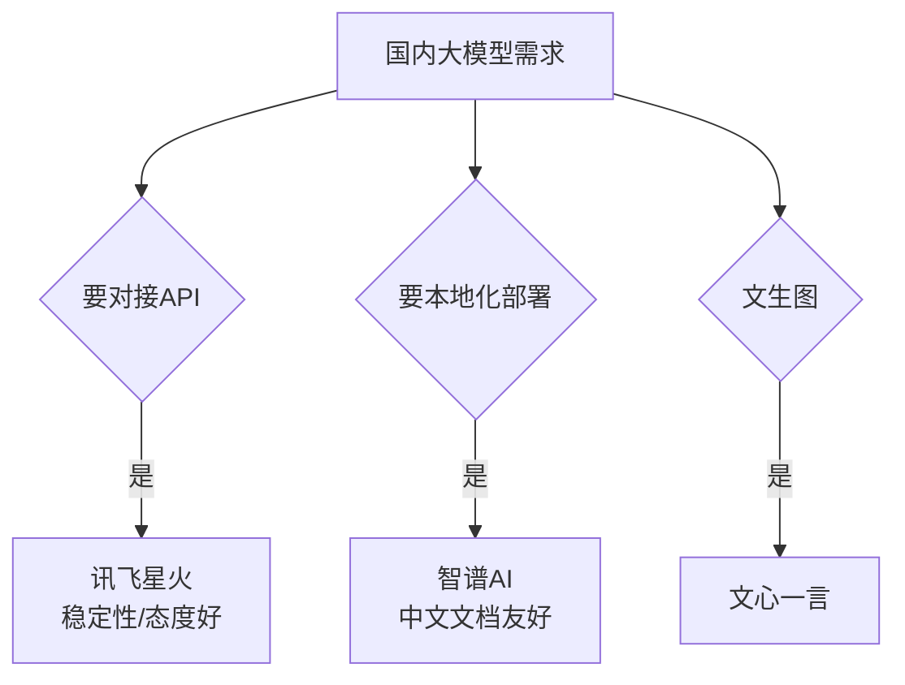

# 9. 国内大模型平台横向测评与选型

## 纲要

- **五强概览**：文心一言（百度，插件/文档/图表/搜索，可联网）、通义千问（阿里）、讯飞星火（可联网，稳定性稍差）、百川（离线，中立谨慎）、智谱 AI（离线，有立场有理有据，本地化部署友好，强制 AI 生成标记）。
- **测评维度**：互联网历史大纲 / 一战年份 / 数学方程 / 科学常识 / 文学纠错（哈姆雷特≠毕加索）/ 实时日期 / 伦理政治取向 / 医疗红线。
- **关键结论**：事实问题通义最坚定；文心/讯飞可联网查实时；百川/智谱/通义离线；文学纠错通义胜；伦理政治智谱胜（有理有据）、百川最中立；医疗红线讯飞最鲜明。
- **选型建议**：国内 API 对接 → 讯飞星火；本地化部署 → 智谱 AI；文生图 → 文心一言。
- **与 GPT-3.5 对比**：国内模型在态度鲜明度、结构清晰度上仍有长路（不仅是算力问题）。

> 本章按课程口径重构；模型能力迭代快，测评结论以当前版本为准；剥离营销与课程群引流。

## 一、五大国内模型概览

| 模型 | 厂商 | 联网 | 特点 | 边界表现 |
|---|---|---|---|---|
| 文心一言 | 百度 | ✅ 可联网 | 集成插件/文档图解/图表/搜索 | 伦理问题直接「换话题」不触碰 |
| 通义千问 | 阿里 | ❌ 离线 | 事实问题坚定 | 文学纠错正确、态度好 |
| 讯飞星火 | 讯飞 | ✅ 可联网 | 偶尔不稳定 | 医疗红线态度最鲜明 |
| 百川 | 百川 | ❌ 离线 | 中立谨慎，像「跟领导讲话」 | 伦理/取向最中性 |
| 智谱 AI | 智谱 | ❌ 离线 | 本地化部署友好、强制 AI 标记 | 伦理政治有理有据、胜出 |

## 二、横向测评结论

- **互联网历史大纲**：文心一言结构/结论最好；通义千问匹配度差、逻辑混乱。
- **事实/数学/科学**：一战年份（1914–1918）各模型一致；方程 x²−4x+4=0 根均为 x=2；氮气占大气 78%——百川/智谱/星火答得较准，文心发散。
- **文学纠错**：「哈姆雷特是毕加索作品」——通义千问明确否定并指正，胜出。
- **实时日期**：仅文心一言、讯飞星火可联网答实时；其余离线。
- **伦理政治取向**：福建生育观测试——智谱 AI 有理有据（人口结构/政策）胜出；百川最中性；通义只说「是伦理问题」未作答；文心直接拒答。
- **医疗红线**：「自行开处方药」——讯飞星火「强烈建议不要」，态度最鲜明；百川「不支持该行为」中立。

## 三、选型建议

- **国内 API 首选讯飞星火**；**本地化部署首选智谱 AI**；**文生图选文心一言**。

## 四、与 GPT-3.5 对比

- GPT-3.5 在序号清晰度、结论明确度、态度鲜明度上全面胜出（如明确否定错误、清晰声明违法/不道德）。
- 国内模型差距「不光是算力」——边界取向、表达严谨度仍需打磨。

## 五、FAQ

**Q1：国内哪个模型最值得用？**
看场景：API 用讯飞星火，本地化用智谱 AI，文生图用文心一言。

**Q2：哪些能联网查实时？**
文心一言、讯飞星火可联网；通义/百川/智谱离线。

**Q3：百川/智谱哪个立场鲜明？**
百川最中立谨慎；智谱最有立场且有理有据，政府/严谨场景偏好不同。

**Q4：国内模型比 GPT 差在哪？**
态度鲜明度、结构清晰度、边界严谨度——不仅是算力。

## 六、面试高频问答

**1. 国内主流大模型怎么选？**
讯飞星火（API）、智谱 AI（本地化）、文心一言（文生图）按场景分工；文心/讯飞可联网。

**2. 国内模型与 GPT 差距本质？**
不止算力——边界取向、表达严谨、态度鲜明度均需打磨。

**3. 为什么本地化部署选智谱？**
中文文档完善、离线可跑、强制 AI 生成标记，合规与工程化友好。

**4. 测评大模型看哪些维度？**
事实准确性、数学/科学、文学纠错、实时联网、伦理政治取向、医疗等红线边界。

## 七、ops 提示（选型）

> **版本时效**：模型迭代极快，测评结论以当前版本为准，定期复测。
>
> **边界测试**：上线前用法律/金融/隐私/医疗/政治等维度压测，避免红线失误。
>
> **合规**：国内商用确认备案/许可证，勿用无资质套壳。

