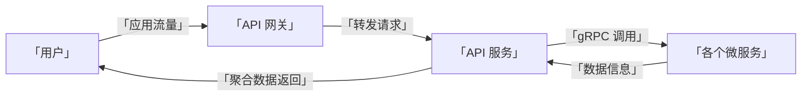

# 1-1-保姆级教学，带你落地GO微服务

本讲是课程的开篇导学，先介绍 Go 语言的发展与它在微服务领域的优势，再引出课程主角 go-zero 微服务框架，然后说明课程的整体路线、项目架构、技术细节的讲解方式，以及学完课程能收获什么、本套课程适合谁来学。

## Go 语言的发展与微服务优势

Go 语言自 2009 年发布之后，凭借高效、轻量级、简洁等诸多特点，逐渐受到了众多企业的关注。如今在业界，它已经成为许多公司应对高并发场景时的首选语言，典型的例子如百度的 BFE 项目就是由 Go 开发的。

Go 在微服务方向也有很强的优势。轻量级特性、并发模型以及优秀的性能，使它成为开发微服务的理想选择：能够快速构建可靠高效的服务，易于扩展和维护，部署也很方便，可以满足现代应用程序对灵活性和可伸缩性的需求。

## go-zero 微服务框架

课程中会讲到的 go-zero，是一款基于 Go 开发的微服务框架，于 2020 年开源，属于后起之秀。它提供了强大的工具和组件，可以帮助开发人员缩短开发周期，目前在业界表现也非常好，在中文 Go 排行中位列第八，发展速度可见一斑。

至于 Go 的学习，语言本身的语法并不难，但在微服务这个方向上，业界可获取的资源比较少，而且零散、不成系统，这也增加了学习的难度。

## 课程路线

本套课程的展开方式是：首先掌握并理解微服务的核心话题，对微服务整体建立初步认知；然后针对 gRPC 与 go-zero 从应用到原理进行分析；再基于 gRPC 与微服务分布式架构，实战构建一个 IM 项目；最后融合前面所学的所有知识点，融会贯通，创造一个属于自己的微服务框架及模块。

从微服务基础，到框架的深入理解，再到应用实战，最后独立开发自己的微服务框架，这条路线从多个维度带领学习者掌握微服务。

## 项目架构

课程项目的架构图大致如下：在 API 接口层，基于 API 网关构建，承接应用流量，将请求转发到对应的业务逻辑中去处理。API 服务通过 gRPC 调用各个微服务，聚合相应的数据信息，然后返回给用户。

在整个微服务架构中，还会涉及微服务的核心技术知识点，比如熔断、降级、链路跟踪、并发控制等等。基础设施层面会用 Docker 进行容器化部署，整个项目还会用到 ETCD、Kafka 等组件。

## 技术细节的讲解方式

对于课程中的一些技术细节，比如负载均衡，会先从整体思路进行分析，然后剖析内部源码，包括 gRPC 与 go-zero 的源码，在掌握负载均衡这套实现方案的同时，了解框架中的具体实现。

自动降级也是同样的过程：先分析实现流程和实现思路，再分析源码，其中也包括限流等。此外还有很多其他细节，都会按照这个思路展开。

## 课程收获

通过本次课程学习，可以收获这些：系统掌握微服务分布式架构的核心技术，并建立整体认知；打通 gRPC 与 go-zero 从应用到底层的壁垒；提升微服务分布式项目架构的实战能力；最后能够探索自己的微服务框架，提升微服务的整体实力。

## 适合谁来学

本套课程适合有一定项目开发经验、掌握 Linux，想了解 go-zero 在项目中如何运用的读者，也适合希望在微服务项目开发上进一步提升的读者。
