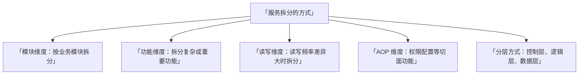

# 1-3-微服务核心要素之拆分原则

本讲分析微服务的核心要素之一：拆分原则。

## 服务拆分得越细越好吗？

在课程开始前，先提出一个疑问：项目拆分的粒度越细越好吗？

从理论上来分析，当一个项目拆分得越细，请求的服务越多，那么它的可维护性、可靠性是比较好的。但它真的就很适合一个项目团队吗？答案是否定的。

在一个项目中，如果把服务拆分的粒度搞得越细，项目所需要的团队人数和所造成的业务复杂度都会逐渐增加。举一个比较简单的例子：单体架构中可能只需要一台机器；把单体架构拆分成三个或四个服务之后，这些拆分之后的服务要部署在三台或四台机器上。机器增加了，而运维多台机器和运维一台机器的复杂度肯定不一样，这是一个比较明显的问题。团队人数也会因此要增加。

所以拆分得越细，项目的复杂度和成本就会越高。因此，拆分要做到适当、合理，否则可能会给自己埋下一些比较难解决的问题。

## 拆分要考虑的两个要素

对于拆分来说，经常考虑的要素有以下几个。

第一个是团队人数和能力。项目最终的落地还是要依托于团队整体来完成，如果团队人数和能力不支持，项目拆分之后对整个团队来说是比较大的一个负担。

其次是业务的需求。业务的复杂度、业务的访问量，也是衡量拆分颗粒度比较重要的依据。

这两项主要用来衡量项目的拆分颗粒度。但拆分除了颗粒度以外，拆分的方式也非常重要。

## 服务拆分的方式

具体如何拆分？这里有几种方式，先来看第一种：模块维度的拆分。

### 1. 模块维度

模块维度的拆分在系统中经常用到，比较直观。它是微服务拆分中最基础的拆分单位，主要是根据一类功能业务集中起来形成的一个模块，然后以此为单位进行拆分。

### 2. 功能维度

第二类是功能维度，它比模块更小。可以理解为在模块中的某一个功能进行拆分，一般是针对复杂度较高的或者重要的功能进行拆分。

### 3. 读写维度

第三类是读写维度，主要针对数据库的读写，在读写频率差异比较大的情况下，就可以考虑针对读写维度进行拆分。

结合一个实际的项目来看。项目中有商品模块、订单模块、用户模块以及其他模块。一开始根据模块维度的拆分，根据它们的业务融合，实际上就是把各个模块单独拆分出来。

在功能上，订单模块又包含购物车、支付、订单等功能，根据功能拆分的话，就是在这之间进行拆分：将订单单独构成一个服务，支付构成一个服务，购物车构成一个服务。像支付这一类服务，项目中对其要求是比较高的。除此之外还有秒杀，秒杀其实也是一个功能，但因为秒杀的特殊性，它会有比较大的访问量，所以才会从功能维度把它拆出来。

除了功能维度以外，像商品有搜索、更新，商品的搜索和更新在频率上具有较大的读写差异，因此针对于商品可以采用读写维度的拆分。

通过这个例子可以明显发现模块维度、功能维度、读写维度各自的拆分方式和具体表现。在业界中，这三个维度的拆分应用最为广泛，拆分时可以优先掌握这三种技巧。

### 4. AOP 维度

除了这三种拆分之外，还有 AOP 维度，主要是针对于面向切面编程的功能模块进行拆分。比如在项目中具有权限配置，希望能够集中起来维护，那么可以把它们拆分成对应的权限服务、配置中心，这里就用到了 AOP 的思想。像权限配置这类功能，在多个模块、多个服务中都会存在，所以可以单独拆分进行维护。

### 5. 分层方式

除了 AOP 以外，还有一个就是分层方式。在代码中，根据分层的设计作为拆分维度。项目中可以有控制层、处理业务的逻辑层，以及单独处理数据的数据层，从上到下根据每一层进行拆分，适用于各个层面。

在业务中，除了前面提到的模块、功能、读写三个维度之外，后面提到的 AOP 与分层这两种方式也是会用到的。当然前三者的应用会更加直观、更加普遍。

以上就是在服务拆分中比较常见的五种方式。

