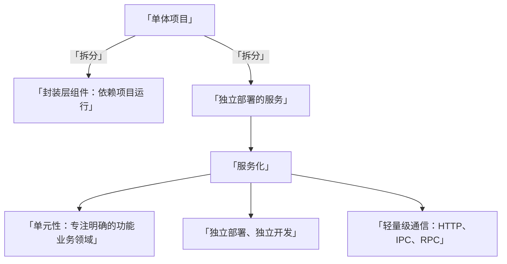

# 1-4-微服务核心要素之服务化

可以根据各个维度对项目进行拆分，形成多个服务。但项目经过拆分之后一定是微服务吗？当然不是的。

## 拆分不等于微服务

比如有一个功能模块，对它进行拆分之后，可以把它形成一个封装层的组件，也可以把它形成一个独立部署的服务。但它们都是在应用项目的技术上面进行拆分的，所以拆分不一定就是微服务。

那如何做到微服务？这里还需要做到服务化。

## 什么是服务化

服务化的定义是：将应用程序拆分为一系列的独立的服务的过程。而每个服务都会具有特定的功能或者业务逻辑，并且它们之间以轻量级的通信来实施协作。

服务化的目的，主要是实现应用的结构化与可伸缩性，支持独立的部署，提高整个系统的灵活性和可维护性。

对项目来说，从单体项目拆分出多个维度的服务之后，从用户的角度来看，所构成的服务对整个系统而言仍然是一个整体，属于一个项目，整体上没有改变。只是原本单体中融合在一起开发的各个模块，被拆分成了多个服务的项目代码并独立运行部署，但从整体的业务逻辑上来说，它仍然属于一个完整的项目。

## 服务化的特点

服务化具有如下特点。第一个就是单元性：每个服务都具有清晰的单元特性，并且每个服务会专注于完成某一个很明确的功能业务领域。拆分本身的目的，就是将一个具有融合性的整体拆分成各个单元的小独立体。而拆分之后又会形成服务化，因此服务化本身具备这个单元性。

同时，服务化要求能做到独立部署、独立开发，并且它们之间可以进行通信，也就是通过轻量级通信来实现信息的交付。因为在服务被拆分之前，各个模块之间可能会有业务相互之间的调度，在原本的业务中，可以通过 new 某个对象，或者以对象.方法的方式来调用，从而完成业务。但拆分之后是各个独立部署的系统，可以通过轻量级的通信方式，比如说使用 HTTP、IPC、RPC 等协议来进行通信。

## 服务化与组件的对比

将服务化与组件进行对比，实际上它们有相同点：都是对一组功能或者模块进行拆分，所以它们从整体上来说是符合拆分思想的。

但不同点在于：服务在拆分之后是可以独立部署的，而组件在拆分之后会依赖于项目进行运行，这是一个比较大的区分点。

再从细节上来说，组件升级的时候，可能会影响到使用这个组件的项目，其代码层面也会跟着发生改变。但服务在升级的时候，如果它对外输出的内容没有更改，其实是不会影响到其他服务的。而最直观的一点区别就在于：组件是依赖于项目进行运行的，而服务化则支持独立部署。

## 服务化与子系统的对比

服务化与子系统的相同点同样在于：它们都具有拆分的思想，拆分出可独立部署运行的服务。

但它们的不同点在于：子系统具有一套独立并且成型的完整的业务系统，可以看作是一套集合性业务较多、业务复杂度较高的子系统。因此当拆分成多个子系统之后，一个子系统在运行的时候可以对外提供服务，但如果说其他子系统出现问题了，它不会影响到自己。

但服务就不一样了。服务虽然是单独的服务，但从整体的业务上来说，它与其他服务是相互融合、相互配合的关系，它们之间会围绕整个业务项目的核心功能相互协作。所以服务之间是具有依存的关系，当一个服务出现了问题，势必会影响到其他服务的功能。这是服务化和子系统比较明显的区别。

到这里，基本上已经知道了服务化的特征，以及它与子系统和组件之间的区别。
