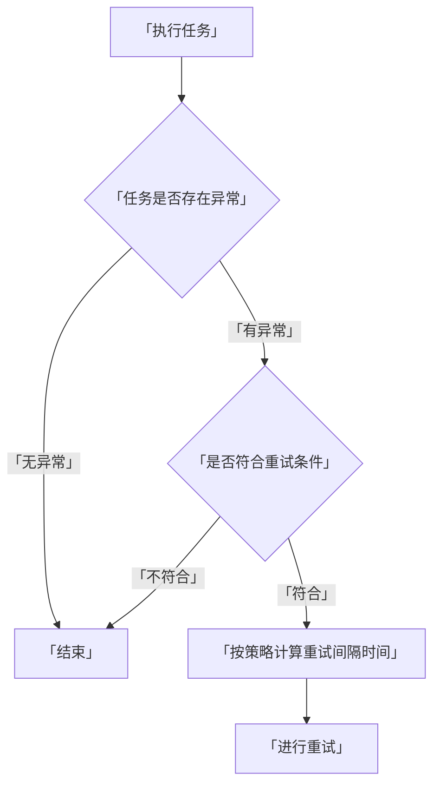

# 10-10-本章总结

本节针对整个章节做一个总结。本章重点讲解了三个话题：任务超时、重试、幂等。

在微服务中因为设计的服务较多，在服务与服务者的调度中，会存在一些偶然的情况，导致任务有较长的延迟时间。因此在请求中，我们往往会设置好请求的超时。当一个服务请求超时之后，或者存在一些问题，考虑到服务本身的请求有一些可能比较重要，所以就会涉及到重试机制，重新去发起同样的请求。但重试机制发起之后，重试又会带来新的问题。对调度者而言，当前这一次重试可能不是一次新的任务，所以同样的任务就会执行两次。因此需要基于幂等性，来解决重试所带来的问题。在本章节中，这三个话题相互依存、相互关联。

首先看任务的超时。对于任务的超时而言，在系统中只讨论一些简单的突发问题，比如说一些突发的网络状况，或者说是在系统服务器中因为资源的竞争关系，而导致的一些程序在响应这一块会有一些延迟性的波动，这种情况会导致超时。超时一旦产生，对于整个系统而言，从用户的角度来说，体验就会下降，系统性能也会降低，并且它也会影响到整个相关的调度链，对于资源也存在一定的消耗。因此在业务中，对于超时，就可以设置超时时间，然后针对一些耗时的任务，基于异步任务进行处理，同时对于整个程序运行过程，进行监控和调优。

对于像超时、一些故障的情况，可以采取重试机制。但重试并不是所有的情况都要重试，而要分业务。因此重试本身，我们会去感知、判断哪些是需要重试的，这个可以通过配置来设置，然后再决定是否进行重试，并选择相关的重试策略。对于重试策略而言，它涉及的是重试的间隔时间。当然在重试过程中，可能目标服务本身就已经无法再运行了，无法再提供相关的服务支持，也需要考虑任务的失败的处理以及自动恢复。这里就涉及到熔断和降级，会在下一章节中讲到。

对于重试机制的处理，流程其实并不复杂。流程中主要会先去执行任务，任务执行完，就要判断这个任务是否存在异常。如果无异常，就结束。有异常，判断异常条件是否符合于重试的条件，如果不符合，那么也结束。最后再根据策略，来计算重试的间隔时间，并进行重试。

重试也会带来新的问题。前面讲到了，业务会多次执行，特别是一些写的操作，这是比较致命的。因此就需要通过幂等性。幂等性的特点就是指一个程序在操作过程中，可能有多次的操作，但产生的结果和影响只有一次，不会因为多次操作而产生副作用，或者说重复性的问题，这是幂等性关键性的作用。

对于幂等性来说，它的主要特点就是避免重复操作，提高系统的吞吐性，而且它也提高了系统的可靠性。因为对于幂等性来说，允许系统存在故障，因此存在故障又会去重新发起请求。所以一定要注意幂等性的应用场景，在目前的业务中，像表单提交、秒杀、超时的情况，或者说是业务特定的情况，都是用得上的。

在课程内容中，对于幂等性的实现，主要是基于唯一 ID 的方式来实现的。即在客户端中，会根据请求的相关信息，生成请求 ID，这个 ID 会随当前的任务请求发送给服务端。服务端会接收到该请求，匹配在自己的服务系统中，是否存在对应的请求 ID，或者说请求 Token。如果存在，那么说明已经在执行任务了；如果不存在，那么就执行任务。通过这样的方式来实现幂等性。前面也通过例子做了演示。

以上，就是整个章节所讲的核心内容。
