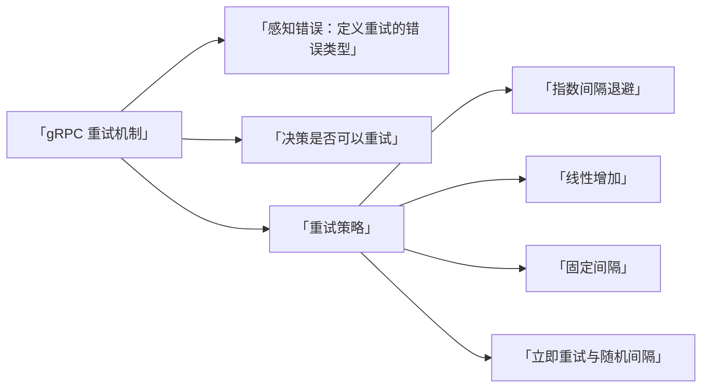

# 10-3-微服务中任务失败后又如何进行重试？

在前面我们已经了解了 go-zero 中超时处理，现在讨论一下：在微服务中如果一个任务失败了，该如何进行相关的处理。为此，我们主要讨论三个话题。

在微服务中，任务的处理失败，我们主要谈的是一些偶然性的失败，并不是平常发生的事情。它是在运行过程中，因为一些资源问题，或者说服务器的一些硬件问题，或者网络等这些相关的情况，造成了短暂的故障，然后会引起一定的波动，影响到了整个系统的调度，产生了一点小问题。在这种情况下面，最好的处理方式就是重试。

所以我们首先简单地应用 gRPC 的重试机制，对它做一点了解。第一，先了解 gRPC 重试机制的设置；第二，再去使用 gRPC 的重试机制；第三，理解 gRPC 的重试机制是怎么走的。

首先对 gRPC 重试机制的设置做一定的了解，因为这个机制的设置还是有一点点麻烦。进到 gRPC 源码中，主要看的就是它的客户端。因为像前面所提到的任务失败，一般来说往往就是去发起 RPC 请求的时候才会失败，所以这种情况下面，可以让客户端重新去发起请求。重点看的就是客户端的构建。在客户端的构建过程中，有一行信息是设置重试机制的参数。这个参数该如何设置呢？在它的 option 中有对应的方法，这就是相关的方法。另外还有一个方法，即设置服务的配置信息，但这个方法目前来说是不推荐使用的，更多推荐的方式是采用前面所看到的那个方法。

重点来看参数。因为此处它是以字符串的方式设置的，但设置的内容是很多的。设置的内容会被解析，解析的时候基于 JSON 的方式。因此传递的是一个 JSON 字符串，再通过它去解析，从而匹配相关的数据。所以我们需要知道这个 JSON 字符串中到底传递了哪些参数。可以看到这里就是解析的对象，我们需要根据这个对象去做 JSON 字符串的转化，才能设置好相关的配置参数。

了解完之后，接下来就去实践，使用 gRPC 的重试机制。在实践前进到程序中，找到 user 服务的登录方法，登录是最简单的方法了。在这个方法中做一个简单的事情：直接 return 一个 error 做测试，把上面的这些代码注释掉。

准备好之后，接下来设置相关的配置参数。设置前先打开它的 Option，对照它填写相关的 JSON 字符串。注意此处要进到 API 服务中，因为设置对象是属于 gRPC 的客户端的 Option。它提供了一个设置方式，用于设置 gRPC Option。

现在就需要在此处增加。在完成它里面内容之前，事先定义一个重试的变量，它是一个 JSON 字符串。主要看的是在客户端中此处它的解析，比如这一个对象的解析。我们设置的是这一个配置信息，把它传出来。在这个配置信息中，可以看到它是一个负载均衡的信息，然后设置里面的信息：名称也就是我们本地的服务名，然后本地这个服务是否设置重试，即重试的策略。所以在这里主要设置这三个参数就可以了，并且这三个参数一定要改为小写开头。

定义好之后，这个名称指的是 service，它是一个服务名，当前我们的服务就对应这个服务名。是否设置重试，当然要设置。策略照着这一份内容来写，名称都改为小写。第一个是重试的最大次数 5，然后是指数的增长时间，以及最大的指数增长时间，后面一定要跟上秒这个单位，以秒为单位。再看配置信息，这个是增长倍率，我们给个 1.0。最后的配置信息，指向的是在程序中遇到哪一些错误类型才进行重试。

关于错误类型，这里定义了很多。其中前面那些是属于程序在运行过程中会抛出的错误，但我们不能写这些，要往下看，写的是这里面的这个，不要写错了，否则是无效的。

到此就定义好了一份关于 gRPC 重试机制的配置。通过 gRPC 中设置服务配置的方法，把刚刚定义的这份配置信息传进来，这样就设置好了一个重试机制。

服务启动之后，进到 API 中发送请求。可以看到它抛出了做测试的信息，并且明显重新执行了多次，总共重试请求 5 次，5 次进去之后发现仍然有错，它就停止了。所以可以看到重试机制确实是设置好了。

但在设置重试机制的时候，一定要注意参数的填写。关于每一个参数的建议和作用，官方文档里面已经有总结，可以自己去查看。

现在来理解一下 gRPC 重试机制的设置。一个重试机制主要关注几个事情。第一就是感知错误，也就是它需要知道哪一些错误类型是要被重试的，如同前面所定义的，就是我们要重试的错误类型。第二就是决策是否可以重试，此项与配置相关，因为此处设置了开启，所以它是允许重试的。在一个项目中，我们也不确定它是不是真的需要重试，所以这一项也是必不可少的。第三点就是重试的策略。如果短时间故障没有在短时间内恢复，就可能会变成长时间故障，这时就要考虑是否不应该再进行重试，应该等故障恢复之后再来。这一点与之后会讲的熔断降级相关，但在重试机制中，这些因素都需要考虑。

接下来看重试机制的实际间隔，也就是重试策略。第一项叫指数间隔，或者说叫指数退避，目前在 gRPC 中采用的就是这一项。我们定义的就是关于指数退避的信息，意思是时间会随指数级增长，这个指数级会慢慢地增长上去。第二种是重试之间基于线性增加，它和第一种有相关性，但增加不是指数级而是线性，可以说是固定增加多久，比如固定增加 10 秒钟，下一次重试要在这个基础上面再增加 10 秒钟。第三种是固定间隔，就是固定一个时间重试，比如三秒重试一次。第四种是立即重试，出现错误立即重试，以及随机间隔时间。这些在目前的业务中都会运用到，而 gRPC 采用的就是第一种方案。

了解完策略之后，接下来看具体的 gRPC 重试策略。这里有一篇官方文章，对 gRPC 重试机制做了解释，其中的方案就是具体的主要重试策略。

接下来是关于源码，重点看一看这个过程。在 gRPC 中 stream.go 存在一个方法，用于处理重试。这个方法就是去判断是否应进行重试。前面这一些判断，主要是判断之前有没有已经进入过重试的流程，然后再接下来才是具体的判断：首先它会去获取当前的错误类型并进行解析，再根据错误类型判断是否在重试的策略列表中，也就是我们在这里定义的那一项。如果在其中，就会去进行重试。然后就是具体计算重试的时间，再进行重试。在计算中，此处是根据指数退避去计算真正值，也就是重试时间的间隔。整个方法就是判断是否重试及设置重试的实际间隔。

接下来看业务的重试。在流程中首先它采用了锁，防止在重试过程中已经有新的重试进来。然后在这个 for 中，首先它此处就会去设置，在整个流程中它不再去发送任何数据，设置好处理后再执行具体的任务，也就是实际执行的方法。方法执行完之后，这一段如果重试对象已经变更了，那么它会直接跳过进行下一次操作，因为它已经要进行重试了。如果说它是正常的执行完成并且没有问题，就结束。这里是执行失败去重试，在重试的时候它变更了，直接跳过重试。然后此处是在上面没有变更的时候，会进入到重试，当然前提是没有错误。这里面是关于失败之后的重试处理：在这个流程中会将标记设置为已经完成，然后在其下会判断当前是否可以运行重试，如果是的话并且没有错误，那么它就会设置为标记还未完成，进入到重试的处理中。所以整个这一段就是针对任务失败之后的重试处理。而这一个方法，是具体用于判断重试的方法。

在学习过程中需要注意，整个重试中这些配置的设置是有关键性的，如果没有设置好会有问题。

通过 gRPC 的源码，我们只要专注几个重点，重点就在重试方法中。首先前面这一段会去停止整个任务的执行，阻止其他的重试进来，因为它本身就要去执行任务了，所以肯定要停止其他重试进来，这是第一个非常关键性的处理。第二个关键性的处理就是执行具体的任务。第三个就是针对任务执行完之后，先判断一下异常是否有问题。在判断前它这里也会判断当前是否已经重新设置了重试，如果设置了就会进入到重试处理中；如果没有，那么就会判断是否没有异常，最后才进行失败处理。在失败处理中就会按照重试策略，判断当前的错误是否要进行重试，然后再去计算当前重试的间隔。

更多的还是需要自己在课后，根据源码及文档，去配合了解整个 gRPC 的重试过程。
