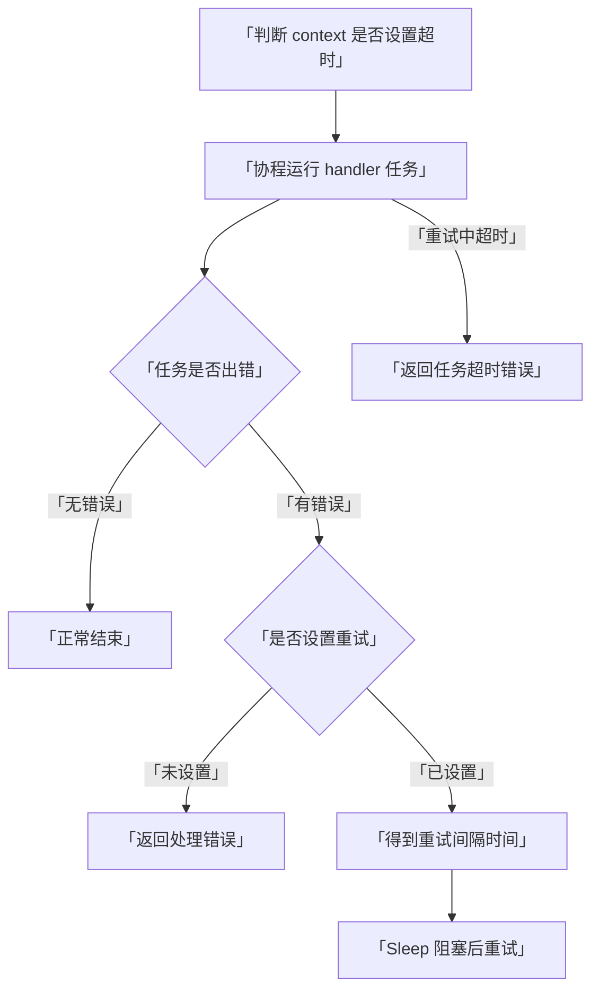

# 10-4-业务任务失败重试处理

在上一讲中我们已经了解了重试机制，并使用了 gRPC 的重试策略。那么在本节中，业务在处理失败的时候，也可以去设置它的重试。对此，我们先进行任务的分析，了解如何去实现，然后再具体实现这个重试策略。

先来分析重试机制的实现。在整个实现中，最关键性的就是：重试的错误类型（即重试的条件），以及重试的时间。这三个是比较关键性的，它决定了因为什么错误在进行重试。对一个任务来说，执行的时候首先判断它当前是否存在错误，即这个错误是否符合重试的需求。然后再依据重试的相关条件，比如重试次数达到了上限，就停止重试；没有达到的话，就正常重试。接着依据策略来进行重试间隔的计算，然后再进行重试。整个流程在实际过程中，与前面分析的 gRPC 是最相似的。

现在来具体实现它。找到 pkg，创建一个包，主要用于处理任务，在此处定义重试的相关处理。首先定义一个类型，它的作用是定义重试的间隔策略，即重试机制采取什么样的间隔。也就是定义一个方法类型，在这个方法类型中要求传递 context、重试的次数，还有上一次的重试间隔。第二个类型是验证是否重试，参数内容中同样传递 context、重试的次数和错误。在程序中，一般来说会对这些方法类型实现一个默认的方法，供程序使用。比如当前定义的类型，就是让它总是能够根据固定间隔的时间去进行重试。在这里定义一个默认的属性，如默认重试间隔的时间为一秒钟。然后定义一个重试超时的时间：做重试时任务也会有超时，我们定义一个总的超时时间，以两秒钟为超时。再定义一个默认的重试次数，五次。在这里使用刚刚定义的属性，它要返回重试的时间，即默认间隔时间。同样的道理，接下来再定义一个针对是否进行重试的方法，把参数传进来。这个方法类型也应该返回一个参数，bool 类型，让它总是返回 true。这些默认方法就定义好了。

方法定义完之后，接下来要提供一个 withRetry 的方法，供业务调用。在这个方法中传递 context，以及 handler（即业务自己正常运行的方法），然后传递一个 option，主要用于设置重试的一些事项。option 的定义之前已经讲过，并不复杂：先定义方法类型，再维护方法类型，定义对应的结构。在结构中定义好要设置的必要属性值，比如当前定义的是超时的时间、重试的次数、是否重试，还有重试的间隔。然后再为 option 提供关键的方法，将 option 参数传递进来。先定义一个 option，里面的属性值都设置默认参数，设置完成之后让 option 执行设置的方法。到此为止就设置好了。

围绕这些还可以定义其他的方法，课后自己设置好就可以了，并不复杂。比如当前设置一个重试超时的时间，此处就设置好它的超时设置。除此之外还有一些其他的，我们就不去设置了。

回到核心的重试方法。先跟上 option，将 option 传递进去。接下来需要判断程序本身是否设置了超时，通过 context 的方法去获取是否设置超时了。如果它没设置，那么就自己设置超时。

超时处理好之后，接下来定一些属性。第一个是 handler，它运行之后会抛出一个 error。第二个是使用的间隔时间，要记住。第三个定一个通道，此处重试会用到通道作为参数之间的传递，传递的主要是 err。再用 for 来进行重试，迭代一次就进行一次：传递重试的时间，传递重试次数，再通过协程运行 handler 方法，并且在 handler 运行完之后，将参数传递出来，通过 chan 来接收。chan 接收的是当前从通道中获取的错误信息。判断当前的错误是否等于空，等于空说明是正常运行，没有问题。如果不等于空，就是出现了异常。此时要做的事情，就是判断当前是否设置重试，将参数传递进去。如果它为 false，就相当于不重试，那么就 return 当前的处理错误。如果重试的话，就要得到重试的时间，让它 Sleep 一下，相当于阻塞一段时间，然后再进行一次。

接下来完成第二个分支。第二个分支主要是在重试的时候超时了，所以给它定义一个错误：任务超时。之后再返回出错误。到此，一个重试的核心方法就写好了。

围绕这个方法，可以生成对应的测试用例。先把 Option 的其他操作复制一份，然后完成测试。测试用例不复杂，这里主要看 handler：任务的执行是我们自定义的一些 handler，下面是测试组。在测试组中，要得到想要的错误类型，我们定义一个错误类型。第一个任务在运行过程中会传递这个错误，我们希望它能够抛出的是任务处理超时的。第二个自定义了任务的超时时间和间隔时间，那么当前的这个错误就不再是超时了，而是应该抛出测试的异常。第三个则是不进行重试。运行一下，效果没有问题。

再仔细看一下。第一个方法它执行了四次，但其实默认让它执行五次。它抛出的异常符合具体需求，抛出了超时的问题。因为默认是间隔一秒钟执行一次，这里执行四次就超时了，不符合超时时间。第二个执行了五次，因为时间是符合的，所以没抛出超时，抛出的是任务的错误。第三个也是抛出任务错误，它只执行一次。从这里可以看出，自己所写的重试方法是没有问题的。

也可以在 API 中像测试用例这样去使用它，实现本服务。本节的重点就是实现这么一个重试机制。
