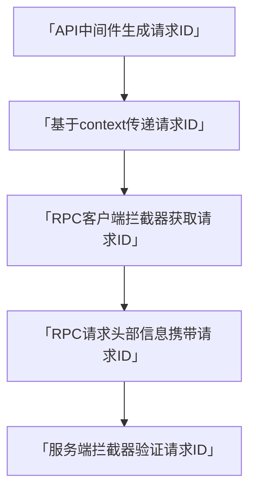

# 10-7-实现社交服务创群请求幂等性（上）

在上一讲中，我们已经理解了幂等性的实现思路。那么在本节中，接下来就去实现社交服务中对群创建的幂等性。课程内容中，我们先回顾幂等性的实现分析，然后再去具体地实现幂等性。

首先回顾对幂等性实现的分析。我们会基于唯一标识的方式来实现幂等性。在流程中，由客户端根据请求的业务，再依据请求的时间等相关的信息，生成一个请求的 ID。在每次对该任务请求的时候，都会携带请求 ID 发送给服务端。服务端在收到请求 ID 之后，会判断它是否存在。如果存在，证明任务正在进行，或者已经结束等这些情况；如果不存在，则执行任务。原理来说是不复杂的。

理解之后有一个问题点：该如何去编写项目代码来实现这个功能。原理并不复杂，但实现它，我们来看这个图，这个图就是对刚刚过程的实现分析。

在流程中，这里属于客户端。客户端会在中间件中，为每一个请求生成对应的请求 ID。这个请求 ID 就是前面所提到的幂等性的请求 ID。它会将这个请求 ID 发送给所有指定的 RPC 请求，注意，是所有指定的 RPC 请求。这些 RPC 请求收到请求 ID 之后，在发起 RPC 请求的时候，都会携带生成的请求 ID。由 RPC 客户端获取到这个请求 ID，并携带好发送给服务端。

在这里，它如何去获取呢？注意，生成是在中间件阶段生成的，获取是从客户端的拦截器中去获取的。之所以这么做，主要是因为不能在业务中就写这个 ID 的传递，这样很繁琐。因此在过程中是基于 context 来传递这个任务 ID 的，然后在请求的 RPC 拦截器中就获取 context 中的值，请求的 RPC 客户端就从拦截器中获取到 context 中传递的请求 ID。而在服务端，它们会到自己的拦截器中，去验证刚刚的过程。

因此我们要写三个地方：第一个是 API 的中间件要生成请求 ID；第二个 RPC 的客户端要去获取生成的 ID；第三个是服务端的拦截器，它需要自己能够去获取到请求 ID 的 RPC 标识。

了解完整个流程之后，接下来就具体实现它。实现流程中，有一个流程就是 RPC 的机制。对于它的机制实现，我们先去编写好：先编写 RPC 的客户端和服务端的拦截器，然后定义好默认拦截器的实现，再做 API 的中间件的实现。

接下来实现具体的功能代码。进到 pkg 中，创建一个用于做幂等的拦截器。首先定义一个幂等的接口，这个接口会约定幂等性的实现要遵循哪些原则。

第一个，用于获取请求标识。前面已经分析了，对客户端来说，获取的关键就是请求标识的获取，所以这里需要定义一个方法，用于获取请求标识。服务端也要获取请求标识，所以这个方法很重要。第二个，是当前这个方法是否支持幂等性，传递请求的方法，判断这里是否支持幂等性。接下来就要去验证，验证这个过程中是否已经执行过了，也就是幂等性的验证，它的作用是判断这个方法是否已经执行，或者请求结果等等。返回的结果就是 interface，以及是否进行了验证。再一个就是执行之后结果的保存。这个方法主要在于有一种情况：前面重试几次，但结果肯定也要考虑是不是返回，所以这里定义一个保存结果，并将结果能够输出来，相应的异常如果是异常的，那么也传递进来。这就是关于幂等性这个方法的作用。

定义完之后，接下来还定义好几个关系信息。第一个，用于设置在整个请求过程中的请求 ID 的标识，或者叫任务的标识。第二个参数，则是设置在 RPC 调度过程中的请求标识。这两个要区分一下：它俩在编写和传递的时候，可以选择同一个 key，但建议还是考虑区分一下，这里是设置 RPC 调度中 RPC 请求的标识。

到此，针对幂等性的基本处理就到这里了。接下来进行第二步，客户端与服务端拦截器的设置。分别都提供了一个方法，统一写在了这个地方。首先第一个，定义的是针对客户端的拦截器。在定义前，还是要定义一个 context 相关的方法，用于设置请求标识、设置请求 ID。在中间件中就可以调用这个方法去设置。把 key 传进来，再把 value 传进去，value 让它随机地生成一个字符串，这里使用的是 go-zero 的一个工具包。到此，就可以设置好请求 ID 了。

然后在下面，它要传递对应的这个幂等性的处理对象，再输出的是 gRPC 客户端的拦截器。在这个里面要填写什么内容？首先第一步，对 RPC 客户端拦截器来说，它的处理并不复杂，主要是获取唯一的 key。也就是说，把这个 key 获取过来，因为它主要是把 key 传给服务端，所以它要获取 key。我们已经在结果中定义了获取 key 的方法，所以从这里获取这个拦截器的 key。获取之后，第二步，就要发送过去。发送的话，最好的方式是设置在头部信息中传递。因此这里使用 gRPC 提供的设置头部信息的方法，用这个方法进行设置，它传递的是 context，然后是 map[string]string 这个数据类型，再把 key 传递好。这样就是设置在 RPC 请求的头部信息中，再请求，把相关的参数传递好。到此，一个客户端就处理好了。

服务端的拦截器处理也不是很复杂。先定一个类的方法，让它创建服务端的拦截器。同样，它的传输也是传递出这个 metadata，返回的对象是服务端的拦截器。在这里之前，第一步也是去获取请求的 ID。现在请求 ID 不能再通过上面的方式去获取了，而是通过下面的这一种方式，因为它是通过 RPC 的方式传参，所以它这里已经设置了 key，并且 value 也设置在这里，因此通过这种方式获取才是正确的。这样就获取到了请求标识。

再验证一下参数，如果这个参数长度为 0，它本身是个字符串，长度为 0 那就是不正确了。如果有，接下来验证当前的这个方法是否要进行，把请求的方法传递进去。不进行幂等性的条件有两个：第一是它的请求 ID 没有；第二是这个方法不支持，没有设置幂等的信息。现在可以打印一下信息输出，把这个 ID 打印出来。这一段只是输出，后面可以通过它来做一些判断，通过打印在后台看进行的情况。

接下来就去验证这个任务是否要执行。传递参数，直接判断当前这个任务是否执行。如果这里返回的是一个值，那么是要执行，它会得出结果和异常，这个肯定要返回出去，但自己肯定要保存一下，做一个打印。现在要做的事情，是将结果保存一下，也就是刚刚所请求的这个幂等，把它的结果记录下来。

到这里，这一段幂等性的任务处理就写好了。如果到下面这个环节，说明任务已经有执行了。把这个执行的编号打印出来，然后判断一下当前的结果是否为空。如果不为空，说明已经执行过，返回结果。如果它不返回任何结果，那么可能还在执行，抛出一个异常，输出一个信息。这里的输出要做一些格式，使用 RPC 的请求标识，因为需要让它重置，所以要把它输出出来，处理为：存在其他任务在执行。

目前两个拦截器就定义好了，内容就是这些。但最关键性的，是定义默认的这个实现。把默认的幂等性的实现完善一下，功能就实现好了。

这一功能的实现写在下面。在它的定义中，首先定义两个默认的参数，即默认幂等性的对象处理，第二个是默认幂等性的 gRPC 客户端，它可以把参数传递进来。然后再去定义对象，这里面需要写什么？需要两个信息。第一个是 redis，redis 在其中发挥的作用主要是获取和设置请求的 ID，然后再是 redis 的定时清理，它可以把一些过期的 key 清理掉，这是第一个点。第二个点要注意存储：存储这里使用 go-zero 所定义的这个缓存对象，它和 redis 一样，再定义一个用于支持幂等方法设置的对象。因此会给当前的对象定义出三个属性。三个属性确定好之后，接下来定义方法。首先提供的就是这个幂等的方法，传入的是 redis 的配置信息，返回幂等的接口。第一步，先创建出这个缓存对象，给它设置的是过期的时间，那么它们的 key 都会在这一时间内过期。第二步，redis 对象的创建，然后缓存，这是哪些方法。然后幂等的操作来写一下。

这个方法的请求 ID 怎么知道呢？当前这个方法肯定写的是服务端的，而不是客户端的。关于它如何知道，可以打开 api 中对应的类库文件，在这个类库文件中就定义了这些方法，在里面其实就是这些，我们要设置这些方法，能够支持幂等操作。通过当前的这个类库文件，我们就可以知道了。

接下来就要完成前面在这里定义的接口，可以先把这个接口中的方法 copy 一下。
