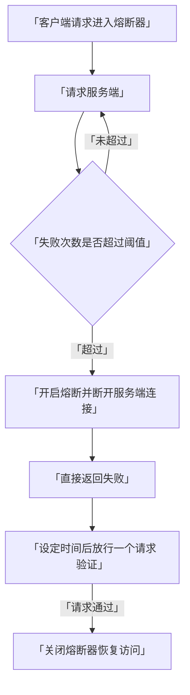

# 11-1-熔断，限流，降级解决的问题与作用

从本章开始，我们会学习熔断、限流、降级这些话题。在本节中，重点理解这三个话题在微服务中起到什么样的作用，又解决一些什么样的问题。课程内容会针对下面几个话题展开：首先第一就是服务的问题，它会有哪些情况；然后再介绍限流、熔断、降级这些机制，以及这些机制所解决的问题，还有相关的作用。

先看服务的问题。对于服务的问题来说，从整体上可以分为两大类。第一类是系统问题，也就是服务器，它可能存在一些宕机，然后网络、机器故障的这些情况。但在实际项目的部署机房中，一般来说是比较稳定的，不排除会有一些特殊的情况，但整体来说正常都是比较稳定的，所以这种情况是比较小的。因此重点来看的是程序的问题。

在程序中，会随时地发现：数据增大，然后用户量也增大，对于业务来说，它开始慢慢地会响应比较慢，然后超时就会存在，大量的一些超时等现象。这些问题主要是因为程序在运行过程中有压力，负载过大，还有一些资源竞争的问题导致。所以从整体来说，服务的问题可以分为两大类，一类是系统，第二类是程序。

针对这些问题，先来看限流这个话题。限流在业务中做得比较多，不管在微服务中还是单体项目中都会涉及到，特别是在讨论秒杀的时候。限流主要解决的问题如图所示：这是一个正常的服务，正常运行过程中，不仅业务在增长，平时也有流量，但它可能在一段时间内，业务突然增长，流量就暴增了。这个流量增大，对于服务来说，它承载不了这么大的压力，此时对系统来说，它就无法去解决这个问题。对于客户端来说，能看到的现象就是服务端正在繁忙，然后可能有各种异常的问题跑出来，甚至会影响到服务器正常的运行。

在这种情况下面，采用限流的机制。限流其实就是一种限流的策略，它会根据我们在测试环境下面压测的服务能承受的压力，来定义这一个阈值。当系统上线之后，程序因为活动的因素导致流量增加，当超过这个阈值的时候，它就会触发限流，会限制涌进来的流量，然后一部分流量会直接性地返回出去。

在业务中，限流的实现方法有很多种。比如说基于 Nginx，它有一个限流的模块，可以基于 Nginx 来实现。另一种是在服务端，采用令牌桶、漏桶的算法来实现限流。所以限流有很多种方案：基于 Nginx 的话，它是在接入层来进行限流；而在服务端，一般来说，会写在中间件中去进行限流。

限流之后，接下来讨论熔断。熔断和限流会有一个区别。熔断是一种保护的思想。在生活中，比如保险丝，这是一个比较典型的例子：当一个电器存在短路，或者电力不稳定的时候，是一种非常危险的情况，房屋的电器会因为电压的问题不稳定，所以会有一个保险丝断开。这个思想，和微服务的项目访问是最相似的。

当客户端向服务端去发送请求的时候，在服务端中，前置肯定会有一个熔断器，可以写在它的拦截器或者中间件中。请求进入到服务器中，客户端进入之后，发现服务端返回失败了。这个失败的因素还有很多种，比如因为限流，让这个流量不能通过，所以它就返回失败了；或者说因为超时的问题。总之，是一个失败的问题。然后它会请求多次，这个多次会有一个阈值，可以自己去定义。当超过这个阈值之后，再一次请求的时候，它就不会再去请求服务端。注意，请求不会走服务端了，而是直接在熔断器中断开和服务端的连接，然后直接给程序返回一个失败。这就是熔断器的作用。

在熔断器中，常常有两个重要的话题：第一个是开启熔断，第二个是熔断恢复。回到前面的图中，在流程中，如果前面这一块的业务在处理的时候，因为服务端短期内压力比较大，而导致请求失败，但之后可能能够正常运行。在这种情况下面，如果一直不去访问服务端，很显然不符合业务的需求。所以在程序中，往往会对程序设置一定的时间，不让它去访问服务器。当这个时间过去之后，会放一个请求去访问服务器，然后发现可以通过了，就把熔断器关闭掉。熔断器在它的核心能力中，就会有开启熔断和熔断恢复。

了解完熔断器之后，接下来讨论降级。降级一般来说是与熔断器配合使用的，当然也不是百分之百一定要配合，只是常见情况来说是与熔断器配合。还是前面那一个例子：请求进入熔断器，熔断器开启了，让请求不去访问目标，而是直接在熔断器内部就返回出去。但直接返回一个错误肯定不好，那么怎么办呢？可以在熔断器中增加一个方法：当程序进来之后，发现熔断开启了，就返回出已经写好的数据，一个固定的数据，返回给请求方。这一个写好的方法，就称之为降级。简单来说，原本需要去访问目标的，但因为目标访问不到，出现了故障，这个时候就改策略，改为降级：不去访问目标了，获取这个固定写死的数据，然后返回出去。

对于降级来说，在实践中有很多种应用。比如超时，可以降级；失败，在失败次数比较多的时候，也可以采用降级；然后像故障、限流等这些情况，都是可以采用降级的。

本节重点就是理解这三个话题。限流是用来保护程序，即保护程序不被流量所冲垮；而熔断是让程序在访问目标的时候，发现它访问失败了，就暂时让这个访问先不去访问目标，而是直接给它输出来。输出什么呢？输出降级中的内容，就是把访问降级，输出固定的内容。所以这三个是相辅相成的关系。
