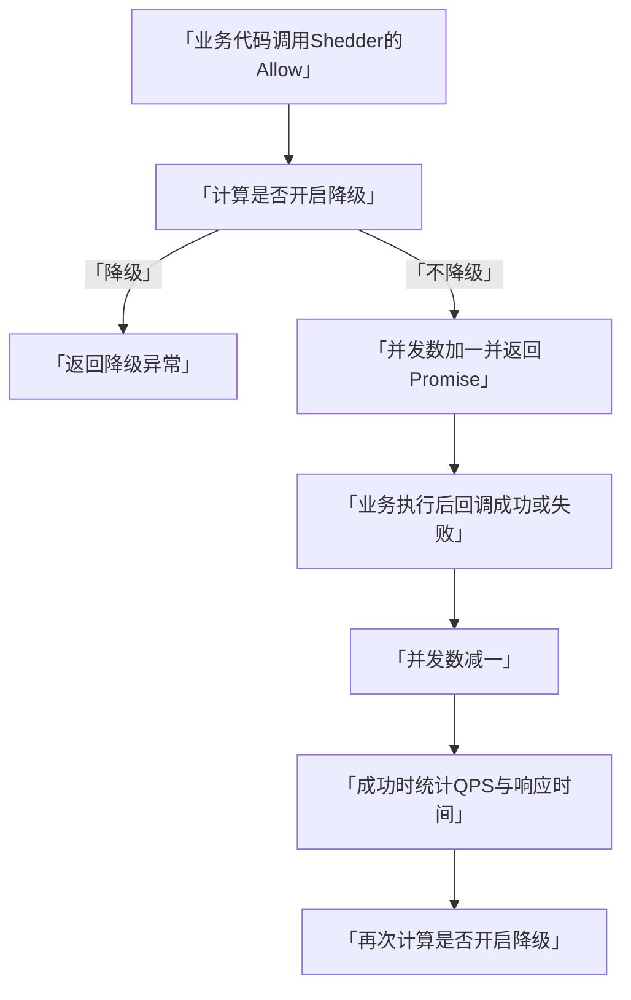

# 11-10-go-zero自动降级内部探索

上一讲已经使用了 go-zero 的自动降级，本节针对 go-zero 的自动降级进行内部的探索，看看它具体是如何实现的。课程内容先分析自动降级的实现，然后再去看内部的源码。

首先分析自动降级的实现。对于自动降级的实现，主要从这几个方面来分析：第一目标与指标，第二就是滑动平均算法，这个算法要理解好，因为这是整个自动降级的核心，然后最后就是应用分析。

对于目标，其实主要是保证系统不被拖垮，在系统稳定的情况下面，又保证系统的存量，这个就是降级的主要目的。而指标也主要是去平衡 CPU 是否过载，以及最大的并发数是否过载这些信息。所以它主要是针对服务端来定义的。

最重要的，还是滑动平均算法，因为这个算法其实是整个 go-zero 对于自动降级的实现的核心。这么一个公式应当这样理解：这是通过该公式计算之后的一个值，这个值就是用来与定义的阈值进行比对，看是否超过这个阈值，超过了那么就会降级。这是计算之后的值。重点来看的是这个公式的内部，又是如何去计算的。在内部，这个符号可以定为 A，它是一个定义的常量，A 的取值范围是大于等于 0，但是小于 1，这是它的取值范围，它不会大于 1，它只会接近 1。

然后公式中的另外两个值属于变量，这个变量是在程序中，假设一个变量 V，在 T 时候，它发生了一个变化，那么称之为叫 VT。可以理解为，当前这个 V 是一个并发数，那么并发数在 T 时候，它产生了一个变化，总共有多少的并发数；或者可以把当前这个 V 理解为 CPU 当前的使用率，那么在 T 时候的使用率是多大，这就是当前在某一个时间点的数值。

然后下面的这两个值分别代表的是新数据和旧数据，这个是旧数据，是上一秒当前这一个值的变化；这是新数据，是目前这一秒数据的变化。因此在这个公式中，A 是一个权重值，它有两种情况：A 如果等于 0 的时候，很显然，新数据的影响都等于 0，所以此时平均值就等于了原平均值，这两个值都是平均值。而 A 越大，那么新数据，即这一个新的数据，它对整个结果的影响就会越大；当 A 越小，那么新数据对整个结果的影响就越小。A 的取值一般就是 0.9。

因此这一个公式在整个计算过程中，它的关键就是，根据定义的一个固定的权重值，再根据计算之后的这个新的滑动值及旧的滑动值，然后两者进行相加，最终得到一个值。此时就会依据这个值去判断是否超过，那么是否应开启降级。这就是这个公式主要的运算，而 A 的取值一般来说，往往就是 0.9。

在应用中，它是这么运行的。从代码的角度来说，降级必然需要一个方法来判断是否降级。所以在流程中，这里会有一个方法，用来判断是否降级，根据 CPU 并发的过载数进行计算。如果说是降级，那么程序就会进行降级的处理，然后再结束，它可以输出一个异常，也可以什么也不输出。而如果说不进行降级，那么它的内部对当前这个请求肯定要记录并发数加一，然后会根据请求执行的结果是否有异常和无异常，分别做相应的加减并发数，统一对并发数进行减一，因为当前程序是执行完了，任务就已经要结束了，所以就减少。但是对有异常情况和无异常情况的结果，会分别进行记录。最终结束，这是整个它的执行流程。

现在来看源码，来进一步地去理解它的执行。在过程中，先看接口的说明，然后再去看降级的处理流程。这里有一个图示，这个图示是绘制的当前 go-zero 自动降级的代码的方法执行流程。在这个流程中，先来看一下接口。在 go-zero 中，它有两个核心的接口，第一个是 Shedder，它主要是定义对外去提供服务的，这里它提供了一个 Allow 的方法，这个方法主要是给外部去判断是否进行降级，它会返回出两个结果，一个是 Promise 和异常。Promise 它会有两个方法，成功和失败，即是分别在业务执行成功之后，或者失败的时候进行执行，它会分别来进行一些数据的记录。这是它的两个非常关键性的接口。

然后再提一下就是具体的代码流程，可以看代码，在其中就是代码的具体执行。来看这个流程：在流程中，自己业务代码会调用 Shedder 的 Allow 的方法，来去验证是否进行降级，而在底层的核心代码中，会调用 Allow 去计算是否开启降级，主要是调用这个方法来完成的。其实这里有两个事情可以分析。然后它会返回出一个结果，如果是降级，那么到这里会直接返回并返回出降级的异常；如果不降级，那么就会走这个流程，会把并发数进行加一，然后会返回出对象，要求在业务端执行的时候，根据执行的情况，再执行对应的失败和成功的统计。无论失败和成功，他们都会把并发数进行减一，而成功则多统计一些，除了将并发数减一以外，还会做 QPS 的统计和响应时间统计。统计起来之后，最终通过上面的这个方法来去计算是否开启降级。这就是整个自动降级的执行流程。

可以看代码，在代码中，这就是降级的核心对象。在这个降级的核心对象中，第一个参数，它的作用就是定义 CPU 的临界值，即 CPU 的运行阈值。再接下来就是当前的统计容量，然后这里是并发数、平均并发数，这是指数，就是在过程中会进行计算，提供一个无并发的锁机制。在其后的信息中，它就有过去的时间，以及最近是否超时，还有下面的请求统计、响应统计，这些信息。把这些统计做好，而在过程中就分别对上面的信息去进行统计，所以对上面的信息进行初始化。

接下来看 Shedder 的方法。在 Shedder 中，刚刚讲到的这一段方法，就是去验证是否进行降级。如果是降级，那么就返回异常；不降级，那么就会记录并发数，然后会把这个对象发布出去。来看这个方法，可以看到它有一个前置判断，这个前置判断就是判断当前是否降级的关键。第一个方法的判断主要是判断当前系统是否过载，其主要的判断依据是当前的 CPU 的值，可以看到它是先获取系统的 CPU 的执行的数据情况，然后再依据当前的阈值进行判断是否过载，过载就降级，这个已经了解了。

第二个判断，它主要是判断当前服务是否处于冷却期，然后程序是否应该要继续进行复杂的计算及请求的丢失，主要情况是因为它如果已经开始降级，那么会在冷却期让它休息缓一缓。

然后在这里才是真正滑动平均算法的应用，即在此处它会依据当前的请求执行的结果，然后去验证进行降级，它这里主要是进行判断，而判断结果依据上面这里当前的并发数，此处就是应用到前面所提到的公式。然后再接下来就根据上面这里执行之后的结果进行判断是否进行降级，所以这里应用到了前面所讲到的公式来验证降级。

而在这个公式中，它有两个参数值的判断，第一个是基于滑动平均数据所计算出的滑动平均值，然后其实是这一个最大的负载值。这个负载值是通过另一个公式计算的，其关键就在这里。可以看到，它是在执行成功之后，再用这一个成功的方法进行统计，它根据下面的这一个迭代进行计算，去找出最大的负载值，进行返回，从上面的这个方法计算之后进行返回。因此最终，依据最大的负载值及滑动平均值，验证是否过载，这就是自动降级的关键因素。

整体就是这个流程。在过程中，它主要是依据滑动平均算法来验证是否进行降级，而这个算法的统计，则是在没有降级的时候，它会依据这个平均数进行统计计算，最终会依据最大的负载值及滑动平均值来计算是否过载。当然前提是 CPU 没有过载，如果 CPU 已经过载，那么它同样也会进行降级，所以它这里是双重的验证。

本节主要是了解自动降级。
