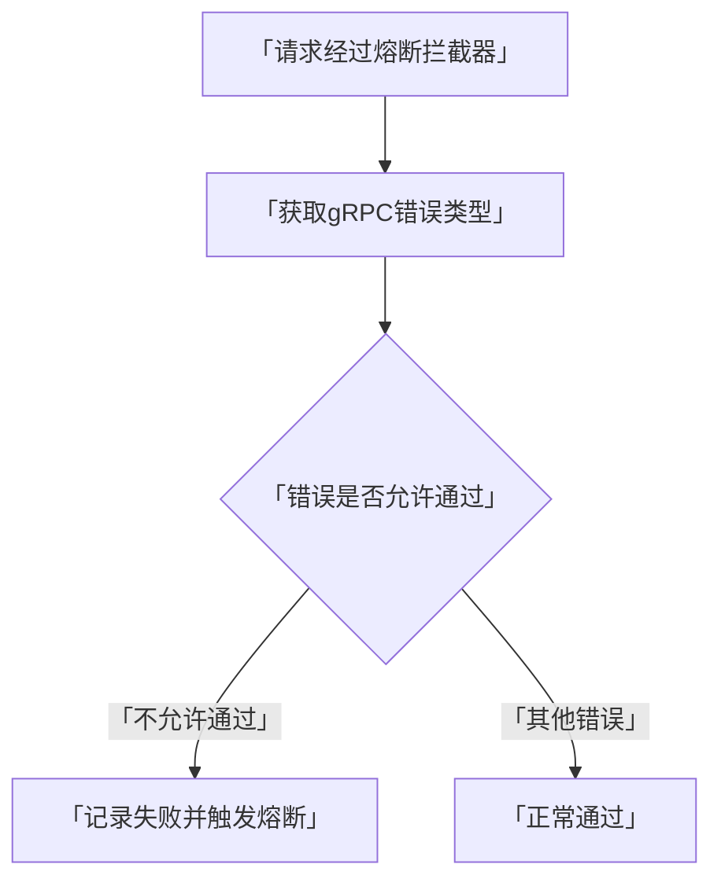

# 11-3-用户列表熔断处理

通过前两讲的课程，我们已经对熔断机制做了了解。接下来在本节中，基于任务列表来作为课程示例，进一步地学习熔断机制。课程内容从两个话题来讲：第一先理解熔断机制，第二会去实际地使用。

先来理解熔断机制。其实在 go-zero 中已经默认使用了熔断机制。进到 go-zero 的核心代码层中，找到它的 RPC Server，在 RPC Server 中可以看到，此处就已经使用了熔断机制的拦截器。再看客户端，客户端在这里也可以看到，也是使用了熔断机制的，把它注册到拦截器中。所以默认的话，是有去使用的。

了解完之后，就来简单地看一看熔断机制它的方法。其实两者之间的差别并不是很大，都是带有这一个方法。在这个方法中，它要求传递三个参数：第一个是方法名，第二个是请求任务，比如说请求的任务的执行方法，第三个参数是验证当中的这个错误是否能够去通过。可以看到，它们对于错误的验证都是统一的。在这个验证中可以明显发现，它所做的事情是：它会去获取 gRPC 的错误，然后对于这一些错误类型，它是不允许通过的，也就是说这一些类型会触发熔断机制，当然其他错误的话，是会通过的。这就是关于熔断机制的设置。

了解完成，接下来就具体地实践这个熔断机制。对于熔断机制的实现，其实主要是去考虑对于服务端的请求它执行的几次，这是我们需要知道的。为了更好的效果，可以分别在客户端和服务端两个端中增加一个参数的输出，即在此处增加两个变量，这两个变量分别来统计请求的次数、任务执行的次数，再打印出来。这里是在 gRPC 的拦截器中所做的一个测试，这是 Server 的拦截器，然后是 RPC client 的拦截器。同样，也可以在客户端的拦截器中增加一个打印，这样可以更好地看效果，处理一下它的并发。增加好之后，接下来进到业务的代码中。在业务代码中要做一件事情：让它直接输出一个异常。进到 user RPC 中找它的业务，在查找用户的方法中，重点要备份的就是这里，它返回的异常。在其上同样还要定义一个变量，这个变量用于统计当前程序执行多少次，再来个输出，把当前的这个统计输出来。然后在这里直接让它输出一个异常。异常的输出也值得注意：当前的异常一定要自定义的，并且这个错误码，它的来源一定是 gRPC 的，因为 gRPC 它只支持这个错误码熔断，所以要注意。

错误码定义好之后，启动好服务来进行测试。在过程中，直接测试 RPC 服务就可以了。因为在当前的 RPC 服务中，它自己本身就已经有熔断机制了，在客户端当中的这个熔断机制，两者之间并没有什么特别大的区别，所以直接测试它的 RPC 接口就可以了。导入这个 proto 的文件，然后接下来找到这个查询的方法，输入参数和本地的服务器地址，请求。可以看到它抛出了这个测试异常，多请求几次。多请求几次之后，可以看到它触发了这个熔断机制，这个就是熔断机制的错误。

然后来看一下打印的信息。在打印的信息中会发现，它总共执行次数和实际请求次数有一个明显区别，说明实际上有一些请求没有进入到这个请求中。可以再来一次，请求触发熔断机制，然后来看这里的打印信息。第一次它任务的执行和总的请求说明问题，但到了后面之后，从这个 8 开始你会发现，它任务的执行只执行了 8 次，但是它实际请求之后，就执行了 9 次以及 10 次，说明有两次是没有实际执行的。也就是当前可以很明显发现是触发了熔断，请求直接断开了，不是调用服务端了。可以多来几次，就可以更加明显地看到这个错误信息了。

简单了解了这一个熔断机制。其实在程序中，也可以在客户端中去使用这个熔断机制来进行相关的测试，这里也有相关的事例，在 API 中去请求就可以了。本节我们就已经了解了 gRPC 的熔断机制了。
