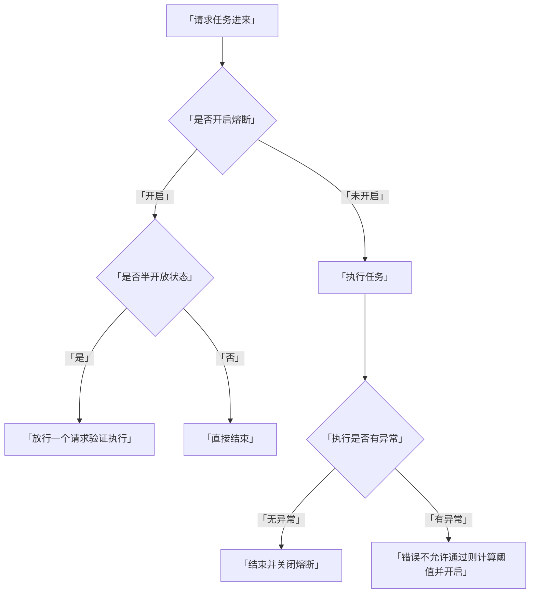

# 11-4-解析go-zero中熔断的实现原理

通过上一讲的课程，我们已经了解了 go-zero 中熔断机制的使用，现在来探究一下 go-zero 中的熔断机制是如何实现的。课程内容总共分为两个话题：首先第一来理解熔断机制本身在实现的时候，我们应该要去考虑哪一些因素，又如何去展开实现；然后再基于刚刚所提到的理论，再去分析 go-zero 的源码。

先理解熔断机制。熔断机制在前面已经有介绍过了，它的作用主要是保护程序的。在业务当中，我们会将熔断机制写在对应的拦截器、中间件中。在请求的时候，请求都会去经过熔断机这一层。业务端向服务端发起请求的过程中，如果请求失败，这个熔断机制会记录总的请求数和失败次数，因此它自己会计算一个值，这个值我们称之为阈值。当请求的次数和失败次数通过计算之后达到这个阈值之后，那么它就会开启熔断。开启熔断之后，请求就不再直接去访问服务端了，而是直接结束，这就是熔断机制。

熔断机制开启之后，它也会在后续的过程中，根据一定的时间适当地去放一个请求过去，看是否能够正常被访问到。如果能，那么说明服务端已经正常了，就可以关闭熔断器了。因此在整个流程中，对于熔断器，其实它有三个状态。状态一就是开启状态，这个状态是熔断机制开启的时候，那么就断开对目标服务的访问。当然其实初始的状态是关闭状态，也就是说正常的流程，它是能够去访问到服务端的，只有在它访问失败，并且这个失败的次数量级达到了一个阈值，才会去开启这个熔断机制的开关。当这个开关开启之后，它会间隔一定的时间，将这个状态设置为半开放状态，也就是它可以允许一个请求，当这个请求通过之后，如果这个请求的结果失败，还是让它继续开启；如果成功，就关闭熔断，恢复为正常的请求。所以熔断就有三个状态。因此在熔断机制中，就有两个状态转换：一开启熔断，二熔断恢复。

根据刚刚所提到的思想，就可以去构建如下的流程来实现熔断机制。在程序中，请求任务进来，首先先验证是否开启了熔断。如果没有开启，执行任务。如果开启了，那么再验证当前这个熔断是否处于半开放的状态。如果是属于半开放的状态，就可以去构建如下的流程：判断这里是否可以放一个请求过去，去验证是否能够执行。如果说当前这里不放请求进去，那么就直接结束了。对于请求任务执行完之后，在程序中也会去验证它是否有存在异常。如果不存在异常，结束并关闭熔断。但如果它存在异常，这个时候就要验证这个错误是否允许通过，也就是说这个错误，它不需要去开启熔断；如果说它是不允许的，那这个时候是计算阈值，然后再去设置开启的状态。这就是整个熔断机制在业务中的执行流程。

理解了熔断机制的执行思路之后，接下来基于 go-zero 的源码来理解熔断机制。在 go-zero 中，它的熔断机制的实现是基于自适应算法，这个算法使用的是 Google SRE 所提供的自适应算法来实现的。这个算法它的作用是什么呢？主要是计算丢弃请求的概率，也就是可以通过这个计算方式去验证当前这个程序是否开启熔断。而具体算法在这个公式中，有几个非常关键性的信息：第一个参数 requests，即请求参数，也就是一定时间内的请求总数；第二个是成功请求数，即请求之后响应成功的请求数量；而 k 是一个固定值，一个常量，它是一个敏感度，k 越小越容易触发熔断，所以一般会推荐在 1.5 至 2 之间。这个公式会去计算，得到一个结果。

现在来理解一下这个公式，它计算的结果为 p。如果这个 p 大于 0，则开启熔断。为什么是它大于 0 的时候要开启熔断呢？看正常的情况：正常情况来说，请求总数与通过数肯定是相等的，你请求多少个，那么成功多少个。但要注意，因为 k 的取值是在 1.5 到 2 之间，而下面的这个值是请求数加 1，所以无论如何去计算，上面的这个结果它一定是为负数，计算之后的结果 p 一定是小于 0 的，这才是正常的情况。所以 p 小于 0 的时候，它是属于正常，也就是熔断是关闭的。

还有一个地方要强调：这个 requests 是一定时间内的请求，也就是说在这一段时间内，它的结果是小于 0，那么就不开启熔断。但是如果存在异常，那么这个结果会越来越小，而总的请求数越来越大，直到总的请求数远远超过了成功的次数，超过这个阈值的时候，整个公式计算之后的结果 p，开始慢慢地趋向于大于 0，直到最后它整体大于 0，就会去开启熔断机制。那么什么时候又会恢复呢？注意还是一定时间，一定时间过去之后，它的这个结果会发生变化的，此时它又会慢慢地回到小于 0，直到最后小于 0，它又会恢复成正常。这就是这个公式的巧妙地方。

理解公式之后，再来看代码的实现。在这个代码的实现中，如图所示，这是它的整体的核心代码结构。在整个核心代码结构中，此处定义的是熔断机制对外所提供的接口对象，而在此处定义的是熔断机制具体算法的实现核心，此处引用的是谷歌所定义的自适应算法。因此这是它的整体代码结构调度。在结构上来说，会有一点点复杂：这里是对外提供的接口，而实际对外返回的对象是这一个对象，它在内部又会去创建并使用这个对象，它里面主要做的事情是对熔断机制所做的事情进行日志的记录，所以它是做一个日志的处理，而最终实际底层的运算是在这个地方，因此这里其实有三层。

进到核心代码中，来看一看 go-zero 的熔断机制，这里就是它的核心代码。根据刚刚的分析，它最终调度的是这个对象，所以直接看它就可以了。在里面主要看的是 toRequired 方法，该方法就是用于去处理熔断的。首先在程序执行前，它执行的一个事情非常关键：这个方法就是计算当前是否开启熔断，而此处就是运用了刚刚所提到的算法来计算的，这是 k 的阈值，这是成功的次数，然后此处就是进行结果的计算。

回到前面，其实在这里就是计算是否开启熔断。如果它开启熔断，值得注意，下面这里有一个方法，这个方法在做什么？它其实是属于失败回调的函数，这个函数其实就是相当于做一个降级，即当其处于熔断的情况下面，就会去执行这个失败的函数，也就相当于说降一级，不去运行正常执行的目标，而是运行这个失败的函数，在这个失败函数中，可能已经写好了一些固定的数据。然后再往下，当它正常通过，这里会设置一个后置的执行方法，这个方法主要是捕获异常，出现异常的时候，它也会去设置这个失败的次数，并且抛出一个异常。然后重点看下面，下面这一段就是去执行具体的业务。在执行了业务之后，验证这个错误是否开启熔断，如果说它开启，那么就会设置失败的次数；如果说它成功，就设置成功的次数。

基本上整个流程走下来就符合前面所提到的流程：首先先判断是否开启熔断，然后再执行请求，请求是否允许通过，然后再去把刚刚执行的结果进行统计，统计完之后，在程序中通过执行的算法，去计算是否开启熔断。这就是整个 go-zero 的熔断机制的核心，其中值得注意的是，此处就是自适应算法的实践。

本节重点的核心就是理解熔断机制。
