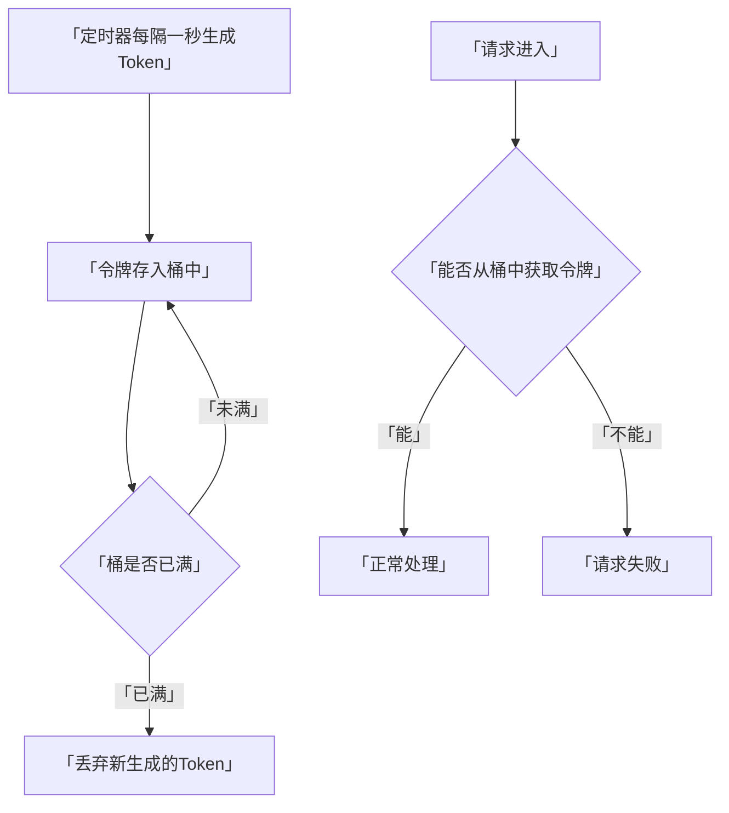

# 11-5-限流的实现方案有哪些

通过前面的学习，已经对熔断机制做了一点了解。来看限流的实现方案有哪一些。对于限流的方案，作为一个内容的理解，先从下面三个话题来讲解：第一限流的指标，第二限流的层级，第三限流的方案。

首先看限流的指标。对于限流来说，指标有很多种，比如说 QPS、并发数、响应数，以及 HPS、TPS 等等，这些都可以作为限流的指标。当然也可以选择让整个程序去监控服务器的内核的运行情况，及服务器之外的 CPU 的情况，也是可以。常用的话，就是 QPS、并发数这些。

达到限流的指标之后，根据限流的指标，再来看限流的层级。它的层级其实也有很多层，常见的可以分为三层。首先是在界面，在界面中可以用哪些限流手段呢？在大家抢购的时候，有些时候会需要输入验证码。验证码其实本身是一种保护手段，但在这种抢购的活动中，它又可以作为一种限流的方案，因为这个验证码的输入需要时间，会导致点击之后，用户最终请求到服务的时间肯定会被拖慢，因此这里其实就多了一层限流。然后再往下就是接入层，接入层可以通过 Nginx 中的限流模块来实现。再进一层的话，就在服务中，可以通过算法来进行实现限流。所以它从层级来说有很多层。再往下进到数据库中，也可以通过像消息队列来做流量削峰。所以其实层级是很多的，一层一层的往下走，流量会不断地被消减。

再来看一下在业务中，它的限流方案有如下：接入层 Nginx 限流，这个是应用比较多，也是比较简单的一种方案。在 Nginx 中，它本身就自带了 limit 限流模块，以及滑动窗口技术，这些在 go-zero 中都有实现了，都是可以去应用的。因此本集重点理解这三种方案的实现思想。

对于 Nginx 可以看一下在这个文档中，如下就是定义对 Nginx 配置的支持。在定义这些配置之前，一定要去确定 Nginx 是安装了 limit 这个模块，如果没有安装，那么这些配置是不生效的。limit 的配置分别是基于控制速率方式及并发数的方式来进行控制，下面是对于上面的参数的解释。

重点来看一下令牌桶与滑动窗口技术。先看令牌桶，它的特点是这样子：这里会有一个定时器，这个定时器的作用主要是生成一个 Token，它会每隔一定时间生成一个 Token，而这个 Token 是有一个数量限制，比如 10 个，这就是它的容量。正常来说，这个 Token 在一开始程序启动的时候，就预先生成了 10 个，这 10 个容量生成之后，就会在桶里面存放着。当有请求进来了，它就会从这个桶中去获取一个令牌，然后再通过这个令牌去进行访问。但这个令牌获取之后，此处它的令牌数由 10 变为 9。而这个定时器触发的时候，是有一个固定时间去生成，比如固定为一秒，去生成一个令牌。那么在一秒以内，下一个请求进来之后，它又会去获取，那就会是 8 个。当一下子短时间内进来了 11 个请求，但总只有 10 个令牌，此时 11 个有 10 个是正常通过，还有一个是不会的，因为它没有获得令牌。而令牌的生成是一秒生成一个，但目前是一秒以内就 11 个请求，很显然，它赶不上生成的数据，所以这第 11 个它就无法成功，就被丢弃。但是在 1 秒以后的第 2 秒，当这一个恒定的速率又生成了一个新的令牌，那么第 2 秒、第 3 秒的就有机会去获得到新的令牌，然后继续去放行。这就是令牌桶。

接下来看滑动窗口的技术。这个技术有一定的巧妙，它的特点应该记住的是：滑动、窗口这个技术。假设它是一个数据，怎么理解这个滑动窗口技术呢？首先先理解这个窗口。这是一个数据，这里有多个小的窗口，窗口的数量是可以定义的，即目前说有五个窗口。那么这五个窗口如何滑动呢？假设滑动是一秒滑动一次，它要根据时机来。滑动的时候，目前有五个窗口，它会计算这一秒，然后五个窗口平均多久滑动一次，计算结果就是 0.2 秒滑动一次。即每个 0.2 秒，这个窗口就会往右移动一格。但移动完之后，不是它增加，而是整个窗口保持五个窗口往右移动，所以下次移动之后，仍然还是五个窗口。然后到了 1.2，就是 0.2，那么这个 0.0 就会被折去，此时它计算的范围就是 0.2 到 1.2 这个范围内，这就是滑动窗口。

理解完滑动窗口之后，它如何去做到限流？关键就在这个窗口里：窗口数为 5 个，而要限流的数为 10 个，它的滑动数据是以 1 秒这个范围，即 0.2 滑动一次。现在假设这里是 0 到 1 这个时间范围内，目前它存在了 10 个流量，这 10 个流量在这个范围内，刚好比如都落在了 0.8 到 1 秒这个范围内，就有 10 个流量。现在当它滑动之后，有新的流量进来了，它会落到新的小窗口里面，此时这里已经有 10 个了，而它的阈值只能接收 10 个，这意味着一个事情：这里流量要被拒绝，因为它已经超过了这个阈值。那么什么时候又可以了？当这个窗口滑动到这个地方的时候，就可以接收新的流量了，因为这里已经满足了。所以所谓的滑动窗口的技术，就是指它会去计算在这个时间范围内，总窗口的请求数，当这个窗口整体的总的请求数超过了定义的阈值，那么新的请求就会被拒绝；直到这个窗口滑动之后，计算之后，它的总的请求数还未超过这个阈值，就允许请求进来。这就是滑动窗口技术。

关于这两个方法，也提供了 Go 的一个示例，可以看一下，这是关于令牌桶的，如下是关于滑动窗口的实现。可以自己去实践，测试看一看。重点就是理解这些方案有哪些，以及令牌桶和滑动窗口这两种的思想。
