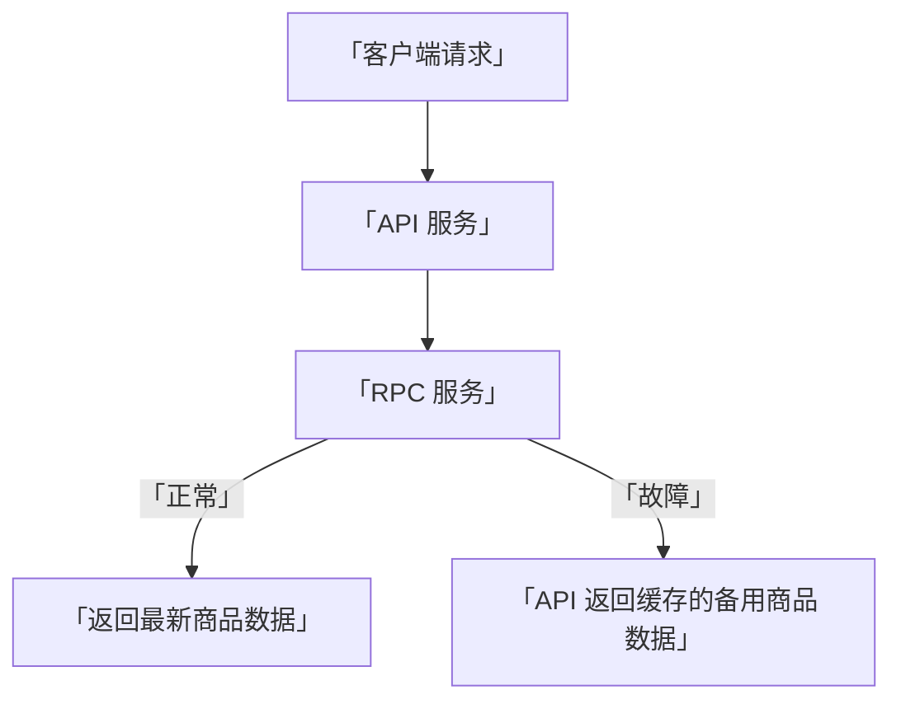

# 11-8-降级在架构中的类型有哪些

通过前面的课程学习，我们已经学习了熔断、限流。本节课程，我们会先理解降级，然后再分析降级的类型与注意事项。

## 先理解降级

对于降级，我们来看目前的例子。

在例子中，一个请求从客户端发出，正常来说会经过 API 服务，然后能够去访问到 RPC 服务，获取数据，进行返回。但是在这些场景下，它也可能会存在一些异常：在 API 请求 RPC 服务的时候，它会出现一些异常的情况，导致请求失败了。

这个时候，在业务上，我们提出一个新的需求：我们希望当前的程序能够给用户更好的体验，如果说服务出现了异常，我们能够给它返回出一些备用的数据。那么此时，这个地方就用到了降级的思想。

原本我们希望访问出最好的数据，但是因为访不到，我们就改为访问备用的数据。

举一个例子，以商品数据为例：在 RPC 服务中，它的商品数据是最新的；而在 API 服务中，它也会存放一份备用的商品数据。正常来说，它是要请求最新的数据。但是，因为 RPC 这里出现了故障，降一级，访问 API 所缓存的旧数据，然后返回给用户。这就是降级。

降级前后的对比如下：

## 降级的类型与事项

讨论降级的类型与事项，即降级的注意事项、降级类型、降级处理。

### 降级的注意事项

对于降级来说，我们得要考虑它什么时候降级，也就是它触发的条件。比如说是在任务超时的时候，或者任务出现错误的时候，或者熔断的时候，那么这些场景都是可以用到降级的。我们也可以在限流的时候用到降级，那么这些都是可以作为条件。

然后，在降级的业务上，也需要考虑。一般降级的业务的话，主要是针对读的时候，会应用较多一些。

最后，就是关于降级之后如何恢复。因为你降级了，它本身访问的数据是备用的，是应对突发情况所准备的数据，所以相对来说肯定会略有缺陷。因此，我们要考虑什么时候才能恢复成正常的情况。对于第三点，我们往往会结合熔断器来进行使用。

### 降级类型

对于降级类型，它其实有很多种，在目前上面演示的是四种：超时、失败次数、故障以及限流。这些场景，都是可以去应用到降级的。

我们以限流降级为例。在系统中，遇到大促活动的时候，像商品抢购这一个功能，以及商品列表展示它的访问量，肯定是比较大的。为了应对这种突发性的情况，我们可以选择让所有的资源向这个功能去进行倾斜，即关闭一些平时访问较小或者几乎不会被访问的一些服务功能，重点将资源面向于这个活动。当这个活动结束之后，我们又恢复成正常的情况。

那么在这个过程中，其实就是用到了降级：我们降低了对其他这些不重要的服务的访问，将资源倾斜给关键服务。这就是关于限流降级。

### 降级的处理

之后，再来看一下降级的处理。对于降级的处理，有页面级的降级，从原本的动态改为静态，这就是一种降级；也就是页面级降级、读写降级和缓存降级。甚至，我们也可以去依据层级来进行降级。

简而言之，其实我们把降级理解为是一种备用的方案，那么你就很容易理解了。而在程序中，我们往往是针对存在问题、可能会发生一些突发情况的场景，就会考虑到应用备用方案。那么这就是所谓的降级，其实它并没有那么的复杂。
