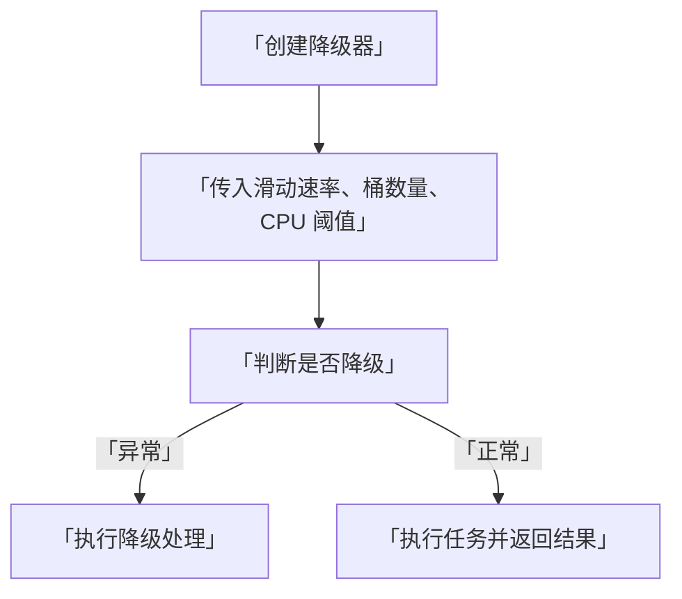

# 11-9-go-zero的自动降级特技应用

本节课程内容会对 go-zero 中的自动降级进行介绍，然后对它在项目中的应用来进行分析。

## 先了解降级模块

先进到代码中。在 go-zero 核心工具包中，这里有一个 loader 加载器，其下就有自动降级的实现：Adaptive Shedder。

在 Adaptive Shedder 中，就是对自动降级的具体实现。内容比较多，会放到下一集来分析这里面的实现。

然后在加载器下，有一个测试用例，可以通过对这个测试用例的了解，来学习自动降级的应用。

在当前的这个测试用例中，这里是创建降级的工具，在里面它传递了三个参数：第一个是滑动速率；第二个是桶的数量；第三个是降级的阈值。

这三个参数和自动降级本身的实现有关系。在 go-zero 中，自动降级的实现是基于滑动平均算法来进行计算的，简单来说，它是根据一段时间内 CPU 请求情况进行统计，然后分析，最终再计算出是否进行降级。因此，传递参数中就包含了滑动速率，然后 CPU 的阈值，由此就创建了降级器。

降级工具创建完了之后，会返回一个 shedder。这个 shedder 在其下就是具体的应用。在这一行中，它主要做的事情是判断是否进行降级：如果出现异常，那么是需要降级的；如果没有异常，那么就是下面的这一段任务的执行。

此处是模拟任务的执行，有一定的耗时时间，执行完之后，再随机的去给它一个新的执行结果处理：是成功或者失败，这个是随机的。

这就是整个测试用例。因此对于降级的应用，从代码的提取来看，关键性的代码就是这些：先是创建降级器，然后再验证是否降级，再根据请求情况来分别执行成功或失败。

自动降级的关键流程如下：

在其下，是定义对降级的测试用例。现在来测试一下，有一个 test，将此处的代码 push 上去。这一堆代码其实就是这里的测试用例，并没有特别的改变。

这是整个代码的内容：上面是 CPU 的阈值，然后休眠时间给大一点；这里是滑动的速率、CPU 的阈值。

现在来进行测试。测试要把它放到 Linux 上面去，不要在 Windows 上面进行，因为 Windows 会有一些意想不到的错误。放到 Linux 下之后，进到目录中。

这里的测试可能需要多执行一定的时间，因为在执行过程中，主要会依据 CPU 当前这一段时间的运行情况，所以多执行一段时间之后，就能出现：有一些请求不会进行降级了，因为当前这个时间点 CPU 开始繁忙了；然后在错误的信息中，它抛出的信息就有 CPU 的执行情况、最大吞吐以及响应的时间，然后就进入了降级的状况中了。

当然并不是所有的情况都会进到降级，前面也可以看到，有成功执行的。由此可以看到降级是成功的。

## 在应用中的使用

现在对降级模块已经做了了解，接下来看在应用中的使用。

go-zero 对降级的应用，分别在 API 和 RPC 中都有应用。进到核心代码层中查看。

先来看 API。在 API 中，它的应用主要是在中间件中，这里有一个 Shedder 中间件，在这里有定义一个降级器的使用。看一下它的方法，首先是验证是否传递降级器，如果不传递，那么就正常的执行；如果传递，那么通过下面的方法去进行启动降级，并设置在降级过程中一些数据的统计。

降级创建好之后，再进到下一个流程，就是执行具体的业务。业务的执行过程中，首先验证是否开启降级，在这一段就是去开启降级；而其下，这里会去获取一个 context 对象，然后根据 context 去验证当前在程序中这一段的执行，也就是业务的执行是否成功：不成功就执行下面这个（降级处理），成功就执行下面这个。

这就是自动降级在中间件中的应用，所以它并不需要额外的自己去配置。

这是在 API 中。在 RPC 中，也同样有自动降级的应用，进到服务的拦截器，再进到这里，这就是自动降级。在当前的这一个自动降级中，其上同样也是开启降级器，然后在其下，也和前面 API 的中间件的降级的编写过程是一样的风格。

因此其实 go-zero 在这里的应用，两者之间并没有特别大的差异：都是传递降级器，然后再以一个降级器去验证是否进行降级，根据请求情况之后，判断是否进行降级处理。

当然也可以自己去写一个降级。

值得注意的是，当前自动降级主要是在服务端进行应用，但是在客户端中是没有进行应用的，可以看到客户端拦截器是没有的。这主要是因为自动降级的主要因素在于，它会计算当前服务的运行情况、数据情况，然后再去进行降级，所以它其实是对服务端的保护，因此没有给客户端去设立降级。

在客户端中也可以应用自动降级，但应用的话效果并没有那么理想，一般的应用方式是结合熔断器。

在这里有一个例子，写法并不是特别复杂，就是这一段例子。看一下熔断器的方法：在熔断器中，这里是不是有 Done 方法？它的作用是在程序执行失败之后，它会去设置一个失败的计数。其实这里，它本身也可以作为一个降级的应用。

例子也并不复杂：像这样把业务放进去，然后降级处理，其实也可以叫失败处理，两者都是一样的意思。

到这里，其实已经对降级有了了解。整理起来，这就是关于 go-zero 的降级。

如果一定要在客户端中去编写降级器，这里提供的示例，实现的过程和服务端是一样的：定义一个降级器，然后来实现下面的这一段流程。可以将其复制，再重新定义一番。这是针对 RPC 客户端所定义的，这里可以处理一下异常的处理，这个异常的处理主要是使用了 go-zero 在熔断器中 gRPC 错误码的方式。

从代码的结构来看，与前面分析 RPC、API 的拦截器和中间件的时候是一样的过程，唯独增加了更多的一些打印，也就是调试设置。

设置的时候，进到这个服务中，进到 ServiceContext 进行应用。比如在这里，就使用引用刚刚所定义的降级器方法，然后它的阈值、滑动速率和桶容量这些信息，可以将其同步到服务器中进行测试，看一个效果。

将代码上交到服务器之后，分别启动好对应的服务，目前已经启动好了。现在就要进行测试，进到 API 的调试页面，在这里来进行压测。进行完之后，来看一下控制台：在当前的控制台中所出示的，这里就有降级，然后可以看到这个请求就进入到降级了；除了进入到降级以外，同时还有正常的请求在执行。

注意：当前降级的应用在于客户端的拦截器中；而在 go-zero 中，自动降级主要是基于滑动平均算法，是依据 CPU 及请求成功等这些信息来进行计算的。所以在客户端中使用这个自动降级的时候，它也会因为其他请求的关系，导致这个自动降级计算 CPU 的时候会存在一定的误差。

整体来说，在客户端中，对于降级的应用，推荐使用的是熔断器这个方式，因为在成功之后或者失败之后，再来进行相应的任务的处理，这样的话更符合于在客户端当中的使用。
