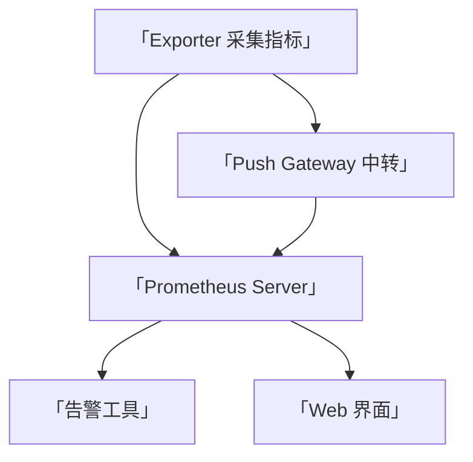

# 12-10-如何实现对各个服务的性能监控？

本节先了解 Prometheus，并了解 Prometheus 的架构。

## 先了解 Prometheus

对单体架构来说，监控并不是很难的事情，直接通过云平台的工具就可以监控，并不复杂。但在微服务的情况下，各个服务部署于多台机器上面，监控起来就很难了。所以这里会面临一个问题、一个挑战：对多个服务去监控的挑战。

为了解决这个问题，业界提出了一套规范的方案：Prometheus。它是一个开源的系统监控和报警的工具包。它可以监控 CPU 指标、内存的使用情况、I/O 等等，这是对系统监控；也可以针对应用程序监控，比如 HTTP 请求时间以及内存分配的使用情况，这些都是可以监控到的。所以它的监控范围包括系统层面和应用程序层面。

提到这个话题，就不得不简单谈一谈 Prometheus 与 ELK 这套架构有什么区别，毕竟它们具有相似点：都能够监控各个服务的信息。前面也提过，可以通过 Beat 这一套工具监控服务器的运行情况，所以 ELK 本身也可以做监控这件事，因此有必要对比一下。

第一个话题是数据类型。Prometheus 主要监控指标数据，例如系统资源的利用率、性能指标，以时间序列来存储；ELK 主要做日志分析，通过 Logstash 搜集。所以两者在数据层面是有区别的：Prometheus 更关注数据的指标、数据具体的值；ELK 则根据 Logstash 搜集的信息去分析。

但它们都是监控型的系统。ELK 本身是以 Elasticsearch 作为查询领域；Prometheus 则用 PromQL 作为查询语言。PromQL 专注于时序数据，以时序数据作为要素进行监控，所以查询领域不一样。

结构方式上，Prometheus 采用 Pull 的方式，而 ELK 的 Push 也是可以的。

另外，两者也具有各自的优缺点：Prometheus 的优点主要是高效的时序查询；ELK 的强大在于数据分析，因为 Elasticsearch 本身专注于数据分析这一块。两者的领域存在一定的差异。总的来说，Prometheus 是监控具体的数据指标的。

## Prometheus 的架构

接下来重点是 Prometheus 的架构。架构图可以看官网，官网中有对它的描述。

在这个架构图中，列举了各个组件。

Prometheus Server 是它的一个服务，也就是 Prometheus 的核心，主要实现对监控数据的获取、存储以及查询这些事项。

数据的来源从哪里来？从 Exporter 这个工具来。Exporter 是一个采集工具，会采集相关的信息，与之前 ELK 中的 Filebeat 有相似性，会采集出相应的指标数据，然后推送给这个服务。采集方式有直接和间接两种：直接类型指这个工具内置了对 Prometheus Server 的监控支持，也就是软件本身就支持了它；间接类型像 MySQL，它是无法做到直接性的，因为 MySQL 已经成型了，再去做这个事情就比较麻烦，所以采用间接的方式。

再看上面的 Push Gateway（Push 网关），主要应用于 Exporter 与 Prometheus Server 在进行交付时，如果因为网络的关系无法满足，就可以通过它来中转：Exporter 先推送给这个网关，再由网关推送给核心，所以这里存在一个中转的关系。

还有一个工具是告警工具：在里面配置的某一个指标超标了，就通知对应的用户。发送方式有多种，比如像邮件的方式发送。

最后是一个 Web 界面。

总的来说，它有一个核心，加一个采集器，加一个中转，以及一个告警，还有一个 Web 界面，这就是它几个组件的功能，即 Prometheus 的组成。

Prometheus 各组件的功能与关系如下：

整体来说它的架构并不复杂，上面是对于 K8s 的支持。更多的信息可以通过官网了解，官网中也有相关介绍，这里主要对它的架构做了解。
