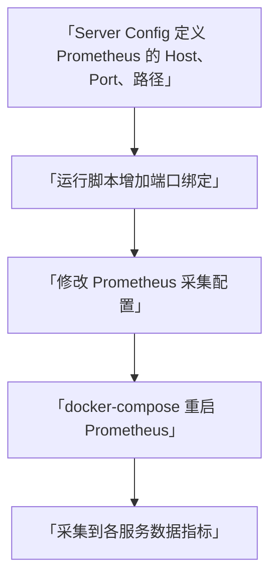

# 12-12-实现对im通讯服务性能的监控

前面的课程中已经安装好了 Prometheus 与 Grafana，本节使用它们来对项目进行监控。

课程内容分为两个话题：先理解 go-zero 中的 Prometheus 组件与数据采集器，然后配置好 go-zero 中的配置信息，实现对项目的监控。

## 先了解 go-zero 中的 Prometheus 组件与数据采集器

打开项目代码，进到 go-zero 的核心代码库中。打开核心工具包，根据之前的源码分析，在服务启动的时候，都会调用到服务的初始化流程，对配置信息进行初始化。初始化的过程包含日志、链路跟踪，其中也包含 Prometheus 初始化。

这次初始化主要做的事情，就是调用 Prometheus 的 StartAgent 方法。这个方法的事情并不复杂：主要就是启动一个服务，并且为这个服务提供一个对外响应的接口，用于接收采集数据，这个接口就是 Prometheus 采集数据的接口。过程并不复杂，在这里就已经被初始化了。

然后在配置中，如果没有去设置 host，那么它不会去配置这项操作。

而在 Prometheus 组件中，可以看到它非常简单，只有一个 host，还有一个配置文件。

那么数据采集在哪里？就在上面的这个 metrics 包中。这里提供了针对数据指标采集的规则，这是它的初始化，然后这里还提供了相关的测试用例。

接下来使用它们，进一步了解 go-zero 的 Prometheus 与 metrics。

打开这些测试用例，将这一份测试注释掉，重新创建一个 main 方法。需要使用 go-zero 的 Prometheus 与 metrics，那么自然要先初始化 Prometheus，里面要传递好参数，这个参数是 Prometheus 的配置文件。在这个配置中，首先定义的是 host，然后是端口，以及监听的路径。

初始化完之后，是数据指标的采集器，也就是这个 Gauge。在整个 go-zero 的核心代码中都有调用到进行使用。源码在前面的课程中已经分析过，这里就不再展开，直接使用它来进一步实践：它会返回一个 Gauge，是 metrics 包中的，里面传递的参数是 metrics 的 Gauge 的参数信息。这里的参数信息其实和下面的参数信息是一样的，可以将其复制引用过来。

引用过来之后要注意：这个名称不能使用中文，这里要注意。然后就定义了一个 Gauge。

定义完之后，后面的处理与此处一样，也同样将其引用过来，就写完了。

写完之后将其同步到服务器中重新运行，可以看到这个信息，说明运行成功了。在这里它没有成功，主要原因有一个：之前的服务已经停止了，所以它在检测的时候，认为它是下线了。可以等待一段时间，它能够自动上线。可以看到它上线了。

要注意：此处的上线与下线，不是说 Prometheus 本身的上线下线，而是 Prometheus 会请求这个路径地址，发现它存活了，才会标记为上线或下线。之前为下线的状态，是因为已经将原来的这个服务停止了，它请求失败，就认为是下线。但它会隔一段时间请求一次，所以等到这一次请求时服务启动了，就证明是成功的。

来看一下这个信息，查找 go-zero，在这里就有所定义的 go-zero 的数据指标。除此之外，还有一些其他关于 Go 运行时的数据指标信息。

目前就基本上对 go-zero 的 Prometheus 与数据采集器做了应用。现在就能去配置系统服务了，怎么配置？

## 在 go-zero 项目中配置监控

在基于 go-zero 的项目中使用 Prometheus 非常简单。前面已经通过源码了解到，Prometheus 在这里就已经进行初始化，而在此处它会得到一个配置文件，这个配置文件就是 Server Config 内置的配置文件信息，在这里定义了。所以使用不复杂，依据这个配置文件信息的内容来进行定义就可以了。

进到配置中心中，也选择 user API 为例，往下定义一个 Prometheus，填上 Prometheus 的配置文件信息：Host、Port 以及路径。先定义的是 Host，然后是端口，以及路径。因为目前是结合项目，所以示例中的 1234 这么个端口不太合适，要根据自己项目的端口来实际定义会更合适一些。比如说这是当前为 user 服务给 Prometheus 的项目提供的端口。

定义完之后，还需要做下一件事：需要让多个容器也能够支持这个端口的开放，所以还需要更改运行脚本，在运行脚本中增加这个端口的绑定，这样才能够使用。

现在将其同步到服务器中，然后进到宿主机的环境中，重新去重启 user API 服务，执行这个命令，执行完成。

现在还要做一个事情：修改 Prometheus。进到 Prometheus 的配置文件信息中。目前测试的是示例程序，现在要进行自己的项目，因此这个配置文件自然也要更改。可以选择将其复制放在下面，将这个任务名更改完成。但其实还有很多其他服务，比如 user、RPC、社交 API、社交 RPC、IM 的 RPC、API 以及 WebSocket 的服务等等，这一系列也是一样的过程。

将其同步到服务器中，再重新启动 Prometheus，通过 docker-compose 进行。完成之后，进到 Prometheus 的界面中，这里就增加了一个 user API 的服务。刷新一下页面，Prometheus 就访问到了定义的这个服务信息，也能采集到它里面的数据信息了。

在 go-zero 项目中配置监控的整体流程如下：

我们可以结合 Grafana 来分析 Prometheus 采集的 go-zero 中的这些数据。go-zero 中采集的数据主要包含哪些？有 HTTP 请求的信息，也有 RPC 调度的信息。

点击此处，创建一个 Dashboard，选择 Prometheus，然后选择 RPC 或者 HTTP 请求，这里选择 HTTP 请求。可以看到这是运行之后的结果，就能看到各个请求的数据情况。时间这里缩短一点，改为五分钟。也可以多次请求相关的服务，让它获得更多的数据。请求完之后再运行，就能看到更多的相关数据结果。这是 HTTP 请求，这是一次请求之后的结果。

除了这样的方式以外，业界中还提供了一个更好的集成化界面。点击此处，相当于更为丰富的仪表盘模板。这里有一个 ID，这个 ID 指示什么内容？此处有一个链接地址，点击跳转之后，会进到这么一个界面。在这个界面中，它是针对 Grafana 所定义的一系列集成式的仪表盘。我们只需输入 Grafana 的 ID，即要使用的 Grafana 仪表盘，里面就对 Grafana 中的一些相关信息进行分析，构建仪表盘的处理。所以对于这个仪表盘的创建，可以直接使用这个模板。

然后这里有个 ID，将这个 ID 引用过来，加载，在下边选择数据源为 Prometheus，选择完之后再导入，就可以使用到这个仪表盘的模板了。

这里面的数据，一方面和这里的时间范围有关系，可以适当地给它增长；另一方面和内部实际的查询有关系，可以立即编辑。它默认选择一分钟，可以增加时长改为一小时，这个时候就有数据图了。同样的道理，其他的也更改一下时长，也有了。然后再把其他图一一更改。

这时候调整后的结果，在这个模板中就分析了 RPC 在代码执行中对自己的项目的情况以及响应的情况，也包括了 HTTP，所以它的分析相对较为全面。大家可以直接使用这个模板，结合自己的项目来进行分析。

基本上，就已经使用 Prometheus 对自己的项目进行监控了，本节的核心到这里就完成了。课程内容中首先理解 go-zero 的 Prometheus 组件与数据采集器的使用，然后再结合自己的项目来进行分析。大家也可以在最后的过程中应用它对自己的项目来进行分析。
