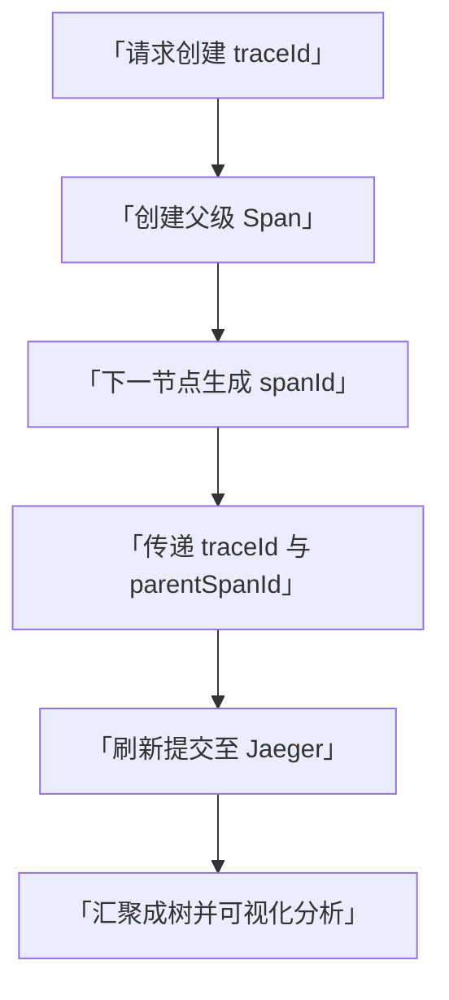

# 12-15-本章总结

本章（第 12 章）的重点有三个核心：链路跟踪、日志搜集、系统监控。这三个核心都是针对项目在部署运行之后，运行过程中所存在的问题，对日志信息及内部的数据情况进行搜集、跟踪，然后进行分析，帮助更好地维护和监控项目。

## 链路跟踪

先看链路跟踪。链路跟踪的主要作用是帮助定位问题的产生，比如在第七个环节出现了问题，应当如何分析？在单体项目中，可以根据 debug 进行调试，就可以跟踪到问题了。但当项目发展到微服务的时候，这就是一个很难的事情。此时就需要针对整个请求的调度链来进行跟踪，再根据调度链过程中存在问题的节点进行记录，来定位问题、进行分析。这就是链路跟踪的作用。

对于链路跟踪，目前的业界实现主要通过 OpenTracing 这个规范的定义和实现。OpenTracing 是一个跨平台、多厂商的 API 规范，可以理解为链路跟踪的一种标准、一种规划。OpenTracing 的官网中介绍了它的数据模型，将每个 Span 的数据信息及 Span 引用等做了一定的规划，这是关于 OpenTracing 的数据模型。

对于 OpenTracing 的实现，目前的开源产品是 Jaeger，go-zero 默认也是使用 Jaeger。图中展示的是 Jaeger 的组件，可以通过它的官网更好地详细了解。它的组件中包含几个信息：它负责收集链路跟踪的 Span，并进行数据处理；处理完之后，会存储数据；数据存储之后，通过它进行查询，并且会提供一个 UI 界面，用户就可以通过 Jaeger 查询到链路跟踪的数据，来分析问题。左侧这一块是 Jaeger 客户端，主要用于收集相关的 Span 信息。这是它的整个组件，应用并不复杂。

对于 go-zero 的使用，非常简单，只需要在配置文件中定义这一份配置，就可以使用到链路跟踪了。链路跟踪在 go-zero 中使用十分简单，但仍然需要知道具体该如何走。课程中提供了一个应用示例。在示例中，go-zero 在链路跟踪的实现，第一步就是进行启动，通过创建 Span 的这个方法来进行启动。

启动之后，当请求进来了之后，在此处就获得一个 Span，它是一个父级的 Span。获取之后，要注意 Span 的刷新。不过要注意，此处刷新的时候，是属于异步的、协程执行的，在测试的时候要注意做好阻塞，让它能够切换到协程来运行。

而对于跨进程的时候，它会根据在 Header 中所传递的这个 traceId 和 Span 的 ID 去获取，获取相应的 traceId 和上级的 SpanID，从而生成自己的 SpanContext，然后产生自己的 Span，并进行刷新，提交到 Jaeger 中。

因此，这里要注意理解好创建 Span 与刷新 Span 的过程。这样的话，再看 go-zero 内部的实现，就能更容易理解它具体是如何应用的。

链路跟踪的关键流程如下：

## 日志的收集

再来看日志的收集。日志收集主要基于 ELK 的架构，它的价值是比较大的。在分布式的体系中，日志有很多种：MySQL 有日志，Redis 有日志，自己所开发的程序也肯定有日志，Nginx 也是有日志的。各个日志的信息都比较分散，而且日志的查看也较繁琐，所以能够将分布式下各个日志的信息收集起来进行相应的分析，对分布式这样的项目来说是非常重要的。

对于日志的收集方案，业界中主要通过 ELK 三件套来实现。E 主要是指 Elasticsearch，K 主要是指 Kibana，然后 Logstash。它们的配合使用过程中，对日志本身最直接的收集，通过 Beats 这一套系列的程序来采集。Beats 这一系列程序采集之后，会将日志信息推送至 Logstash，当然也可以直接推送到 Elasticsearch。至于如何选择，主要取决于是否需要对日志信息进行过滤或处理。如果需要对日志信息进行过滤处理，那么推送到 Logstash 是最合适的，然后再通过 Logstash 推送给 Elasticsearch。这就是 ELK 三件套的处理过程。

在这三件套的处理过程中，需要记住的重点是 Logstash 里面的语法，相对难点的就是 Grok 语法，要注意。另外，在采用 Beats 这一套系列工具采集的时候，要注意在 Beats 中定义好对日志区分的标识字段，这样在 Logstash 中就可以区分各个日志类型，进行相应的匹配及输出。这是非常重要的两个地方。

## 系统监控

最后是关于系统监控。对于微服务来说，服务拆分了很多，而服务之间内部的运行情况、运行指标，也需要去进行监控。如果某一些指标过高，可能要做一些扩容或缩容的处理，所以这一项事情也是非常重要的。

对于系统的监控，它有很多的信息，比如 CPU 的利用率、内存的使用情况、QPS、流量等；而对应用程序来说，就是 HTTP 请求、内存分配使用情况等。所以可监控的信息相对而言是很多的。

目前的业界中，主要通过 Prometheus 与 Grafana 这个解决方案来实现。Prometheus 的主要职责是承担对数据指标的采集；Grafana 则针对 Prometheus 所采集的数据，提供一个展示、分析的平台。其实底层还是通过 Prometheus 中的方式来进行分析的，只是 Grafana 会更好地展示出分析之后的结果，能够更直观地看出相关的问题。所以这两者在目前的业界中经常配合使用。

而 Prometheus 在数据的采集上，主要通过直接和间接的方式采集。如果是自己编写的程序，推荐用直接的方式，因为这样可以更好、更准确地采集到相关的数据。直接的方式主要是需要服务端，比如采集的目标服务，需要自己对外提供一个 API 的接口，能够让 Prometheus 访问到这个接口，并采集好相关的数据。间接的方式则是针对目前已经成熟并运行的程序，如 Redis、MySQL，在外部提供一个相应的定制化的程序来采集，并提供给 Prometheus。

在数据采集中，需要注意的一点是它的配置文件：在配置文件中，要定好采集的目标、采集的请求地址和服务地址。

另外，就是了解好 go-zero 对 Prometheus 以及数据指标的使用，这样也可以在自己的系统中适当地运用数据指标，定制化地采集想要采集的数据。因为默认来说，采集的是 go-zero 内部的核心指标，所以数据采集器的使用，有助于在项目中满足自己的需求，定制化地采集相关的数据结果。

当数据采集之后，就可以通过 Grafana，采用 Prometheus 的数据源，构建好相应的仪表盘信息，展示相关的数据结果，比如说 RPC 的调度、HTTP 的请求，这些信息都能够展示出来。它能够间隔一定的时间进行刷新，更新相应的结果。然后自己也可以通过这个平台查看项目的运行情况，这就是关于系统监控。

总体来说，第 12 章针对的是项目运行过程中的情况、数据、监控和分析。
