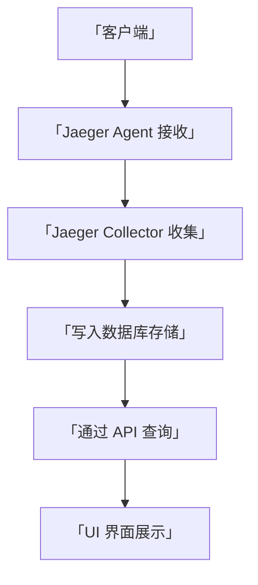

# 12-3-OpenTracing与jaeger理解及安装

关于链路跟踪的实现，本节讨论 OpenTracing，并安装使用 Jaeger：先理解 OpenTracing，再对 Jaeger 进行介绍并安装，最后做一次实际应用。

## 理解 OpenTracing

OpenTracing 通过提供平台无关、厂商无关的 API，可以理解为分布式系统的一套规范，它约定了目前业界分布式跟踪的标准和要求。可以把它类比为链路跟踪的 RESTful API，两者具有相似的特点，都是一种规范约定。目前市面上绝大部分链路跟踪软件都会实现这套规范。

接下来理解它的数据模型。这套模型在官网文档中做了详细定义，模型如下。

这个模型与前面的链路跟踪流程最为相似：A 作为一个节点、一个事项，可以理解为一个服务；下面是它调度的 B 服务和 C 服务；B 服务又会调度 D 服务；C 服务则调度 E 和 F 服务。每一个服务都会作为整个链路的一个节点，称之为 Span。这个节点不仅仅是服务，也可以理解为对数据库的查询。

在这个模型中，它的组成主要通过 Span 之间的引用，依据 Span 在整个调度中的记录，构建出调度过程。信息中约定了操作名、开始时间、结束时间，通过这两个信息就可以确定一个请求需要多久、是否包含耗时任务，后台可以基于收集的信息进行分析。除此之外，日志、标签等相关信息也做了约束。还要注意，一个 Span 的 context 作为整个过程的上下文，这就是 OpenTracing 的数据模型。

Span 之间的传递主要通过 Span 的 context，具体要看场景：进程内部的传递，比如父子模型之间记录的传递，通过 Span 的 context 传递；跨服务时则通过 Header（头部）传递相关信息。本地解析时同样通过 Span 的 context 获取并解析，因为双方约定了头部传递信息的格式。整体来说，传递过程中的信息获取基本上都通过 Span 的 context 来进行。

这里还强调了父亲和子女的关系。以上述流程为例：请求往上走，A 服务作为 B 服务的上一级，也就是它的父亲；B 服务对 D 和 C 服务的调度，则让 D 和 C 成为 B 服务的子女。根据调度过程会绘制成流程图展示，这就是 Span 之间的引用。过程中需要注意 Span 的参数信息，以及它们之间的关系。

## Jaeger 介绍与安装

Jaeger 是由 Uber 开发的开源分布式跟踪系统，前面已经介绍过。它具有分布式跟踪和分析功能，可以基于它做故障排查和优化。它本身遵循 OpenTracing 规范，规范保证了信息传递的可行性，并且具有高度扩展性，这是它的特点。

再来看它的结构，官网中有相关介绍和组件图。图中有几个关键信息需要注意：OpenTracing 的 API，由各个语言实现 SDK，支持的语言很多。

还有代理（Agent）。可以理解为过程中开启的一个 Jaeger 接收程序，接收客户端推送的链路跟踪消息，发送给核心程序，即 Jaeger 的收集器（Collector）。收集器将收集到的信息写入数据库，通过 Jaeger 提供的 API 进行查询，同时提供一个 API 界面。此外还有一些负责维护数据的组件。

Jaeger 各组件的协作关系如下：

安装方面有两种方法：第一，直接通过 Docker 安装；第二，通过 Docker Compose。这里选择 Docker Compose，将其引入编排文件。在这个项目中放到最后，部署到服务器上。

目前服务已经部署完成并正在运行。通过访问 API 对应的端口，就能进到服务中，至此可以确定当前系统已经安装成功。

## 编写链路跟踪示例

安装完成后就可以使用它。使用前需要先在程序中添加两个包，然后定义对应的测试用例。

先定义一个测试 Jaeger 的测试方法。方法中首先定义 Jaeger 的配置文件，引入相应的包并填写信息。配置中主要需要定义两项：一是取样器（Sampler），定义收集的信息、信息类型，设定取样器类型以及参数；二是定义信息发送给哪个对象，即 Jaeger 的服务器对象，包括日志 Span 是否开启，以及服务器地址。

当前的请求基于 API 方式发送，这里的信息实际是 API 的 traces 上报接口，即服务器地址加上端口 14268，也就是在服务器中定义的地址，配置就定义好了。

然后创建 Jaeger 的客户端，通过配置的方式进行初始化。这里的初始化实际是初始化全局 Tracer：它会把自己的信息注册到 OpenTracing 中。初始化时第一个参数是服务名，第二个参数是日志格式，做相应处理。注意开启之后要关闭它，至此初始化完成。

接下来执行任务，第一件事是得到 Tracer。这里不再通过 Jaeger 获取，而是通过 OpenTracing 的全局 Tracer 方式获取。为什么上面通过 Jaeger 初始化，下面却通过 OpenTracing 获取？看它的源码就清楚：OpenTracing 提供了设置全局 Tracer 的方法，Jaeger 初始化时把对象设置到 OpenTracing 中且是全局的，因此从全局中获取即可。

然后定义当前的任务节点，即父级 Span，开启一个 Span，定义为 A。定义完之后注意，需要把它刷新到服务器上，所以要有一个刷新（Finish）。

还需要定义一个 B 方法作为子级任务，参数是 OpenTracing 的 Tracer 以及父级的 Span，并在上面调用 B 方法传递参数。B 方法的作用是创建子级 Span，同样调用 StartSpan 方法，传递一个 B 作为名字；第二个参数是 Span 的 OpenTracing 设置，在里面需要设置它是子级，因此要把父级的 context 传递进来，最后刷新（Finish）。

之后运行测试。第一次运行发现服务器地址不正确，因为是不同的服务器，重新配置后再跑就没问题了。可以看到输出中包含启动时的 debug 调试信息，并分别有两个 Span，第一个 Span 和第二个 Span 都成功上报。

进到可视化界面刷新，这里就会出现两个服务，可以看到当前自定义的服务和请求的服务信息：code1 code2 以父子迹的方式排列起来。

至此链路跟踪的小示例就写好了，并不复杂。本节的重点是理解 OpenTracing 这套定义规范，掌握 Jaeger 的使用，并构建了这样一个示例。
