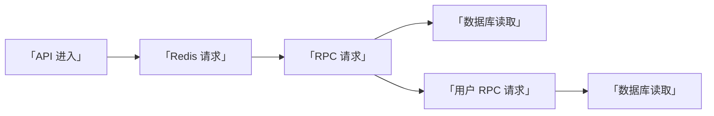

# 12-4-基于jaeger实现消息群用户列表的链路跟踪

Jaeger 已经安装好并构建了相关应用，本节基于用户列表这个功能来做链路跟踪。先了解 go-zero 的 trace 机制，再基于用户群信息展示链路跟踪。

## go-zero 中 trace 的初始化

先看第一个点，go-zero 的 trace。进入 go-zero 的核心代码库，其中有一个 trace 包，trace 中提供了一个 StartAgent 方法，在启动 API 服务、RPC 服务的时候，都会调用这个方法来初始化整个配置。

整个初始化过程中，有一段就是对 trace 做初始化。过程中要求传递一份配置信息，这份配置信息中定义了 trace 初始化的相关参数。通过这个配置可以大致了解到，如果要在项目中应用，只需要定义这个配置文件就可以了。

以 RPC 为例看 go-zero 中的引用。RPC 服务当中已经有对 trace 的引用，内部已经引用好，不需要额外配置，只需定义好配置信息即可。

## 在项目中应用链路跟踪

接下来在项目中应用。应用并不难，直接在配置中心中配置即可。先进到用户的 RPC 中定义配置信息，只需要定义三个信息：当前服务名、采样率，以及 trace 的地址和服务对象类型。

将这份配置信息复制一份，放到涉及到的 API 和 RPC 中做同样编写，然后在涉及的 RPC 中保存。

配置文件定义好之后，要确保服务能够启动。由于整个服务已配置了自动更新，配置更新之后会自动重启，不需要手动重启。

## 验证链路跟踪效果

请求服务之后进到界面刷新，可以看到有四个服务，其中就有涉及 API 的请求。有新的请求时，都会自动聚合起来。

在整个链路中可以看到，链路跟踪了 API 进入，然后是 Redis 请求，再到 RPC 请求；RPC 请求过程中也有数据库的读取；接下来又跟踪到用户 RPC 的请求及数据库读取。这就是完整的链路。

本次链路跟踪的完整链路如下：

使用其实并不难，配置好就可以正常使用。分析过程中它会展示一个请求需要多长时间、每一个请求多久完成，可以据此做后期的性能分析以及问题定位。

通过这个例子，结合 Jaeger 就实现了项目的链路跟踪。
