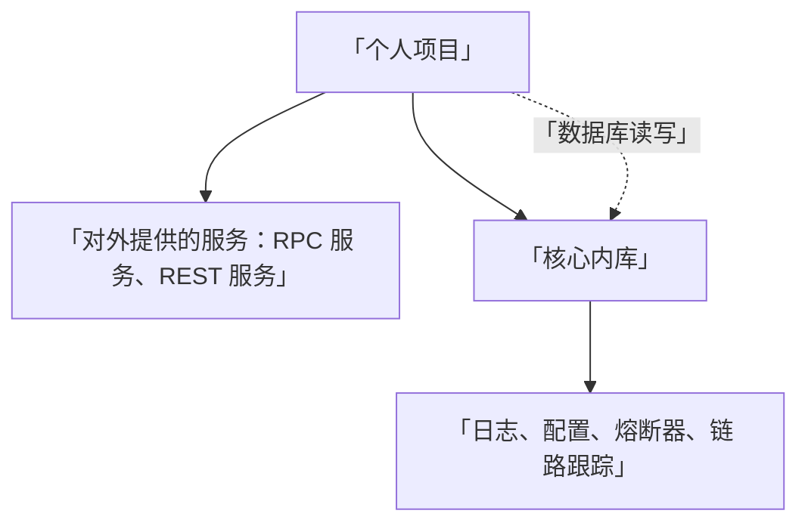

# 13-2-框架的构建核心结构设计分析

本章主要是构建一个微服务的框架。本讲主要讨论这个框架的核心结构设计。

对于一个项目来说，目录的规划设计是非常关键的，也是非常重要的。它可以提高代码的可维护性、扩展性、可读性，让我们更容易理解并定位代码，能够减少开发中的混乱和错误。所以目录的设计尤为重要。

对于目录的设计，在目前的项目中通常采用如下的方式：比如分层结构，根据功能来进行分层，构建出控制层、服务层、模型层。除了功能以外，也会根据业务来划分各个模块以及模块对应的层级。在项目的开发过程中，会有一些公共的方法、公共的组件、公共的操作，会将其封装起来，构建一个通用的组件，供整个项目使用，配置也是一样的。这是项目中会用到的方式。

但在设计一个框架的时候，应该如何设计？为此可以参考开源程序是如何设计的。

图中有两种设计：左边是 go-kit，右边的是 go-micro。go-micro 这种是比较典型化的，很多框架都会采用这种风格。

先来看这种风格。在这个风格上，这里属于工具包，这里属于对外提供的属性方法，它们都属于同级的关系，最多是在同一个根目录下。在平时项目的调度过程中，会先调用到同级下的这个包中的方法，比如以创建服务为例，就会调用 server 包中的 NewServer 的方法，以此创建服务。但其实 server 包本身也会去调用到相应内库中的方法，来完成具体的事项，比如配置，那肯定会调用到配置相关的包。而对个人的项目来说，也就是自己写的项目，也同样可以使用到这些内库包来完成相关的事项。

这一种方式在 gRPC 的根目录中采用得比较广泛，这是 gRPC 根目录的结构，这些都是 gRPC 的核心内库包。

## go-zero 的结构设计

接下来是对外提供相应服务的封装。下图是属于 go-zero。在它的结构中，从大体的结构上来说，可以分为两层：第一层是核心内库，第二层是对外提供的服务。核心内库包含了比如日志、配置、熔断器、链路跟踪等这些处理，都在核心的内库包中。而服务则有像 RPC 服务和 REST 服务这两种。go-zero 这种代码层次来说，它是分为了三个大的包。

在个人项目的调度过程中，会先调用到服务中的方法来创建对应的服务。过程中也有一些功能，可以调用到内库包中的相关方法来完成，比如数据库的读写，那就需要用到内库工具包中数据库处理的方法。这是 go-zero 的设计。

go-zero 的两层结构设计如下：

另外在 go-zero 中，对于核心服务来说，它有基于 gRPC 的实现。gRPC 的特点是面向内部的业务。点开它的内库代码可以看到，gRPC 的目录结构就是它的核心业务的实现，而且同理下来则包含了对外提供服务的服务端。

那么在项目中可以基于 go-zero 来构建，因为课程的重点就是分析 go-zero 这款框架。

## 构建项目结构

现在来构建相应的项目结构：首先是核心库，用于存放核心的内库；同时定义一下 zrpc，代表是对 RPC 服务的处理；在同一层下还定义一个目录作为示例（example），因为肯定要进行测试，所以在这里定义一个示例。当 server 服务或客户端服务创建之后，就可以在示例中进行相应的处理。

本讲主要构建框架的核心目录结构，同时理解目前业界中目录结构这一块的设计。
