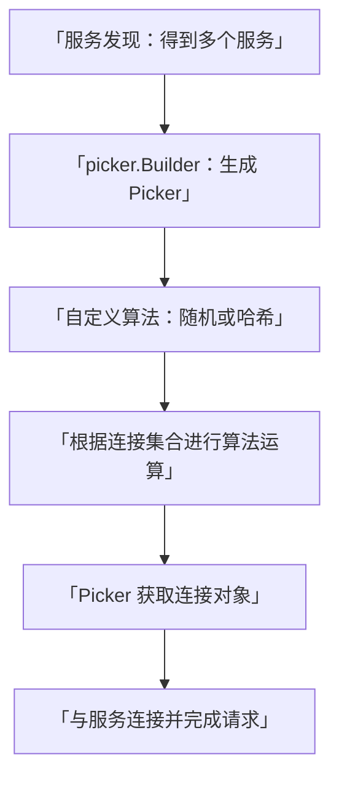

# 13-7-集成负载均衡机制

本节来集成负载均衡机制。对于负载均衡机制的集成，会先分析该如何做，然后具体实现。

## 负载均衡的分析

先看分析。在之前的分析中，负载均衡是属于服务发现之后：对于服务发现来说，它可能会发现很多个服务，当发现多个服务之后，到底选择哪一个服务进行访问？在此处，负载均衡就会有一定的算法，比如哈希、随机，再通过算法得到一个要访问的目标服务之后，再去与服务进行连接，并完成相关的请求。

在之前的源码分析流程中，这里是属于 gRPC 的服务发现与负载均衡的相关流程图。在图中，内容是非常庞大的，上面这里是对外提供服务的入口，接下来才是具体的核心。在整个流程中，需要实现的最为关键的就是这个地方的这两个接口。而 go-zero 也是选择实现上面这两个接口。在实现这两个接口的时候，同时它还使用了 base balancer 来协助构建。我们现在也需要定义服务发现机制，因为是基于 gRPC 的核心机制的关系，所以也需要实现这两个接口。

对于这两个接口该如何实现？可以看这里有一个代码示例图，当前就是对刚刚描述到的两个接口的示例代码。picker.Builder 的主要作用是生成 Picker，而 Picker 的主要作用在 gRPC 中就是通过它来获取连接对象的，这里会返回一个连接结果，就是连接对象。

现在需要定义一个 picker.Builder，这个 picker.Builder 可以是一个固定的。现在的需求是只需要扩展算法就可以了，不需要考虑连接的过程。那么这个时候，这个 picker.Builder 的主要作用就是实现并加载多样化的算法。而多样化的算法又如何很好地扩展？在这个 Builder 中，它会封装一个信息，即上面的这个连接信息中的连接集合，一个非常关键的信息，然后自定义的这个算法根据这个连接集合来进行相应算法的处理，在这个 Picker 中进行算法运算。

所以在当前的这个实现代码中，此处就定义了一个方法类型，其实这个方法类型就是上面的这个 pick 的方法。通过 Builder 得到这个连接集合，在代码上用该方法创建出 Picker，然后在 gRPC 中就可以用这个 Picker 方法来获取对应的服务。这就是代码上要做的设计。

负载均衡的设计思路如下：

## 编写负载均衡代码

了解完之后，接下来编写代码进行具体实现。进到代码中，首先在核心目录中创建一个 balance 包。先定义当前的这个连接，这个连接是属于自己框架中使用的，它会根据这里封装的信息来进行解析、适配，所以先定义好这个对象，然后再写下面的方法。定义好这个对象，在对象中它会得到连接地址，然后有连接，这是 balancer 中的连接属性。

得到之后，接下来还要做一个事情，定义一个 Balancer。先定义一下这个 balance 包，定义一个变量名称，这个变量的作用主要是用于注册到 gRPC，因为需要把自己的机制注册到 gRPC，所以要给这一个机制取个名称。然后再定义一个方法类型：picker Builder 的方法，封装一个 balance.picker。定义完成。

接下来就要定义 picker.Builder。定义一个 picker.Builder 的属性，然后需要使这个 picker.Builder 实现这个 Build 的方法，同时还提供一个 register 的方法。方法引进来之后，就完成 Build 中的内容。

在 Build 中要做如下事情：首先这里接收一个 basePickerBuilder 的 info 参数，这里就是连接的详细信息。在这个连接详细信息中有一个属性，这个属性就是具体的连接列表，所以需要先得到这个连接列表。得到这个连接列表之后，再验证当前这个列表是不是为空的：如果它为空，就直接输出，作为异常；如果不为空，那么就定义好自己的连接属性，进行适配。添加好连接属性，然后完成里面的内容。在这个内容中，首先是地址，通过这个连接 info 中来获取，然后是连接。这样就做适配了。

这里要发布的就是创建的这个 Build，它要发布出去，因此在此处调用 Build 进行发布。而这个 picker.Builder 的作用就是自己自定义的 Pick 方法。此处 picker.Builder 就定好了。

然后前面还有一个 register 方法，这个 register 方法是注册，它要把这个 picker.Builder 注册到 gRPC 中。注意是注册到 gRPC 中，这里别搞混淆。用 balancer 中的 register 方法来进行注册，注册是用 register 中 Base 下面对应的对象来进行注册的，指定名称 picker.Builder，还有一个参数是配置信息，这样一个注册就定好了。

## 实现随机算法

现在需要编写相应的算法。目前定义的这个算法是随机算法，即根据列表随机选择一个连接。把连接传入进来，然后返回 Picker。Picker 将当前算法这个对象发布出去，实现这个 Picker 中的接口，把包加载一下。这样就实现了一个接口了，接下来完成里面的内容就可以了。

因为此处需要随机选择连接，所以在这里提供了一个随机器，将其引用到项目中。之所以要再写一个随机器，是因为在使用中，标准库的随机工具会对性能有一定的影响，所以这里提供了一个随机器、随机的工具。引用进来，然后根据传递的连接的长度进行随机选择，返回一个连接。在里面会得到这个连接对象，然后可以给它定义一个结束的方法，这个方法需要自己去定义。定义里面的参数，这是具体的处理，这里就没有什么处理了，就给它留个空，交给大家来完善。这是在连接结束完之后、结束的时候处理。目前来说，当前的负载均衡机制就定义好了。

## 在客户端中引用

接下来需要在客户端中引用。自然就要进到此处，在 option 中更改客户端的 Option，加一个 picker.Builder，这个 picker.Builder 就是自定义的负载均衡算法注册的方法。然后再在注册的方法中，此处要更改一下，这里就更改完全了。

再进到客户端的对象处理。在这里已经向 gRPC 注册了服务发现机制，那么在这里自然就要注册服务的负载均衡机制。先声明这个机制，它不能用空，然后得到这个机制名称，用 register 方法来进行注册。得到名称之后，它要做个事情，需要将这个名称进行特殊的拼接，这个拼接是固定的一个写法，可以参看文档中这一段，这属于 gRPC 的一个特定的写法，需要注意，因为它是以 json 字符串作为参数来进行传递的，所以如果不这么做的话，就实现不了效果。然后把它设置到 gRPC 中，设置到这个服务的配置信息中，就可以了。这一步就是设置负载均衡机制。

## 测试负载均衡

这一步定义完之后，接下来进行最终的测试。对于测试而言，开的服务肯定多一点会更好。所以在这个服务中，首先对响应结果 OK 更改一下，改为 1234，目前用 1234 端口来运行一个服务。然后将这个 1234 放到此处。首先启动 1234 这个服务，然后再定义第二个服务，第二个服务改为 3434，更改服务的监听地址，再给这里的响应的结果也更改一下。更改完之后，再重新打开控制台。执行 go run 运行，目前两个服务就运行了。在此处进行客户端的请求，服务准备好之后，启动客户端进行测试。在客户端启动前，需要在此处引用刚刚定义的负载均衡机制。将指定的算法放进来，这样就可以了。

定义好之后，接下来通过自己的运行程序来测试，看是否实现了这个负载均衡机制。第一次运行结果，第二次运行结果，可以看到它是有差异的，说明算法已经生效了。

到这里，负载均衡机制就实现好了。它的实现并不难，理解 gRPC 的这两个地方就可以了。如果想在程序中扩展其他算法，只需要实现这个 picker，就可以支持其他算法。
