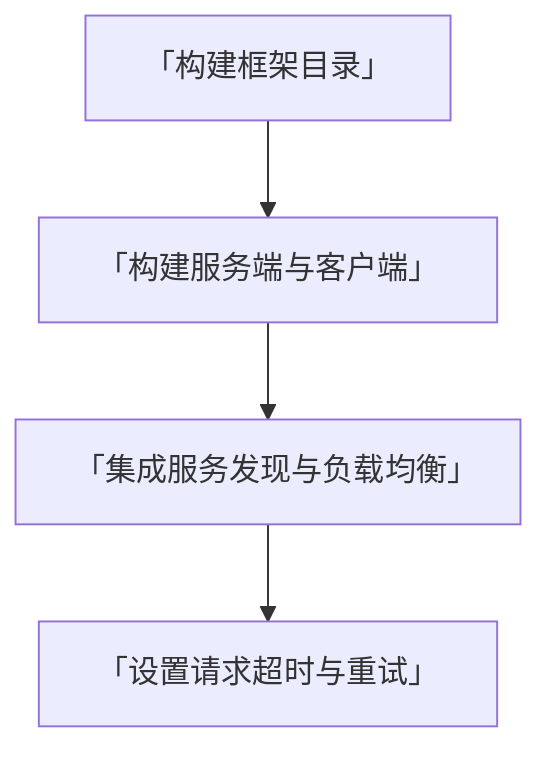

# 13-9-课程总结

针对第 13 章节做一个课程的总结。

在前面的课程中，已经学习了 gRPC、go-zero，并且完成了项目的开发，然后通过前面所学的知识点，自研微服务的框架，进一步帮助自己和企业进阶成长。

当然在这里，很多学员会有一个疑问：已经有成熟框架了，为什么还需要自研？其实对一个框架的自研而言，它对个人及企业有很多帮助。

## 自研框架对个人及企业的帮助

首先是认知这一块的提升：可以提升自己对框架内部构架、框架原理，以及框架构建过程中存在的问题的理解，能更好地理解并分析出来。所以可以提升自己的认知，也能够给自己带来技术上的核心竞争力。在目前的行业来说，不缺能做项目的、能做业务开发的，缺少的是针对核心技术点攻关的人才。当我们能够分析并理解这些框架使用背后的原理，对自己而言其实就是提升了一层核心竞争力。

第二个点，就是定制化地满足需求。通过自研框架，结合自己在开发过程中所存在的问题，提出相应的需求，然后定制化地开发，那么这个框架个性化程度很高，能够更好地结合工作中的需求。很多企业就会如此，比如典型的代表，如腾讯的 trpc 这一个框架，这个框架是自研的。因此框架在使用过程中，扩展性和灵活性更高，毕竟自己所写，熟悉度肯定也会大于开源的，而且自己更新起来也会更加方便。所以综合来说，自研框架对个人、对企业来说，都是最有帮助的。

当然并不是所有场景都适合。对个人而言，推荐是在自己有时间、喜欢探究探索的情况下，鼓励大家去自研框架；对企业而言，得按照自己的需求，因为自研仍然需要足够的时间。

## 本章课程内容回顾

讲解完自研框架对个人及企业的意义之后，课程的过程中会先构建好框架的目录，然后再构建服务端、客户端，集成服务发现与负载均衡机制，并设置请求超时与重试，这就是本章课程主要讲到的内容。

这些内容是微服务框架中的核心关键技术点。当然除了这些技术点以外，还有像熔断、限流、降级等，这些方案也是比较核心的。没有选择在课程中讲，主要是希望大家能够结合自己的实际情况，在目前所讲的过程中，也多是围绕前面所讲的知识点一步一步实现出来。同样，大家也可以放心地去学习并构建出来，这样才能够给自己一个提升。

课程中，我们的构建是基于 gRPC 来展开的，以 gRPC 作为框架基础，以 gRPC 来构建服务端、客户端，并基于 gRPC 去设置相应的服务发现、负载均衡等相关的机制。所以框架本身是基于 gRPC 底层的核心设计而构建的，这一点与 go-zero 是一样的方式。然后在上层中使用自己所写的框架。所以其实自己所写的框架，是对 gRPC 的使用做进一步封装，同时给应用提供相应的工具。

如果你在使用 go-zero，其实一开始是没有感觉到的，但通过本套课程的讲解，以及目前基于 go-zero 的模式来构建的这个微服务框架，就更加容易理解 go-zero 的设计。

## 框架构建的关键点

在构建中，对一个框架的构建，首先核心第一点就是构建好相应的目录，也就是目录的结构。无论是自己的项目开发，还是构建一个微服务框架，还是自己去写一套组件，目录的设计是非常重要的一件事情，因为目录设计可以很直观地看出项目设计的思路，或者说框架构建的思路。

图中展示的是两个结构，一个是 go-zero 的，第二个是 go-micro 的，无论哪种设计其实都是可以的，这两种都具有各自的优点。比如说这一种，在入口文件与工具层同级，但入口文件会调用工具层的方法，而个人也会调用这个工具层，所以对个人在使用过程中，这些都是同级的关系，引用起来非常方便。而这种，它是根据功能特点去划分对应的包，然后去分类，所以它是更细一层的划分。

目录结构定义完之后，自然就要去开发。开发过程中是先开发的服务，而在服务的过程中存在的问题，主要是在于框架的这个服务对象，如何实现多样化的 RPC 服务的注册工作。因为这一行的代码是可变的，它是通过代码生成工具，基于 proto 的文件生成的库文件，所以在使用的时候会具有差异性，因此怎么把它们结合起来是这个地方的难点。框架主要的模式是定义一个方法类型，然后以闭包的方式传递进去构建。这种方式可以理解为一种代码的写法，或者代码的技巧，大家在实际开发过程中也可能是可以使用到的，构建的时候也理解一下这种写法，以便在自己的项目中更好地应用起来。

对于客户端的构建来说并没有什么特定的难点，客户端的重点就是得到一个连接，然后客户端就基于这个连接去发起 RPC 的请求。但我们自己的框架，针对这个连接在创建的时候就会设置相应的一些操作，这一点包含了负载均衡、超时、重试这些机制。

然后在本章课程中，讲了服务发现及服务的负载均衡。服务发现和负载均衡，在前面的章节中就有分析，看一下这个就是前面章节中所分析构建的 gRPC 的核心结构。服务发现和负载均衡，因为是使用 gRPC 的核心机制来实现的，所以在构建前，需要先理解这一套机制它的实现：先了解一些接口，然后以什么样的方式进行注册，这是需要理解的。

所以大家在构建的时候，建议先看之前的分析，来理解它们之间的代码调度，或者说它们之间接口的关系。在这里，它就会调用下层所包装的具体方法来完成具体业务工作。

左边这里属于服务发现。服务发现它定义了一个接口，比如这个 resolver.Builder 接口，就是自己在扩展时候要实现的接口，而 go-zero 就是实现了这一个接口，通过调用 updateState 来维护服务列表，这就是 gRPC 的服务发现实现。自己在实现时候也是实现这个 Builder 接口，然后用这个方法来更新服务列表。

右边这一层属于负载均衡，它要做的事情、所需的工作更多一些。在结构中，它提供了两个非常关键的接口：这里 picker.Builder 以及 Picker，这两个接口就是去进行负载均衡的。其中 Picker 就是具体的算法实现，而 picker.Builder 就是创建 Picker。因此自己实现，也是要实现这两个接口，通过这个 baseBuilder 来加载自己实现的对象，注册到 gRPC 中并进行使用。这是在实现服务发现与负载均衡中主要实现的两个接口。此处也给大家提供了相关的代码结构示意，就是关于服务发现以及负载均衡的。

当服务发现与负载均衡实现之后，还有重试机制和超时机制，其实这两个机制并不是很难，它们主要就是基于拦截器而实现的，实现的核心点是通过 context 与 select 进行实现的。

本章节的难点主要是在集成服务发现和负载均衡这两个机制，因为它们是围绕 gRPC 内部核心的机制而实现的。像熔断、限流、降级这些机制，gRPC 内部核心中是没有提供的，所以可以自己去定义这些机制，进行扩展。相对较为难的就是负载均衡和熔断等机制，因为需要结合 gRPC 它自己内部的实现，再去结合自己的需求定制化这一套机制。

本章的核心是带大家构建微服务框架并实现相应的功能，更多的功能可以在课后慢慢完善。
