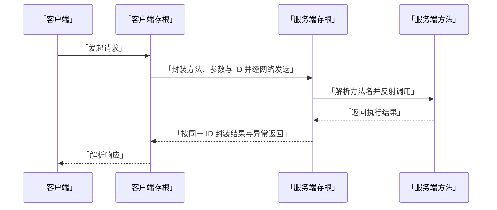

# 2-13-章节总结

本节课程主要是针对整个章节做总结。在课程的内容中，主要是先介绍 RPC，了解 RPC 的应用、特点及作用，并针对 RPC 所解决的问题，介绍了 gRPC 框架，同样也列举了应用实例，并对它进行了一些源码的分析，了解了内部的实际过程，这是本章节所讲到的核心内容。下面细节地了解一下具体过程。

## 服务间通信为什么需要 RPC

首先，在项目中可能会存在多个功能模块，比如在单体项目中，就会有用户、订单、课程、通讯这些功能模块，然后它们再通过前面章节所介绍的微服务的核心话题，进行拆分服务化，最终构成了多个服务。服务与服务之间，它们本身也是需要继续通信的，而 RPC 就针对服务与服务之间通信做一个统称。

因为 RPC 它本身，在通信的实现方式上，具有多样性，它可以通过 TCP、UDP，甚至是 HTTP 等协议来实现。因此在企业中，经常也可能会提到 RPC 和 RESTful 这两者的区别。

现在看一下 RPC。RPC 在定义上，它是指微服务中服务与服务之间的调度过程，所以它没有描述出具体调度的细节，而是描述的是服务与服务之间的调度过程的定义，可以理解为它是针对服务与服务之间调度这一个过程的统称，它不在乎方式。而 RESTful 是 HTTP 请求协议请求的一种标准，可以理解为它是一种约束，主要针对的目标是 HTTP。这两者之间其实在本质的定义上是不具备可比性的，因为它们的作用目标是不一样的。

但如果硬要在服务与服务之间使用 RESTful 的风格去通信，这是可以做到的，但是这并不符合 RPC 本身这种定义的期望。因为对 RPC 来说，它是更加期望于使得本地服务在调用远程服务的时候，能够有类似于本地的调用方式，它的作用目标主要是远程服务中的某一个函数。所以使用 RESTful 从理论上是可以实现，但如果真的使用会增加项目的复杂度。

## RPC 的调度过程

在图中描述了 RPC 的调度过程，整个调度过程并不是很复杂。来看一看：在调度的过程中，首先客户端需要向服务端发起调度，因此在调度过程中，首先会发起请求，而请求对象，会通过客户端的存根文件进行处理，它会把请求的方式，封装成类似这样的消息结构体，比如需要请求服务端的哪一个方法、请求的参数，以及请求的 ID，以类似这样的格式进行封装、编译，然后通过网络再发送给服务端。

服务端存根会接收到该信息并解析，通过消息中的第一个方法名，可以了解到到底要调用的是哪一个方法，再利用反射或者说反射的机制，进行调用服务端的该方法。在服务端该方法调用成功之后，它会返回出结果给客户端。服务端的存根会存储为这一个格式，在格式内容中，这里会有一个 ID，与这里的 ID 是一致的，同时，响应的信息就是请求服务端调用的该方法的结果，反而也会有返回出异常，这里的异常，它可能来自于服务端，也可能来自于系统内部的异常，都会有。最后它会以这样的数据格式，通过网络返回给客户端，客户端接收之后，通过客户端存根，然后会去解析，这就是一个 RPC 的调度过程，并不复杂。

需要记得关注的就是，它们通讯的方式，在根本的本质来说，就是客户端需要描述清楚，要调用服务端的哪一个方法及请求参数，同时，在传输过程中相互的解包和封包，所运用到的方式，必须是保持一致的。服务端会响应出对应的结果，同时，它也会标示当前的请求 ID，以便于客户端根据请求 ID 来进行适配对应的请求结果。

## 如何实现一个 RPC 通信

那么应该如何去实现一个 RPC 的通信？这里其实可以通过四个方面来进行分析：第一，就是考虑如何去加载服务；第二，如何调用服务；这两个是比较关键性的。

加载服务就是，让我们自己的程序，可以加载到 RPC 程序，比如 RPC 定义的服务，这样的话，就具备了扩展性，因此，就需要去考虑到服务。同时，如何调用服务，也是比较关键性的，客户端一旦传递消息，那么在服务当中会解析到对应的请求对象和目标，所以肯定要调用方法。在整个过程中，通过前面的图示，就已经有过分析了。

第一，在加载服务对象中，其实在企业中，一般对于服务的加载，它往往都会有根据服务名及服务对象，往往会采用到 map 来进行加载，map 的 key 作为服务的名称，而 value 就是服务的对象。服务对象中，同样以 key 和 value 的方式，存储着方法名及方法，这样就可以加载好服务了。

而调用服务也比较简单，就是根据服务名，找到服务，然后再根据方法名，找到方法，具体调用，在方式上，可以通过反射机制去进行调用，通过反射去传参。而传输的协议，在企业中，通常主要有 JSON 和 Protobuf 这两种协议为主，相对来说，这两种会用更为广泛一些，但还是有一些会用到，比如 XML，这是在自研 RPC 服务上，可以通过自定义去进行思考。那么就可能去构建出一个服务，只要把这几个问题能解决，基本上大部分的服务、RPC 服务，就可以自己去构建成功了。

## net/rpc 包的实现

再往下看，在 Go 的 net/rpc 包中，它的实现是，会提供一个 register 方法，去用于服务的注册。所有对象它会注册到一个 map 中，key 就是作为服务名，server 就是自己的服务。比如这是一个 UserServer，需要注册它，那么在注册的时候，可以会调用到注册方法，然后会在调用的时候，会反射给它注册进去。这个过程，就是调用 register 方法的时候，它会再通过反射，去获取到 UserServer 它的结构名，以及它的方法名，会给它封装，并最终存在这个 map 中，把它存到这个 map 中，就可以完成注册了。

而在使用上来说，也非常简单，只需要通过对应的服务名，就可以找到服务，然后再通过这个 server，就是查找到对应的方法，并进行调用。所以如果自己实现，也并不复杂。

但是在传统的 RPC 之内，又会存在如下一些问题：第一，缺乏跨语言的支持，简而言之就是，当前在 Go 语言中实现之后，其他语言需要根据 Go 语言它的一些特点去实现，因此，在这一点上面，就是其他语言也需要自己去定义，去实现成功；同时，缺乏对错误处理的统一约定，在 Go 语言内的 RPC 封装，是不存在错误处理的约定的，它只是一个单纯的 RPC 的调度机制；同时没有清晰的接口语义，此条主要是针对所定义的服务，如何调度、路由的请求，这些是不明了的；在功能上，同样缺乏了发现机制，就是当客户端想要调用服务，那么它不清楚这个服务是不是存在，所以缺乏一种对新服务的发现机制。所以说的这些问题，它有很多自然就没有列举，而列举的就是一些比较明确的问题。

## gRPC 的改进

因此为了解决这个问题，就提出了 gRPC 这一个框架。在框架中定义一个 proto 文件，这个文件，就用于客户端和服务端共享，作为整个服务通信调度过程中的契约文件，或者约定文件。然后通过它，会生成一个 .pb.go 的库文件，在库文件中，会定义好对 proto 文件中所描述到的消息体、服务对象进行定义，定义好消息体，定义好服务对象的接口，以及客户端调度的具体内容。然后在客户端和服务端之间，会通过这个库文件，去实现服务的定义和服务的调度。

在 gRPC 中，它就会有如下这些功能。而第一，就是 gRPC 底层的 rpc 服务功能，它的功能中，就包含了拦截器、服务发现、负载均衡等一系列机制，都包含了。而同时，在通信的方式上，采用了 HTTP/2 进行优化，并在协议上通过 protobuf 做数据的序列化与反序列化，这是 gRPC 与传统 RPC 所存在的一些区别点。

接下来先来看一下 gRPC 底层的功能有哪些：首先它支持了错误的处理、拦截器的功能，同时具有服务发现、负载均衡的机制，并且它能够去实现服务的调度，如果说调度出现问题，它会有调度重试、超时支持，因此它其实具备的功能是蛮多的，在传统的 RPC 的技术上面，进行了一些扩展。

除此之外，再来看一下 HTTP/2。HTTP/2 是由 HTTP 发展演变而成的，它并不是一成不变的，在发展过程中，主要针对 HTTP 做了下面这些改进：第一个就是传输的改进，因为 HTTP 的传输方式，经历一次连接，就只能发送一次请求，不能多次的去处理，所以这是一个比较明显的改进。同样，因为前期的改进之后，它采用了当前的这种方式，能够构建好一个长连接，那么在整个通信过程中来说，它就不需要客户端反复的去进行连接，一个连接可以多次的被使用，所以就直接复用。同时在请求这一块，对请求信息也进行了优化，它在通信的过程中，会把请求头保存起来，如果已经存在了，就不会再发送，只发送有区别的，所以在请求头上，也做了优化，这样的话，减少了网络的传输信号。并且服务端是可以主动向客户端进行推送的，所以相比于 HTTP/1，就做了这些优化。

## Protobuf 协议

接下来看一下 Protobuf。Protobuf 的特点是：第一，使用标识号作为数据传输中的 key。在 JSON 这一种方式的传输过程中，往往的 key，是使用自定义的属性值，但是其实这一个属性值，它有一个特点，例如往往是用字符串来定义，所以它传输上来说，它是比较大的。但我们每次传输都是一种固定不变的，因此 Protobuf 在考虑这个因素上面，它采用了自定义的标识号的方式，而不是采用了自定义的字段名的方式。而自定义标识号，它是一个数字，一个 int 类型，在传输过程中，使用一个 int 类型，肯定比一个 string 类型，会占用的字节更少，这样的话更省空间。

同时考虑到这个是 int 类型，会比较多，因此在编码上面，又对 int 类型，再进一步的去优化，采用 Varint 来去存储 int 类型的数值。Varint 它的特点是，会去把一个 int 类型，原本需要四个字节的空间，通过 Varint 一优化，只需要两个字节，就可以存储，就大大地节省空间。并且在传输的数据上来说，采用了 TLV 的方式进行数据传输，T 就是标签，L 就是数据的长度，也就是这个 Value，这个值。在传输过程中，Value 因为它是可变的，它可以是数字，也可以是字符串，当然，如果它是一个数值类型，那么这个 L 是可以省略的，因为在数值类型，它会采用到 Varint 进行存储。Varint 的特点，是可以识别出 ValueInt 的值，通过 Varint 进行识别，Varint 也是可以识别出，在整个存储过程中，会进行解析，识别出 Varint 的具体值和 key。所以在整体上来说，是比较能够去省空间的，这是 Protobuf 的一个协议。

## gRPC 的内部实现

在了解 Protobuf 协议之后，最后也去尝试并分析了 gRPC 的内部实现。在 gRPC 的内部实现中，其实分析之后可以发现，通过 protoc 工具这一行命令编译完之后，会生成一份库文件，而这一份库文件，可以说是 gRPC 客户端和服务端的一个核心的方式。因为在这一个库文件中，它会被定义好，比如说服务的接口，一些客户端调用服务端的方式，在最下面，这里会有一份描述，一个服务端的描述，它会描述了这个服务端的名称，及服务端的一些方法等等。在其上，会为每个方法来定义一个具体的函数，这样做就是去调用方法的调用方式，就不再是采用反射的方式，而是采用接口断言的方式去进行调用，这个性能会更高一些，相比起反射来说。

因此在服务端，它在做的时候，可以通过 RegisterServer 的方法来，会根据服务端的描述，和服务对象去完成最终的注册。在服务端中，会描述服务的方法和信息，而客户端的调用，它同样也会通过库文件中的 Invoke 这个方法，去完成调度。而 Invoke 的方法中，会先获取到一个客户端的流，先去发送消息，再接收消息，这是整个的调度过程。

好了，到此整个章节就了解完了，从 RPC 到 gRPC 的这个过程，进行了完整的分析。
