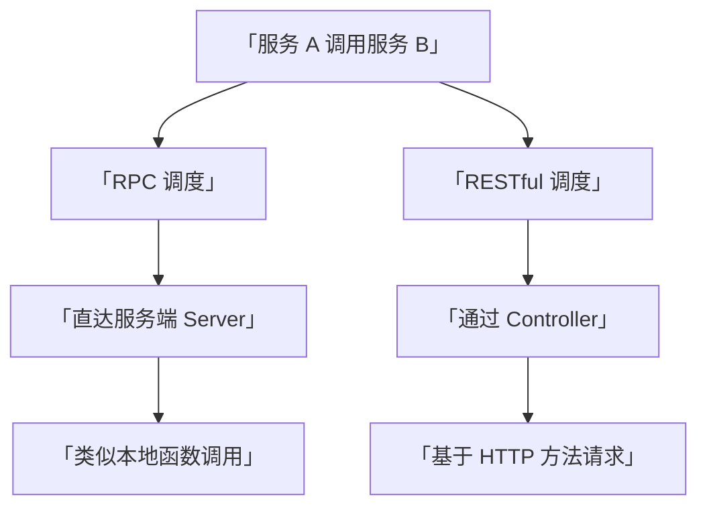

# 2-2-为什么是以rpc为主而不是restful？

通过前面的课程学习，我们了解到微服务中，服务与服务之间的通讯，可以通过 RPC 进行实现，而 RPC 可以通过 TCP、HTTP 等相关的协议来进行实现。

那在这个时候，可能会提出一个疑问：为什么不采用 RESTful？带着这个问题，我们来讨论一下。

假设这里有两个服务，服务 A 和服务 B，现在服务 A 要调用服务 B。在调用的过程中和方式上，无论是 RPC 也好，还是 RESTful 也好，这两种均可以用得上，都可以实现 A 服务调用 B 服务的需求，这就更加有疑问了：为什么不采用 RESTful？

## RPC 的特点

先看 RPC 的特点。RPC 是客户端对远程服务端上的函数进行调用。其次，调用过程中，客户端向服务端发送消息，希望调用方式与本地函数调用方式相同。也就是说，既要调用远程服务器上的函数，同时又希望能够像本地函数调用一样，这是 RPC 的关键性特点。

其次，RPC 中有一个存根，客户端和服务端中均会有，主要用来做序列化和反序列化，以及接收结果等，这是通过前面课程学习了解到的 RPC 的特点。

## RESTful 的特点

接下来看 RESTful。RESTful 的定义同样是客户端和服务端，但客户端和服务端之间是相互独立的系统。前面提到 RPC 的特点是服务端和客户端属于共同的一个系统，可以说是 A 部门和 B 部门之间的一个调度过程。而 RESTful 则属于 A 公司和 B 公司这样的调度情况，它们是相互独立的系统，从这一点就与 RPC 有了明显的区别。

再来看，服务端不保留两者之间的状态，这也是 RESTful 的一个风格。因为它是 HTTP 请求，用浏览器发送之后，后续的数据就返回了，服务端并不清楚状态的记录，所以没有保留状态。

RESTful 还有第三个特点，就是统一接口：客户端和服务端会通过统一标准化的 RESTful API 风格来进行通讯，可以理解为一个标准化的协议，服务端和客户端都定义统一协议风格，按协议来。RESTful 的 API 就是一个协议风格。

## RPC 与 RESTful 的区别

总结下来，RPC 和 RESTful 的定义有明显区别。RPC 是一种思想，它是对微服务之间调度过程的定义。从某种定义上来说，服务与服务之间可以基于 RESTful 这种规范来进行通讯。但 RPC 的定义是服务与服务之间调度过程的定义，因此，如果两个服务之间基于 RESTful 来实现通讯，从广义上讲，它们也属于 RPC 通讯，只不过在 RPC 通讯的基础上，它们基于了 RESTful 的这种标准来定义，所以从定义上，这是一个比较大的明显区别。

第二，目标。RPC 的主要调用目标是 Server，而 RESTful 是基于 HTTP 方法请求的，因此调用的目标是 Controller，这一点它们也有区别。

所以，谈微服务中服务与服务之间的通讯时，我们说的是基于 RPC：其一，它们通讯的这个过程，在定义上就叫 RPC；其二，RPC 可以基于 TCP、HTTP/1 等协议实现，理论上在基于 HTTP 实现的时候，可以基于 RESTful 的这种规范来实现，但不采用，是因为它的本质是希望客户端在调用服务端的时候，能够像本地函数调用的方式来进行调用，而并不是要走这么多复杂的流程。因为 RESTful 是基于 Controller 的 Server，而 RPC 是直达 Server、不通过 Controller 的，这是两者之间的特点。

本节课的重点是了解 RPC 和 RESTful 这两者的区别。
