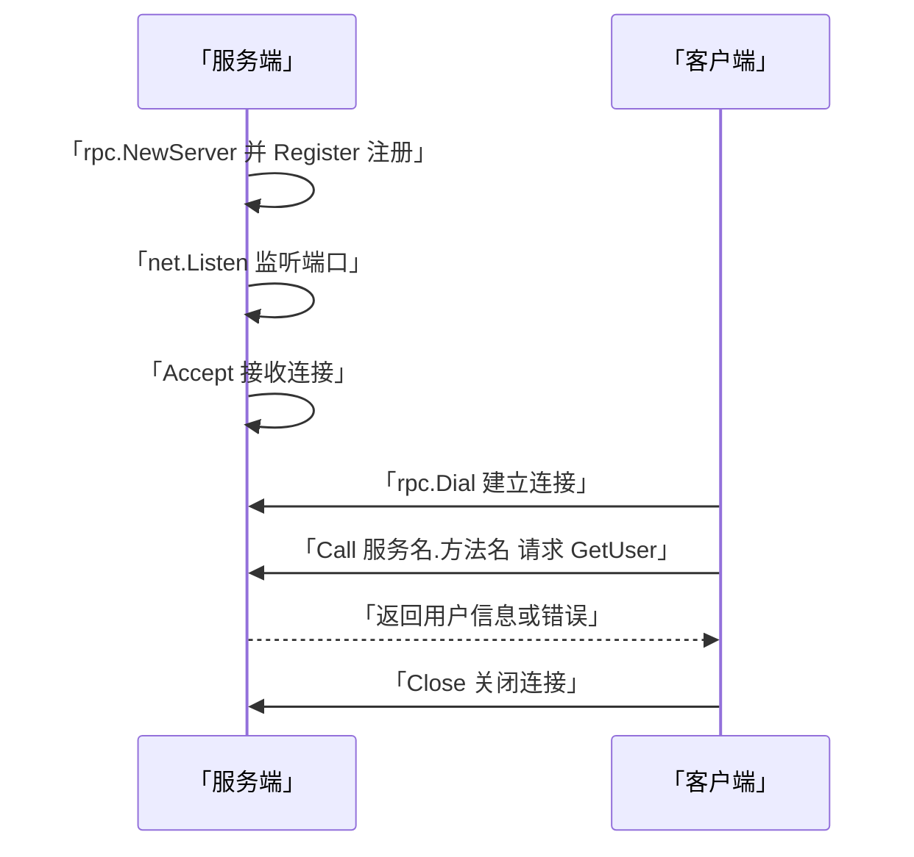

# 2-3-net、rpc实践案例

本讲使用 Go 语言，基于标准库 net/rpc 来构建一个 RPC 的应用实例。按照惯例，会先把服务端构建好，然后再构建客户端，最后让两者通过 RPC 完成通信。

课程中使用的是 GoLand 这个 IDE，它默认已经加载好了所需要使用到的标准库。如果不知道这个标准库在哪里，可以通过输入 `go env` 查看系统的环境变量配置，找到 GOROOT，用到的标准库都放在了 GOROOT 目录下。

## 认识 net/rpc 包

net 包封装了对网络通信协议的处理所需要用到的程序。找到其中的 rpc 目录，从整体上看有三块内容：一个是 JSON 序列化内部的封装，然后是 RPC 客户端和服务端。在服务端中，包含了请求响应的数据结构的定义，以及自定义服务加载的注册方法。

接下来完成服务端的应用请求。在服务端开启前，先创建好 User 结构，在 User 结构中定义了一个 Data，Data 里面存放的就是要假造的一些数据，它使用的是 User 这个结构体，然后在里面存放了 User 的信息。

而需求就是：在服务端中提供一个 RPC 的方法，供客户端调用，用来获取用户的信息。这样来定义服务，服务中它会提供一个方法，那么方法中应该传递什么样的参数，这是需要思考的问题。

在使用 Go 的标准库时，它的定义是这样的：第一个参数是请求，第二个参数是响应，它返回的结果是错误，可以是程序处理的错误。而它的请求和响应在 net/rpc 中要求的是一个结构体，因此需要分别给请求、响应定义好相关的结构体。

所以在这个定义上有一个技巧：请求和响应都定义为结构体，而响应的话，一般会以方法名作为前缀来定义它的结构体对象。这里代表的是 GetUser 的请求参数、GetUser 的响应参数，即 GetUserRequest 与 GetUserResponse。在请求参数中，需要传递 Id，因为它需要根据 Id 去获取用户信息。而响应会返回 Id、用户名、手机号码。

接下来需要在方法中使用这两个结构体。请求的信息可以直接使用，可以不用指针类型；但是需要注意的是，响应需要用指针类型，因为它要通过指针写入结果，所以这点必须要用到指针类型。

再往下就是业务逻辑：通过请求传递的 Id 去查找是否存在该用户，如果存在，那就把它返回出来，通过指针的方式传递，然后定义好要写入的结构体。因为已经查得到并放到了 User 这里，所以可以通过 User，把最后要返回的信息写入响应。如果没有找到，就给它报出一个错误：「没有找到用户」。

## 服务端的启动与监听

到这里，一个服务就定义完成了。但工作还没完成，服务定义完了，不代表它能启动去运行，所以还需要完成它的监听工作。

首先，需要创建一个服务，通过 `rpc.NewServer` 的方式就可以了，没有什么其他技巧。创建服务之后，将服务注册到 RPC 里，可以用它标准库中所提供的 `Register` 方法，然后把服务放进来。注意它注册的时候需要传的是指针，这里不要错了。

然后再实现监听。对于 RPC 的监听，它可以使用 tcp 协议，也可以用 http，但 tcp 使用比较多，因此就用 tcp 来进行监听。调用 net 包所提供的 `Listen` 方法，以 tcp 的方式，指定端口 1234。它会返回两个结果：一个是监听的对象，第二个是 error。做好 error 的处理，给它抛出一个「监听失败」的错误；如果监听成功了，那就输出一个信息，表示服务端启动成功。

最后再实现接收连接。在监听的对象中，会有一个 `Accept` 方法，它通过这个方法来接收客户端的请求连接，再返回出连接的信息和 error，所以它会返回出一个连接 conn，然后返回 error。在得到连接之后，它并不能被立即处理，还需要通过连接去获取信息、然后再处理信息，所以这里要注意，它只是与客户端得到一个连接。

处理一下 error，如果是「接收客户端连接失败」，就结束本次请求。得到连接之后，如前面提到的，需要基于连接去获取客户端的请求信息，然后再返回客户端信息，因此这里会涉及到读和写。而在 net/rpc 包中，它已经完成了这些动作，所以不需要自己处理，只需要调用它的方法，然后使用 conn 把它传进去即可。在前面再加一个 `go`，使它并发地处理客户端请求。

## 服务名与方法名的确定

服务端的名称怎么获取，客户端的名称又怎么确定？这可以看 net/rpc 的源码，就在 rpc 那段内容里请求响应的部分。在请求中，有一个服务的方法的定义，它的格式是服务的名称和方法。服务名其实就是使用的结构名，而方法名就是它所定义的方法。写法就是服务名加方法名，中间用点号连接，这就是它的格式，文档中有描述出来。

## 客户端的编写

客户端在编写前，也需要解决一个问题：到底应该传输什么样的数据结构和接收什么样的数据内容。因此需要从服务端中，把定义好的请求、响应的数据结构，复制到客户端中。

在客户端中，首先通过 rpc 的 `Dial` 方法建立到客户端的连接。方法的第一个参数就是请求的协议，第二个参数就是请求的地址。因为是在本地，所以可以用 localhost 做一下处理。如果建立连接失败，就返回错误。当连接成功之后，在发送请求和获取信息时，需要定义好请求和响应的实例：一个是请求，请求使用的是 GetUserRequest，然后它需要传递的参数 Id；然后是响应对象的接收。最后去调用请求的方法，该方法主要来自于客户端对象，往上调度可以找到它。

同时需要注意的是，在客户端中它会返回客户端的对象，它所实现的接口中有一个关闭连接的 `Close` 方法。因为客户端一旦创建成功之后，要注意资源的回收，避免资源溢出的情况，所以要做好关闭的处理。

回到调度方法 `Call` 中，它会有三个参数：第一个参数是传递的方法名，第二个是参数，第三个是响应的内容，最后它会返回一个 error。因此这里需要去传递方法，方法名在前面已经分析好了，就是结构名加方法名，这是要请求的方法。请求、响应通过指针传递，它会返回一个 error。把结果输出一下：如果请求失败，就反馈 error 并结束，然后把结果带出来。

## 运行与验证

接下来让客户端去实现 RPC 请求，两者直接通信。先把服务端启动运行，如果服务端不运行，客户端肯定是请求失败的。服务端启动成功后，再用客户端请求，可以看到确实请求到了一个用户（慕希老师）。

然后在客户端中，可以再给一个不存在的 Id，比如说 4，它会报出错误，抛出一个请求失败：「没有找到用户」。该错误是属于服务端内部定义的错误。

## 服务名与方法名的错误排查

在使用 Go 标准库 net/rpc 包进行 RPC 服务处理时，一定要注意好服务名的定义和方法名，这里它是写死的，需要自己写。如果服务名和方法名不存在，可以给一个不存在的方法试试，看会抛出什么样的错误。在服务仍然启动的状态下再请求一次，此时会报出一个 RPC 错误：「没有找到服务」，它找不到这个服务，所以报错了。然后再改一下方法名，会报出一个「不存在该方法」的错误，不过这里报出的错误类型就不一样了：上面是服务名不存在，下面是方法名不存在。

因此总结一点：在使用 Go 的 net/rpc 包进行 RPC 服务处理的时候，一定要注意好服务名的定义和方法，其次就是请求和响应的参数结果。
