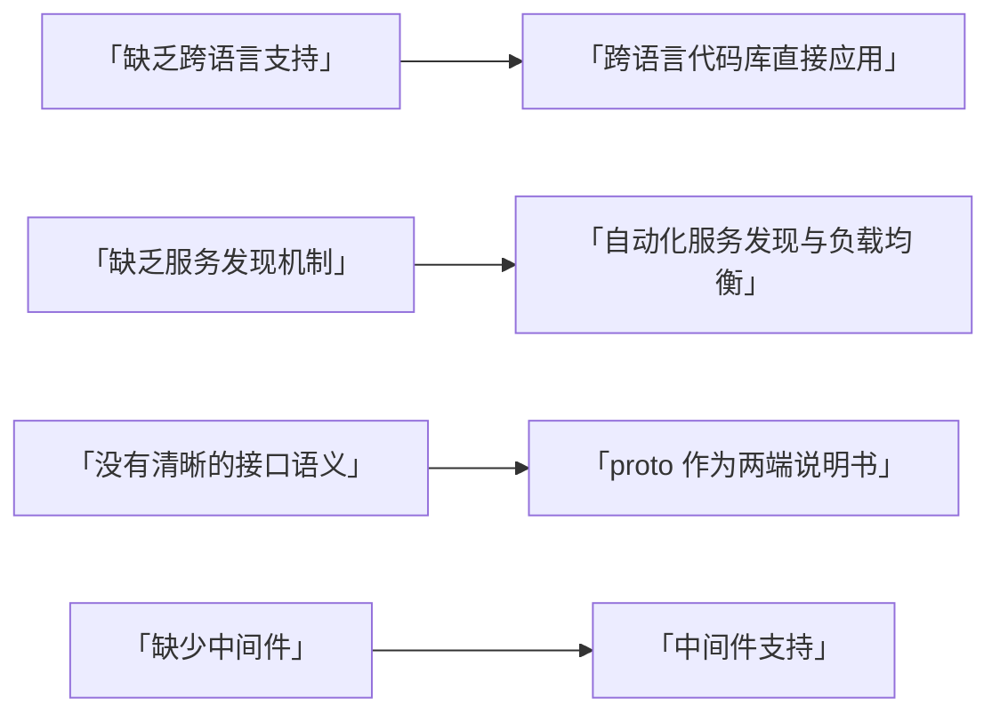

# 2-5-grpc介绍与下载安装

在前面的课程中，已经学习了 RPC 相关的技术知识，并且构建好了 RPC 的案例。接下来讲解一款 RPC 的框架：gRPC。

在介绍这个框架前，首先有一个问题：在目前 RPC 的通讯机制下，它存在一些什么样的问题。之所以抛出这么一个问题，是因为 gRPC 是一个框架，为什么要来了解这块框架？针对这个问题，可以从 RPC 目前机制下的问题得到答案。

首先，在 RPC 的机制下，它存在的问题有如下。

## 跨语言支持问题

第一，缺乏跨语言的支持。Go 语言自己内部的 RPC 机制构建好之后，它就变成一个服务了，如果其他语言想要去访问这个服务，它不能直接用，需要自己写一套机制，根据 Go 语言定义的这套机制，比如方法是如何传递的、参数、请求的结果是如何定义的，以及传输过程中的相关内容，进行实现。所以如果想要进行跨语言的 RPC 通信，就必须自己再造轮子。

## 错误处理机制问题

第二点，就是缺乏错误的处理机制。就目前 RPC 的通信机制来说，它是不包含任何错误处理的，只是一个请求调度和响应就完了，所以目前没有对错误处理，错误的处理需要自己额外在上层做处理，在这里又造一层轮子。

## 服务发现问题

第三个，就是缺乏了对服务的发现机制。客户端想要知道某一个服务，按照目前的方式是写好的 RPC 端口然后去请求的，但如果服务是动态的增加扩容，很显然这种方式是不行的。那如何解决？那就是在上层引入相关的机制，或者自己把这套机制写下来。

## 接口语义与中间件问题

除了这三个问题外，还有像没有清晰的接口语义以及中间件，这也是比较关键性的。

清晰的语义这一点，可以通过阅读代码看到。比如在服务端，此处所定义的服务，假设这个服务不在同一个项目中，哪怕是在同一个项目中，其他人针对这个服务的定义内容，比如他定义的服务、服务名、请求参数、响应结果，我们想要去调用这个 RPC，对他来说是不知道的，因为他需要去了解你的写法，或者你有相关的文档来提供，我才知道你的请求参数到底要传什么，你的服务名和方法名是什么。因为他是不知道的，所以这是一个比较明显的问题。

除此之外，中间件这一点，在源码中也有明确的描述，比如这一段：这一段属于 net/rpc 下面 server.go 中它的调度方法的核心代码。在这一段代码中可以看到，首先第一步是获取要调度的方法，得到方法了，那么就可以通过反射所注册的服务的方法，来完成任务请求。由这一点可以看出来，它上下没有做任何中间件相关的操作，只是纯调用，这是不支持的。因此想要支持，就需要自己再实现一趟。所以中间件已经很明确地发现了它的缺点。

除了这些以外还有很多，就没有一一列下来。

## gRPC 的引入与特点

在这些情况下，就提出了 gRPC 这一框架、这个解决方案。那 gRPC 又是什么？gRPC 是一款 RPC 框架，由谷歌开源。在框架中，以 HTTP/2 作为应用层的协议，使用 protocol buffers 作为数据序列化、反序列化的格式，并且它还支持接口定义。

它的主要特点有如下：在框架中首先支持了跨语言，在一个语言上定义的服务，其他语言并不需要再去造轮子，直接下载好 gRPC 相关的代码库、代码包，就可以去应用开发了。还有像基于 HTTP/2 的传输协议、自动化的服务发现机制和负载均衡等等。这些内容目前比较抽象，会放到后面讲解，特别是 HTTP/2 协议，这是一个相对来说对比 JSON 会更高效、更快的方式。而像服务发现和负载均衡，目前没有什么特别好的效果呈现，会在后面的课程中讲解并分析原理。同样中间件，只需要知道它具备这些功能。

由此可见，gRPC 是一种针对了 RPC 缺失的问题而提出的新解决方案。在使用中，RPC 客户端通过 gRPC 的代码库，依据 proto，前面已经提到，它是一个相对清晰明了的接口，可以把 proto 看成是一个说明书，应用于服务端和客户端。对客户端来说，它就是一个服务端的说明书，描述服务端的方法和参数；服务端也能够根据这个说明书，了解到怎么去创建服务端。这就是 gRPC 对于两者服务端调度的一种解决方案。

## gRPC 的下载与安装

接下来讲 gRPC 的下载。

首先是 protoc，它是对数据进行序列化、反序列化的工具，这是属于第三方库 protobuf。其次就是下载 gRPC 的核心代码，因为下载地址是在国外谷歌地址，所以在国内可能访问不到。为此整理了在国内的访问方式：可以通过 git clone 将代码克隆到本地，因为它有同步到 GitHub 上去。

然后再下载 gRPC 的代码生成工具，这个工具主要是生成 Go 的代码，所以这里是 protoc，protoc 属于 Go 的一个生成器。其他语言的也有其他语言生成代码工具。

最后是编译器。protoc 是根据自己的程序、自己实际系统所运行的环境来定义的，因为当前是在 Windows 上面，所以下载的是 .exe 的一个安装文件。下载之后，可以在环境里面安装，执行一下 protoc，如果能够输出信息，那么证明是安装成功了。

关于 Git 的安装方式，文档中有描述，其实也并不是很难。这是关于 protoc 的一个安装方式。

关于下载的例子，根据文档中所提示的下面的这些命令，完成对核心库的下载：第一行下载的是 protobuf 协议的核心库代码；第二行会下载 gRPC 核心库包，同时它也会下载一份 gRPC 针对 proto 的编译工具；第三个是针对 Go、基于对 protoc 的编译器的一个工具；最后是下载 protoc 的一个工具、一个编译工具。

在下载完成之后，会下载到 pkg/mod 目录下面，然后在这目录下面就能够看到所下载的一些包，这里就不去解释了。

同时还有一个非常关键的就是，前面讲到的三个工具：一个是 protoc 的编译器，还有一个是代码生成工具，其实这两个是 gRPC 为 Go 所提供的编译器，根据它会去生成标准的一些库代码，在后面的课程中会有应用到，并且去完成对 proto 的编译处理。

本讲主要就是对 gRPC 进行了解，同时安装好它。
