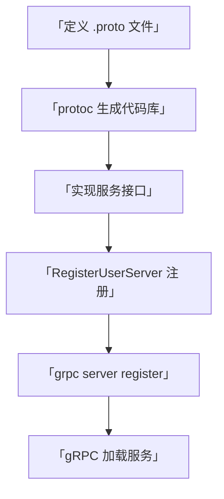

# 2-9-grpc的服务端连接调度实现原理分析（上）

在前面的课程中，对 gRPC 所使用的 HTTP/2 协议进行了分析。在本次课程，会分析 gRPC 的服务调度的一些原理。

课程内容中，会基于下面这四个环节来进行分析：首先理解，在上层服务中，制定的服务是如何通过 gRPC 的方法去完成加载；然后看 gRPC 初始化过程中做了哪些事情，会使用 gRPC 的拦截器，看拦截器是如何被调用执行的；最后再去分析 gRPC 在接受请求连接的时候做什么样的处理。

## 服务的加载与注册

先来看第一个：制定的服务是如何加载的。根据前面课程的设定，首先会定义一个 .proto 的文件，在文件中，先定好服务，在这个服务里再给它定好方法，然后根据方法定好方法所需要接收到的请求的消息体、需要响应的消息体。这时一个服务就描述好了。再通过 protoc 的工具，生成相应的代码库。在这个库中，会根据这个 .proto 文件描述的服务接口定义好，而制定的服务就要去实现这一个库中所定义的服务接口，进而再通过库中提供的注册方法，完成服务的注册并注册到 gRPC 中，然后 gRPC 会去加载这个服务。这就是在前面课程的示例中这样执行的。



来看一下代码。这就是刚刚提到的 .proto 文件，在 .proto 文件中就定义好了服务名、服务的方法和方法所需要使用到的消息体结构。而在这里就记录了所需要定义的库。

再来看一下 server.go。在 server.go 中就定义了自定义的服务，往下就是这个服务它的启动过程：上面先定义好监听，然后再去初始化 grpc server 这个服务。得到这个服务之后，下面就调用了自己生成的这一个库代码中 RegisterUserServer 的方法去把自己的服务注册进去，最后再启动服务。这是上层代码的一个过程，核心的注册代码如下：

```go
s := grpc.NewServer()
user.RegisterUserServer(s, new(UserServer))
```

然后重点来看库代码是如何去注册的。根据前面的分析，是 UserServer 调用这个库代码去注册到 grpc server 中的，所以要看的库代码怎么做的。

通过跳转到代码中，可以看到它传递两个参数：第一个参数是 grpc 的 server 的对象，然后第二个参数是服务对象。而这个服务对象是要求实现接口。

回到代码中，在代码里面它就有一行代码，就是调用传递的服务对象，然后调用它的 register 的方法去完成服务注册。而在 register 的方法中，它做了一个事情，它传了两个参数，一个是对服务的描述，即 User_ServiceDesc，第二个是服务对象 UserServer。User_ServiceDesc 的内容如下：

```go
var User_ServiceDesc = grpc.ServiceDesc{
    ServiceName: 「user.User」,
    HandlerType: (*UserServer)(nil),
    Methods: []grpc.MethodDesc{
        {
            MethodName: 「GetUser」,
            Handler:    _User_GetUser_Handler,
        },
    },
    Streams: []grpc.StreamDesc{},
    Metadata: 「user.proto」,
}
```

现在看一下这个 User_ServiceDesc 里面是什么内容。在内容中，非常明显地发现，如这个变量的名称一样，用户服务的描述，它里面的确实是对于该服务的描述，比如要定义的服务名，那这里就会给它描述清楚，以及服务的类型 UserServer 一个接口，它就给它做一个类型。然后在下边就有一个方法列表，是对于方法的描述及方法名，以及要处理的方法，比如当前的这个方法名对应的要处理执行的方法。那就可以看到，下面就是对 User 的方法的处理，以及当前的数据是来自哪里，通过 user.proto 的文件给它编译过来。那从这里就可以很明显发现，它确实是做了一个对服务的描述。那么通过这一份文件，在注册的时候，就能够很轻而易举地通过它获得服务、服务的类型及方法，也就能够很快完成这个注册。

来看一下注册的过程。在 grpc/server.go 中，往上走，根据它的参数：一份描述加服务，也就意味着这一个描述就是对服务的描述，那么注册的时候，它就依据这个描述内容去注册服务了：

```go
func (s *Server) RegisterService(sd *ServiceDesc, ss any) {
    // ... (省略部分)
    if !st.Implements(ht) {
        logger.Fatal(fmt.Sprintf(「grpc: Server.RegisterService found the handler of type %v that does not satisfy %v」, st, ht))
    }
    // ... (省略部分)
    s.mu.Lock()
    defer s.mu.Unlock()
    s.print(fmt.Sprintf(「RegisterService(%q)」, sd.ServiceName))
    s.service = append(s.service, sd)
    s.mu.Unlock()
}
```

在此处注意，它是使用一个接口，刚刚在上层传的就是 grpc server 对象，然后可以通过这里往下走，那就是 grpc server 的对象。在里面它有两块代码：第一块是判断当前它是否不为空，不为空的话，它就会去获取到它是否是一个实现，就是相当于说，服务的实现实例。在得到实现实例之后，那么就往下走，传入的这个，调用了 register 的方法之后，完成服务的注册。

在服务的整体注册中，可以明显地发现，它先会去判断当前的服务是否已经注册过了，那这里会有一个判断，而判断数据的依据就来自于 sd 这一个描述中的内容，ServiceName 这一个属性，那就确实是依据这一份描述去完成注册。那这里就是做一句描述、做判断，然后下边就是一句描述去完成注册，注册方法就是注册方法，然后注册服务本身的信息。这样的话，就已经把服务注册到 gRPC 中了。

## 生成的 Handler 方法

再回到前面的 grpc.pb.go 中，看一下这个描述它的方法。在方法中，方法是一个小写字母开头的方法，是生成的方法，而这个方法可以看到，它其实是不希望被外面的代码去调用的，所以说它是以下标（小写开头）作为前面的第一个标识符。然后在方法的参数中这里比较多，就来看一下方法的内容。其实从方法的整体上，就能够明显地发现，它有三块内容。

第一块是先创建好请求对象，然后再解析请求对象，就是把接收到的信息转化存储到对象中、这个请求对象中。

在下面，就会去判断当前有没有一个拦截器，即判断 Interceptor 是否为空。如果说 Interceptor 不为空，那么就往上走，说明它有定义拦截器，注意 Interceptor 是一个拦截器，然后它就会去描述当前服务的请求信息，再通过给它放上一个链、一个 handler 的链，再传达 Interceptor 去执行。而注意此处是实际执行，而 handler，后面再看到第三个话题，说拦截器系统做的，看这个 handler 是怎么执行的。

最终实际被调用的，就是在 server.go 中所定义的服务方法：

```go
func (srv *UserServer) GetUser(ctx context.Context, req *user.GetUserRequest) (*user.GetUserResponse, error) {
    // ... (省略部分)
}
```

那么从整体上就可以发现，代码可以分成三块，而且在调用的过程中，实际上也是非常清晰的。有一点需要注意的是，它此处的调用不是通过反射，而是通过接口的断言，即传递好这个 server 接口 server 对象，传递完之后，通过断言，承指定的服务，再通过接口的方式去进行调用。这里实际上它本质来说是实现这个接口的实例对象，因此实际上就是调用了外面定义的这个服务的方法。那从这里就可以看出怎么去调用了。

因此总结一点就是：gRPC 的服务注册，会先通过库文件中 RegisterUserServer 的方法来去完成注册的，而到这个方法中，它会调用本身 grpc server 的 register 的方法，而在方法中，它会根据服务的 desc 参数，然后根据服务本身的信息，会去注册好自己的服务信息。而在服务的描述中，它会包含比如对所定义的方法的描述，目前只有一个就是 GetUser 方法，还有一些其他的方法，同样的也是这样子。这就是在 gRPC 上层的服务是如何去注册加载的。
