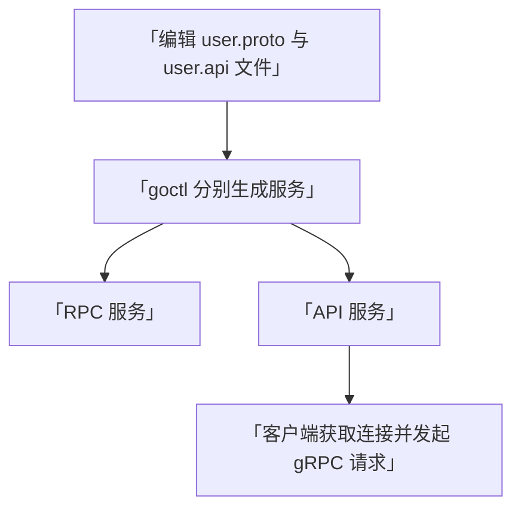

# 3-12-章节总结

本章首先从 go-zero 微服务框架与传统框架的区别、go-zero 的热度等方面展开了解，然后构建了 go-zero 的相关应用案例实例，了解了 API 服务、RPC 服务及其内部功能，最后对 go-zero 内部服务是如何执行初始化的做了一些分析。

先来回顾对 go-zero 这一块的了解。课程是从微服务框架与 Web 框架的区别开始分析的，然后再看 go-zero 在目前行业界的一些发展，以及 go-zero 在官方文章中的概念定义，从这些方面去了解 go-zero。

## 微服务框架与传统框架的区别

学习微服务框架的时候，很多人可能会有这样的疑问：毕竟传统框架已经用习惯了，只需要在其中引用 RPC 或者自己去实现 RPC，就可以构建微服务，没必要再使用一个新的框架。因此在这里提出一个问题来对比。

核心话题是：Web 框架主要针对 Web 应用，可以让开发人员快速地搭建和管理 Web 项目，所以它在模型以及视图这一块的构建非常快速；而微服务框架主要面向分布式系统和服务化的构建，每个服务可以单独开发，也可以单独部署，它是针对微服务体系中所存在的一些问题去展开设计的。这是它们本质上的区别。

## go-zero 的热度与设计

了解了两者之间的目的和用途之后，再看 go-zero 的一些热度问题：它是 2020 年开源的，目前 GitHub 上的 star 数有 25.6K。之所以能够被企业认可，一方面来自它内部社区的建设非常完善，像交流群、公众号，以及官方文章的更新，框架本身的更新非常齐全。

另一方面与它的设计有关：go-zero 吸收了很多微服务框架、Web 框架在实际开发过程中的经验并总结起来，使得使用 go-zero 的时候比较顺手，开发速度也比较快，这是 go-zero 在设计上的一个特点。这一点官方文档中也有提示，描述得非常明显：它的设计主要来源于目前实际的一些经验总结。

那么它到底有什么好的地方？在概念中其实已经描述了它一些比较直观的信息。结合本章的学习，体现得最直观的就是 goctl 命令非常强大，能够帮助构建一个可以运行的 API 服务，也可以构建一个可以运行的 RPC 服务；数据库模型这一块的生成也非常完善，可以快速生成数据库基础操作的相关方法。除此之外还有一些其他机制，比如自适应的超时、限流等也非常完善，所以随着发展被大多数人所认可。

## go-zero 的应用与模型

再看 go-zero 这一块的应用。使用 go-zero 主要需要注意两条命令：一个是 goctl 中创建 RPC 的命令，一个是创建 API 的命令。除了这两条命令以外，官方文档中还有很多其他命令，比如数据库模型这里的生成。

使用 go-zero 构建 API 服务的时候，官方有相应的示例和描述它的文档，语法、proto 的语法都写得比较齐全，构建 API 的时候可以参考。

实际上，使用 go-zero 构建案例的过程是：分别编辑好 API 服务文件和 proto 文件，再分别生成对应的 API 服务和 RPC 服务。本次的例子也是这么做的：先生成了一个 user.proto 的文件，再生成一个 API 的文件，并分别生成了对应的服务。

此外 go-zero 还有一些其他功能，这里提一下模型。模型的创建功能在于查询的时候使用了一些缓存：它自己会对模型在查询的时候自动使用缓存，并对增删查改对缓存做了处理。因此在应用层这一块，不需要针对模型中查询数据再额外去做一次缓存，它已经处理好了。当然也可以不用缓存，体现在命令上就是：不加 `-c` 就不会使用缓存，加了 `-c` 就会使用缓存。

## go-zero 对 gRPC 的扩展

对 go-zero 内部的探究主要从两大方面进行：一是探究 go-zero 对 gRPC 的实现，二是探究 go-zero API 服务的构建过程。

在实现上，go-zero 是基于 gRPC 去进行实现的，它通过 gRPC 对外提供的一些扩展方法以及设计方式，在其基础上进一步封装。可以理解为，使用 go-zero 的时候其实也是在使用 gRPC，只是 go-zero 帮忙封装了 gRPC 的一些操作。除此之外，它还提供了很多核心操作，通过源码就可以看到：源码中有一个 core 目录，这个目录下包含了一些核心的操作事项，比如限流、超时等机制都在这里。

再看 go-zero 服务这一块所定义的结构设计。在入口文件中得到的就是 RPC Server 这个对象，它有两个非常关键的属性：一个是 Server，一个是 cli。cli 是要求用户在调用 new 方法的时候传进来的，用于给用户自己去定义自己的服务；而 Server 则是具体实际启动的，它会因为所选的服务类型而发生改变：如果配置文件中使用了 ETCD 的配置信息，那么默认就会创建 KeyBalance；如果不是，就会创建原生的 RPC。可以通过源码，在 server.go 中看见它的创建过程。

客户端这边，得到的客户端都会实现上面的客户端接口。new 客户端返回的是一个 Clients 接口，在这个接口中只有一个方法，这个方法是获取 RPC 的连接对象的。简单讲，go-zero 客户端的目的就是得到一个连接对象，而它本身会去实现这一套服务发现、服务注册以及负载均衡的机制。

上层代码中提供了对应的客户端代码，去调度 gRPC 的客户端并发起 gRPC 的连接。因此实际上客户端注册是在这里注册，然后通过这里获取连接对象，并且发起 gRPC 的请求。

## go-zero API 的执行流程

最后看 go-zero API 的执行。先看 go-zero 在 API 这一块的设计：它采用了一个树的结构来构建，根据请求的 URL，将其中具有相似请求地址信息的部分进行拆分，构建成一棵树。这棵树的好处是对整个程序来说会减少内存，在查询效率上也不会特别差，因为它是树的结构，实际上实现了 go-zero 的一个折中：既能节省内存，性能也不会太差。

再往下是 API 服务器的流程：启动的时候，首先对整个服务器进行初始化，然后注册路由，注册的就是在上层定义的路由。注册完之后，再通过 Server Start 进行启动服务。在启动服务过程中，创建的时候本身就会创建一个 engine 的对象，因此启动服务之后，实际就是这个 engine 对象在启动，它会绑定路由、加载证书等这些操作。其中需要指出的是，这一步过程中它会去绑定路由，把路由、中间件这些绑定起来。这就是 API 服务的启动流程。

关于本章内容，主要是这些。
