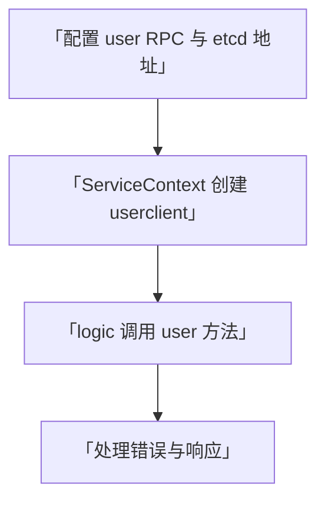

# 3-5-实践go-zero基础功能案例(api与rpc)-下

先看 internal 里的内容。配置文件比较简单，就一个服务名和监听的地址，地址可以修改。其中有一段 Etcd 配置，说明 go-zero 默认已经使用 Etcd 做服务发现注册功能，它认为创建的 RPC 服务就应该注册到 Etcd 中，所以这里填的是 Etcd 的地址。另外，课前已经在本地环境安装并运行了 Etcd，所以后面不再专门演示安装步骤。

## 服务端代码结构

回到代码本身。目前的代码只有业务逻辑、一个 Server 和一个 ServiceContext。先看 Server：Server 的设计都是基于 proto 文件生成的。go-zero 本身是基于 gRPC 进一步设计的，所以在服务定义上遵循 gRPC 的结构：以这个接口为例，它会要求第一个参数是 ServiceDesc，第二个参数是方法，第三个是输出和结果，也就是一个 Response 和一个 gRPC 的错误。

UserServer 实现了刚才那个接口，这就是实例化的结果。值得注意的是，实际执行中它会进一步调用业务逻辑：创建一个 GetUser 的业务逻辑处理对象，并调用这个对象的方法去处理请求。也就是先创建对象，再通过对象的方法完成 GetUser 的业务逻辑。

在 logic 文件中，会创建一个 ServiceContext 并在这里进行注册，把当前的 UserServer 注册进去，这就是整个目录结构的关系。

ServiceContext 里放什么？从 yaml 文件的结构可以看到。这里需要注意的是，ServiceContext 在整个服务中起的是一个上下文的作用，可以理解为服务的上下文，数据库的连接、其他服务的 RPC 客户端等都会放到这里，供整个逻辑层调度调用。

还有一个有意思的设计：逻辑层的对象是根据 proto 文件中的方法名来创建的。每在 proto 中写一个方法，比如再新建一个 RPC Ping，goctl 就会创建一个对应的 Ping 对象并处理 Ping 的业务逻辑。这是 go-zero 的设计特点。

对个人开发者而言，需要填写的只有业务逻辑，整个项目的构建运行基本上由 go-zero 一键完成。

## 实现业务逻辑并启动 RPC 服务

接下来完成 GetUser 中的业务逻辑：复制前面的代码，把 data 拷过来，修改 module，再把业务段拷过来，业务逻辑就写完了。

写完之后就可以启动运行，方式很简单：进入对应目录，执行 go run。启动后会有一些输出信息。测试用的是 ApiPost 工具：创建一个 gRPC 请求接口，导入之前那个 proto 文件，它就会生成相关的测试用例；服务地址填配置中的监听地址，再填上要访问的 Id 就可以了。

启动服务之后发起请求，能看到确实访问到了，说明服务构建成功。

## 编写 API 文件

RPC 服务构建完成后，接着构建 API 服务，同样先编写 API 文件。API 文件怎么写？官网文档中有 API 定义的介绍，内容比较多，可以直接参考快速开始里的 API 服务构建示例，把前面的内容拷贝过来。

可以看到这种写法风格与 proto 文件很类似：先声明版本，然后是 info，info 指 API 的一些信息，比如标题写用户服务的 API，描述写用户服务 API 的内容；其他信息如作者等也都可以加。

定义好 info 之后，就要定义对应的服务。API 服务的定义通过 service 关键词，代表当前是 API 服务，可以有多个。作为 API 服务，对外提供的是 API 接口，所以要定义好请求方式是 get 还是 post。这里定义一个 get 方法，请求路径是 user。方法中可以要求传递请求参数，参数在上面用 type 声明出来，即 UserRequest。这一段写法与 Go 语言的结构体很相似，也支持直接用 Go 的结构体来定义，没有问题。

类型的定义如 Id、string，写法与 Go 一致，同样支持标签，所以可以理解为 api 文件中的描述是 Go 结构体的简化版。再来一个响应：名称 string，再加一个手机号码的输出，到这里就定义了请求和响应的结构体。然后在方法中同时引用它们：入参是请求，输出是响应结果，这样一个 API 服务的描述就定义好了。

需要注意，这里定义的是 API 请求的 URL、请求参数和响应参数，但具体执行的方法还没有定义，需要通过注解的方式修饰：用 handler 关键词描述当前请求实际执行的方法，后面就是方法名。到此 API 服务定义完成。

## 生成并运行 API 服务

生成命令是 `goctl api go -api user.api -dir .`：-api 指定 user.api，后面的关键词指定生成的目录。第一次执行报了一个错误，提示要写一个 Module，因为模块命名要符合 Go 的规范。补上之后就生成完成了。

生成的 API 服务目录结构和 RPC 服务很相似，但多了一个 types 目录，里面定义的是 API 服务的结构体，可以理解为数据模型；同时多了 handler，可以理解为控制器，里面会定义路由和 handler 方法。整体来看：入口文件、types 中定义的结构和响应输出信息、ServiceContext、具体的业务逻辑处理层、控制器代码、路由，以及 etc 中的配置，一个服务的构建就完成了。

即使还没连接 RPC 服务，也可以先独立运行。比如把业务逻辑中定义错的 int 类型改成 string（本来应该是 string 类型），这里的业务逻辑代码不需要改变，只要重新执行一次命令，类型就会自动更正过来。

然后执行 go mod tidy 添加依赖，再启动服务。回到 ApiPost，创建一个接口测试这个 go-zero API：接口地址是 HTTP 的 127.0.0.1，端口 8888。直接请求可能会返回 404，因为请求地址应该是 user；再带上 Id 参数请求（GET 方式，关键参数就是 Id）。可以看到请求成功并返回了数据，API 服务的构建非常快。

## API 服务调用 RPC 服务

最后让 API 服务访问 RPC 服务。先把 API 服务停掉，RPC 服务保持不动。回到 API 服务中，重点是配置文件：在配置中定义好 user RPC 的服务对象，使用 etcd 作为服务发现，写上请求地址、etcd 的地址，最后是一个 key：user.rpc。如果不知道怎么写，直接从 RPC 服务那边把对应配置拷回来即可。

配置定义完之后，还要保证结构体中的配置项与之一致（命名为 user RPC，不一致会报错），然后定义 rpc 的客户端配置。配置完成后，修改 API 下面的 ServiceContext：引入 user 的 userclient 客户端对象及相关依赖包，在 ServiceContext 中创建出来，这样就得到了一个客户端服务。

在 API 服务中使用它也非常简单：调用处给它 user 的响应信息和错误，通过 ServiceContext 中的 user 客户端去调度，调用 user 方法，创建 context，再创建请求信息。这些信息在 userclient 中都已经定义好了，因为它本身就是对 user RPC 的封装，使用起来非常简单。最后处理一下错误和响应信息，user RPC 服务就能够被 API 服务调用了。重新启动 API 服务后再请求一次，没有问题。整个案例构建完成，内容并不难，构建起来也很快。

细节上需要重点理解的是 go-zero 目录结构的设计意图，其次是命令的编写，再是 demo 的设计。另外要注意 API 文件的格式，后续课程中还会用到。除此之外，像 model 等一系列生成示例，也可以通过 goctl 命令生成。

本节的核心是了解 go-zero 如何构建 RPC 和 API 服务，以及它们如何调度和使用。总结来说非常简单，上手也很快。学习和使用 go-zero 时，一定要理解它目录结构的设计意图：最外层代表服务，里面是服务中的细节、服务对象、服务类型，再往里是配置以及最终聚合的逻辑，然后是 user 这个库（当前的服务类型），最后提供了对外的客户端。
