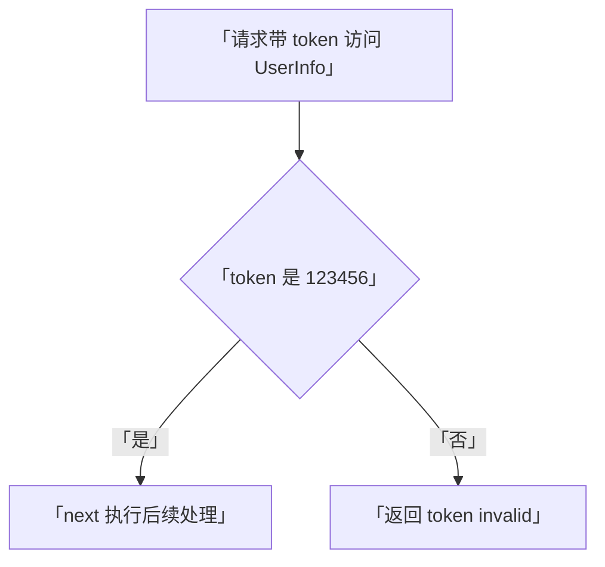

# 3-7-实践go-zero基础功能案例(数据库读写与中间件（下）

新增和插入已经验证没有问题，不再演示。接下来看 go-zero 的中间件处理。RPC 这一块已经差不多了，但项目中 API 也需要中间件，因为传输的权限验证都是通过中间件处理的。比如实际的 get 操作，肯定需要进行权限验证。在 go-zero 中，这件事处理起来非常简单。

## 在 api 文件中定义中间件

在最初的示例基础上新增一个 service：User，仍然是用户相关的服务。在其中填一个 handler 方法 GetUser，定义请求 URL 和返回值，返回值还是使用上面的结构，区别只在路由不一样。

go-zero 的 .api 文件支持同一个 service 定义多个接口，相当于多组路由：上面一组，下面一组，但它们可以归属于同一个服务对象。

要让这一组路由使用中间件，在它上面定义一个 `@server`，定义好之后，下面的 service 就会使用 `@server` 中定义的操作。比如定义一个中间件，名字为 LoginVerification，用于做登录验证。这会影响上面那段定义吗？不会，因为上面的 service 前面没有 `@server`，所以不受影响。定义好的 .api 文件如下：

```go
service User {
    @handler user
    get /user(UserReq) returns(UserResp)
}

service User{
    @server LoginVerification
    @handler user
    get /userinfo(UserReq) returns (UserResp)
}
```

定义好之后重新执行生成命令，指定 API 文件为 user.api，执行一次。

执行时会扫描是否存在重复要生成的文件：对已存在的文件会跳过，发现新需要生成的才去定义，已经生成过的内容不会被改动。

可以看到，它创建了一个中间件，同时在 handler 中创建了 UserInfo 对应的方法处理，也生成了 UserInfo 的处理逻辑，并为 UserInfo 定义了路由。这里有一个值得注意的现象：路由处会引用这个中间件，但编译时会抛出错误，提示不认识这个中间件。为什么生成代码没有帮忙完成中间件的创建？因为像登录验证这样的中间件，往往需要额外的实现或特定的业务处理，goctl 没有在生成代码中代劳，还需要自己在代码中创建中间件并使用它。下面继续完善。

## 创建并使用中间件

完善中间件的实现。在 ServiceContext 中使用中间件时，名称就是 .api 中定义的名称（LoginVerification），类型是 rest.Middleware。编译时报错，观察后发现 rest.Middleware 是一个方法类型，而当前填的是一个结构体对象。这个方法类型就是 Handle，rest.Middleware 的实现要求，所以还需要在中间件上实现 Handle 方法才能使用。在 ServiceContext 中的创建如下：

```go
func NewServiceContext(c config.Config) *ServiceContext {
    return &ServiceContext{
        Config: c,
        User: userclient.NewUser(srpc.MustNewUserClient(c.UserRpc)),
        LoginVerification: middleware.NewLoginVerificationMiddleware(),
    }
}
```

其他地方没有任何改变，业务逻辑、路由都没有动，只是在这里定义好中间件，go-zero 就会自动把这个中间件挂到对应的路由上，而前面的路由没有任何变化。

接下来完善中间件内部的实现，逻辑很简单：根据请求头是否传递了 token，并且值为 123456，匹配则放行往下执行，否则抛出异常。这样一个中间件就定义完成了：



```go
func (m *LoginVerificationMiddleware) Handle(next http.HandlerFunc) http.HandlerFunc {
    return func(w http.ResponseWriter, r *http.Request) {
        if r.Header.Get(「token」) == 「123456」 {
            next(w, r)
            return
        }
        w.Write([]byte(「token invalid」))
        return
    }
}
```

## 测试中间件效果

启动服务，然后在 ApiPost 中测试。先请求 get /user 这个接口，没有问题。再换 UserInfo 接口，同样是 GET 请求，请求后返回 token invalid，说明不携带正确 token 是无法访问的。把正确的 token 复制过来，在 header 中设置后再请求，就没有再出现 token invalid 的问题。

这里返回 none 是因为还没有完善 UserInfo 的代码。把对应代码拷过来完善：

```go
func (l *UserLogic) User(req *types.UserReq, resp *types.UserResp, err error) {
    getUserResp, err := l.svcCtx.User.GetUser(l.ctx, &userclient.GetUserReq{
        Id: req.Id,
    })
    if err != nil {
        return &types.UserResp{
            Id:     getUserResp.Id,
            Name:   getUserResp.Name,
            Phone:  getUserResp.Phone,
        }, err
    }
}
```

重新启动服务，业务就正常了，说明中间件已经生效。

本节主要介绍了 go-zero 中数据库的读写操作，以及中间件的处理。整体并不复杂：理解其中的机制，通过命令生成代码，然后使用即可。
