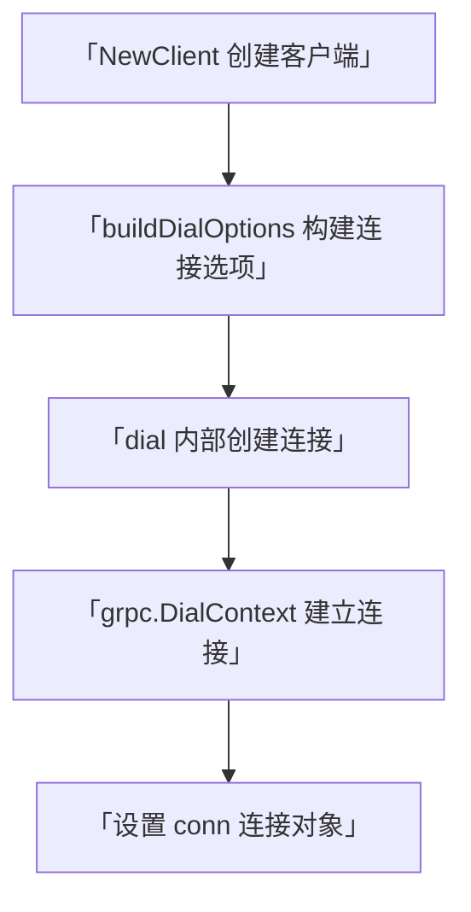

# 3-9-探究go-zero是如何基于grpc进一步扩展-client

上一讲分析了 go-zero 如何基于 gRPC 扩展 Server 服务，本讲继续探究它如何扩展 Client。内容主要有两个：一是 go-zero 与 gRPC 客户端的适配方式，二是 Client 的初始化过程。

## go-zero 对 gRPC 客户端的适配

先看适配方式。适配涉及调用链路，所以要进入 API 的 ServiceContext。ServiceContext 中主要做的事情是引用 userclient 对象并进行初始化。这个对象是通过 go-zero 提供的 goctl 命令生成的，通过其中的 New 方法得到对象。

在这个文件中，定义了对当前客户端操作的一些结构体和属性类型，再往下是具体的调度。先看初始化方法，它要求传入的是 gRPC 的客户端：

```go
type defaultUser struct {
    cli zrpc.Client
}

func NewUser(cli zrpc.Client) User {
    return defaultUser{
        cli: cli,
    }
}
```

再看客户端的使用，即调度方法。方法的第一行是创建：使用 zrpc.Client 生成对 gRPC 访问操作的客户端对象，传入的参数是一个客户端连接。可以看到，当前程序主要是用 gRPC 的 Client 获取客户端连接，再通过这个连接得到操作的客户端，并最终调用它发送 RPC 请求。以这样的方式适配 gRPC，命令生成的这段客户端调用处理，整体上与 Server 侧具有相似的特征。

## 客户端的初始化过程

看初始化之前，先看它的结构。上面是 gRPC 对客户端的定义，一个接口，这个接口有一个方法，用于返回 gRPC 的客户端连接：

```go
func (c *Client) Conn() *grpc.ClientConn {
    return c.conn
}
```

下面有两个实现，一个是基于 etcd 的生成，还有一个是默认生成。从这里可以看出，基于 etcd 的 client 使用了这个 client 对象，所以它最重要的实现还是在 gRPC 这个 client 上。再往下看创建过程：

```go
func NewClient(target string, middlewares ClientMiddlewaresConf, opts ...ClientOption) (Client, error) {
    cli := Client{
        conn: nil,
        middlewares: middlewares,
    }

    svcCfg := fmt.Sprintf(`"loadBalancingPolicy"="%s"`, svcCfg)
    balancerOpt := WithDialOption(grpc.WithDefaultServiceConfig(svcCfg))
    opts = append(opts, balancerOpt)

    // ... 其他配置项 ...

    target = cli.dial(target, opts...)
    return &cli, nil
}
```

上面第一行处理的是服务端是否设置了证书验证：判断有没有证书验证，有的话就设置证书验证的连接处理。这一段整体上都是对连接处理的操作，连接相关的选项通过下面的方法构建：

```go
func (c *Client) buildDialOptions(opts ...ClientOption) []grpc.DialOption {
    var options []grpc.DialOption
    for _, opt := range opts {
        options = append(options, opt)
    }
    return options
}
```

然后通过内部 dial 的方式创建客户端，这是整个 gRPC 客户端的处理。在这一段上面值得注意的是，处理时会设置一些默认属性参数，比如超时、连接保活。

继续分析内部客户端创建的具体过程。这一段中，真正创建连接的是其中一行代码。上面得到的是负载均衡的操作，负载均衡的处理会在后面的课程中分析，这里只需要知道这两行代码是在设置服务发现和负载均衡机制，让它们能够加载进 gRPC 系统；具体加载过程稍复杂，后面课程会专门分析。

再看连接的建立。连接建立前首先通过一个标准方法返回 gRPC 系统连接的处理，在这个处理对象中会加载好证书等内容。这里也可以看出，拦截器的设置方法与 Server 侧的服务定义具有相似的特征，同样默认定义好了拦截器处理：

```go
func (c *Client) buildInterceptors() []grpc.UnaryInterceptor {
    interceptors := []grpc.UnaryInterceptor{}
    if c.middlewares.Breaker {
        interceptors = append(interceptors, clientinterceptors.BreakerInterceptor())
    }
    if c.middlewares.Timeout > 0 {
        interceptors = append(interceptors, clientinterceptors.TimeoutInterceptor(c.middlewares.Timeout))
    }
    return interceptors
}
```

再往下设置请求超时，并让客户端建立连接，建立之后设置好连接对象：

```go
func (c *Client) dial(server string, opts ...ClientOption) error {
    options := c.buildDialOptions(opts...)
    timeCtx, cancel := context.WithTimeout(context.Background(), dialTimeout)
    defer cancel()
    conn, err := grpc.DialContext(timeCtx, server, options...)
    if err != nil {
        return fmt.Errorf(「rpc dial: %s, make sure rpc service %q is already started」, err, server)
    }
    c.conn = conn
    return nil
}
```

整体来说并不复杂。可以看到，go-zero 对 gRPC 的操作在客户端这一块并不复杂：基于客户端进行初始化，初始化时帮助设置好拦截器以及服务发现机制。



本讲内容就到这里。
