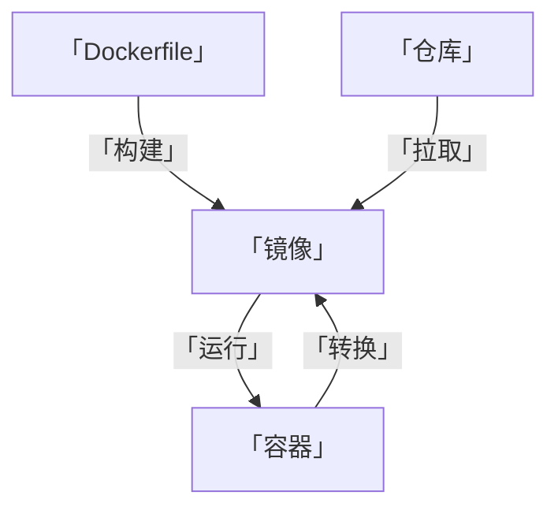

# 4-1-docker介绍与安装及上手应用

## 从单体到微服务：部署难题的由来

我们先回顾一个单体项目。当单体项目按功能模块拆分为多个微服务之后，会面临一个现实问题：这些服务怎么部署？

在实际生产中，我们通常会根据每个服务的特点，选择合适的机器来进行部署。这就会造成多个服务被分散部署到不同的机器上，原本一个项目可能只需要一台机器，拆分成微服务体系之后，就需要多台机器来支撑这些服务的部署。

这会带来一系列问题。

首先是部署过于繁琐。以前只需要部署一台机器，现在可能需要三台、四台甚至更多。虽然每台机器的部署过程大同小异，但各台机器上的配置、软件版本往往存在差异，这无疑大大增加了工作量。

其次是扩容和缩容比较困难。当需要自动增加一台新机器，或者需要减少一些机器时，操作起来并不容易，因为部署本身已经很麻烦，再增加一台机器意味着继续增加部署难度，而且部署完成之后，还要把新机器加入到整个项目中来，这对整个系统来说是很有挑战的。

再次是环境不一致的问题。虽然可以部署多台机器，但每台机器上的环境其实并不一样。典型的情况是：本地开发往往在同一台机器上完成，而到了生产环境可能是多台机器，此时就会产生环境不一致的问题，并可能因此引发一些不必要的故障。

最后是服务管理难度的增加。以前只需要管理一台机器、一台机器上只有一个程序在运行，只要保证它能活着就可以了。现在则可能需要管理很多台机器，每一台机器的运行情况、性能情况都需要关注，这极大地增加了工作难度。

因此，在业界实践中，为了让项目更加专注于自身的业务，Docker 技术应运而生，用来解决这些问题。

## 虚拟化技术及其瓶颈

要理解 Docker 是怎么解决这些问题的，首先需要理解虚拟化技术。

比如我们有一台机器，希望在这台机器上同时运行 CentOS、Ubuntu、macOS，再起一个 Windows，虚拟化技术就可以做到。它根据当前系统所运行的资源进行分割处理，把这些资源虚拟成一个新的、独立的系统，然后再运行起来。

这样一来，前面提到的服务环境不一致的问题就迎刃而解了：我们可以在不同的服务器上虚拟出需要的环境，然后部署项目，不需要关心其他系统的环境怎么样，只要能够虚拟出目标系统的环境，就可以运行自己的程序。

但这种技术并不能直接解决所有问题，它还存在一些典型的短板：

- **重量级**：虚拟机以 GB 为单位。课程中使用的虚拟机工具（VMware）虚拟出的系统，一个占用 5G 存储空间，另一个占用 9G，无论哪一个，单位都是以 GB 计的。
- **启动慢**：启动虚拟机相当于启动一个完整的系统。机器配置高，启动速度就快；配置一般的话，可能需要三四分钟才能启动。
- **移植性差**：把当前运行的虚拟机迁移到别人的电脑上比较麻烦，因为它需要占用数 GB 的存储空间，需要打包之后再传输，整个过程并不轻松。
- **资源开销大**：虚拟机在运行过程中比较吃内存等运行资源。机器有 16G 内存时开多个虚拟机没有问题，但如果机器本身只有几个 G 的内存，开一个虚拟机都很有挑战。

## Docker 与容器化技术

Docker 采用的技术是容器化，可以理解为虚拟化技术的缩小版，它在虚拟化技术的基础上，针对上述问题进行了优化：

- **体积更小**：从 GB 级别缩小到几十兆、几百兆；
- **启动更快**：系统的启动速度大幅提升；
- **移植性更强**：几百兆的东西，移植起来非常方便；
- **开销更低**：运行时的资源占用远低于 VM。

也就是说，容器化技术把 VM 所存在的问题逐一优化、缩小，同时仍然保留了虚拟化的核心特征，可以虚拟出新的系统供程序使用。

理解了这一点，也就理解了 Docker：有了 Docker，前面微服务拆分之后的问题就很好解决了。针对每一个服务，我们只需要构建好相关的 Docker 容器，再把它迁移到其他系统中，部署就更加方便，环境也能够保持统一。同时，我们可以持续性地交付项目，只需要交付编译之后的 Docker 镜像即可。

## Docker 的下载与安装

接下来需要下载并安装 Docker。课程文档中给出了完整的安装命令，按照文档的步骤执行即可。当前演示所用的系统是 CentOS，如果使用其他系统会有一定的差异性，但整体来说，Docker 的安装没有太复杂的细节。

安装过程中有一个需要特别关心的地方，就是文档下方配置 Docker 镜像资源地址的部分。它主要解决的是 Docker 下载系统镜像的速度问题，Docker 的镜像默认从国外下载，国内访问国外会比较慢，因此可以配置国内的镜像加速地址来提升拉取速度。把文档中给出的配置命令运行一遍，Docker 就安装好了。

在操作之前，我们先理解几个 Docker 相关的核心概念：

- **宿主机（Host）**：Docker 所安装的这台机器，就称为宿主机。在后期项目和个人工作中，我们都会经常提到宿主机这个概念，一定要理清楚。
- **容器（Container）**：Docker 运行所需要的系统资源，统称为容器。以后我们会经常以「容器」来代表 Docker 运行所需的这些系统，以「宿主机」来代表 Docker 所安装的这台机器。

## Docker 的核心组成

Docker 是怎么构建容器的？这就要提到它的几个关键组成。

**镜像（Image）**：我们一直提到的「系统」是怎么来的？它肯定是可以运行的，而这个系统需要我们下载之后才能运行，下载的就是镜像。镜像是对一个系统的说明和描述，一个程序系统本身严格来说也是一个城市（编译产物），编译之后的可运行文件就可以称为镜像。所以运行容器前需要下载镜像，这是非常关键的一步。在 Docker 中，我们根据镜像来构建容器；同时，构建完容器之后，Docker 也支持由容器再转为镜像。例如从 1.0 的镜像构建出一个 1.1 的容器，容器在操作过程中可能又安装了一些新的程序、运行了一些新的事项，此时也可以将容器转化为镜像，Docker 为此提供了相关的命令。

**Dockerfile**：镜像从哪里来？首先可以通过 Dockerfile 定义出来。Dockerfile 本身是一个文件，也可以说是一个描述，它描述了这个镜像会有哪些内容。我们可以在 Dockerfile 中定义需要哪个系统、在这个系统里安装哪些软件和程序、如何运行、如何配置。定义好之后，再编译出一个镜像，最后基于镜像构建出容器。

**仓库（Repository）**：除了 Dockerfile，仓库也是获取镜像的关键位置。我们可以从仓库中拉取镜像。可以这样类比理解：镜像是你的代码，仓库就是你的代码仓库。其中比较大的仓库是 hub.docker.com，上面存放了大量的镜像，比如 Go 的镜像就有很多版本和相关内容，我们可以从这里拉取镜像。

## Docker 的常用命令

Docker 的常用命令主要有四个：

- `docker pull`：从仓库上拉取镜像；
- `docker images`：查看系统中的镜像；
- `docker run`：基于镜像运行容器；
- `docker ps`：查看所运行的容器。

这四个命令在课程以及日后的工作中会经常用到。

下面以 Redis 为例进行实操演示。

首先在仓库中搜索 Redis 的镜像，这里有一个 tag（标签）的概念，同一个镜像有很多版本标签，以及其他所运行的系统信息。我们选择一个带版本标签的，执行 `docker pull` 拉取镜像。拉取完成后，用 `docker images` 查看拉取到的镜像。输出的信息包括镜像的名称、标签、镜像 ID 和创建时间、大小等，可以看到这个 Redis 镜像只有 38.4 兆，相对于虚拟机以 GB 计的体积，在项目部署上非常有优势。

接下来执行 `docker run`，它根据镜像把容器跑起来。可以通过 `docker run --help` 查看命令的写法，这里有很多介绍，我们只使用常用的参数：

- `-p`：指定运行的端口，即端口映射。当前启动的是一个系统（容器），它有自己的端口，但它是运行在宿主机内部的，外部并不知道容器内部是怎么访问的。所以要访问容器，需要先访问宿主机的端口，再由宿主机的端口映射到当前的容器端口。`-p` 的第一个值是宿主机的端口，然后再绑定容器里面的端口，这样两个端口就绑在了一起，访问宿主机端口就能访问到容器端口。
- `--name`：给容器起一个名称。
- `-d`：让容器后台启动。
- 最后一个参数非常关键，是镜像名，当前是 Redis 的名称，后面跟上对应的标签。

回车之后，如果能看到输出的容器 ID，说明当前程序已经启动成功了。再用 `docker ps` 验证一下，可以看到容器启动成功。输出信息中，NAME 列代表容器的名称，也就是上面通过 `--name` 指定的；后面是容器的 ID、启动所使用的镜像、实际执行的命令、启动的时间，以及端口信息，这里映射了宿主机的 16379 端口到容器的 6379 端口。

也就是说，我们想要访问容器很简单，找到这个映射的端口就可以了。我们可以用一个 Redis 连接工具，输入当前服务的地址进行连接。这个工具部署在当前的 Windows 上，而实际的宿主机是通过 VMware 虚拟出来的 CentOS 系统，容器是运行在这个 CentOS 里面的。连接时端口填 16379，密码为空，确定后可以看到连接成功。

我们可以给 Redis 添加一个 key，例如 `user`，值为 `imooc.com`，刷新页面就能看到这个 key。接下来进入容器看看，容器是一个运行的系统，怎么进去呢？可以使用命令 `docker exec -it 容器名称 sh`。

其中 `-i` 的意思是希望和这个容器进行交互，而且是保持交互的，而不是交互一次之后就结束，所以我们能够一直保持连接；`-t` 是代表要执行操作；然后选择要进入的容器，最后还要跟上要执行的命令 `sh`，这样就可以进出容器了。

进入容器后，可以看到容器内的 IP 是 172.17.0.2。再查看之前写入的 key，执行 `get user`，就能看到我们所写的数值 `imooc.com`。这说明我们已经和容器交互起来了。

需要注意的是，我们实际上并没有在宿主机上安装 Redis，而是通过下载 Redis 容器完成了 Redis 的安装，这种移植性就非常方便。在今后的项目中，大家进行容器开发时，往往都是把自己的项目编译好、打包好，通过容器进行部署，这样就能保证环境的统一性。

另外，当前这个容器所运行的系统是 Alpine 系统，后期也会经常提到。

## 本讲小结

本讲的核心是让大家了解 Docker，理解 Docker 的目的和它要解决的问题，同时把 Docker 安装好，并对 Docker 进行实际应用。掌握这些内容，就为后续在项目中使用 Docker 做部署打下了基础。
