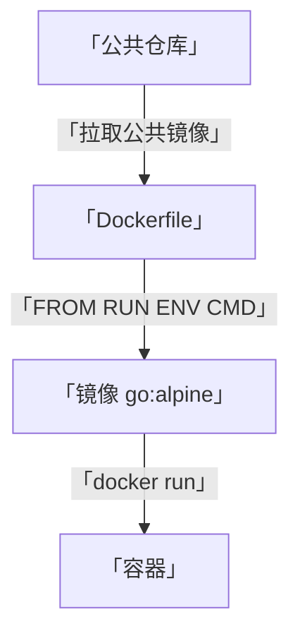

# 4-2-dockerfile介绍并创建go-zero环境容器（上）

## Dockerfile 的作用与定位

上一讲已经了解了 Docker 的作用和目的，安装好了 Docker，并构建好了它的应用实例。本讲来了解 Dockerfile，并基于它构建一个 Go 环境容器。

先回顾一下 Docker 的组成。在 Docker 中，镜像是一个非常重要的存在，可以把它理解为一份程序或者一份代码，在镜像里面包含了容器启动的所有相关内容。Docker 会基于镜像构建出容器，容器也可以转换为镜像，这一点在 Docker 内部有对应的实现。

那么镜像怎么来？为此 Docker 提供了 Dockerfile。Dockerfile 以文件的形式存储，里面会描述好镜像的构建过程以及它所依赖的系统。Docker 会基于 Dockerfile 里面的命令一行一行地执行，最终构成镜像。所以 Dockerfile 的目的就是构建出镜像。

镜像构建成功之后，可以在本地构建成容器，也可以把它推送到仓库中。在正常的开发流程中，一般是先从公共仓库中拉取一份公共资源的镜像，再基于公共资源镜像进行处理，利用 Dockerfile 的方式把它编译成一个新的镜像，然后推送到自己的私有仓库里去；而运维则从私有仓库中拉取镜像并部署，或者自己拉取镜像来部署。所以仓库可以有公共的，也可以有私有的。

了解了 Dockerfile 相关的组成之后，先从零构建出一个 Go 环境的容器，因为 GoZero 肯定是需要 Go 环境才能运行起来的。除了基于 Go 源码的方式之外，也可以采用编译的方式，将 GoZero 的项目编译成一个可执行文件来进行部署。本讲会用两种方案：第一种是直接基于 Go 语言本身的项目程序，第二种是基于编译后的执行文件。同时，也会总结出在 Docker 使用中经常可能遇到的一些问题。

## 使用 Alpine 作为基础系统

先看 Go 的容器应该怎么搭建。构建的过程是这样的：在自己的电脑上先编辑好一份 Dockerfile 文件，通过它来生成镜像，然后再基于生成的镜像构建好容器。

由于要从零构建，理论上来说并不会直接下载一个 GoZero 环境的容器，而是下载一个空的系统。业界中系统有很多，比如 CentOS、Ubuntu；而在常用的容器系统中，有一个比较小型的 Alpine 系统。这个容器系统非常小，在 Docker Hub 的功能搜索中输入 Alpine 就可以查到，官方文档中写出了 Alpine 的大小：只有几兆。虽然比较小，但是它应有的功能基本上都有。

为什么常用 Alpine 系统？业界中经常用到 CentOS 和 Ubuntu，但这两个系统一般来说比较大；而 Docker 是一个轻量级的容器化程序，所以它希望自己的程序、自己的容器，理论上来说也应该足够小，这样在部署和传输上就比较方便。

选择其中一个版本，这里选择第二个，拉取 Alpine 镜像。拉取之后，在本地就可以看到 Alpine 镜像。接下来就会基于这个 Alpine 去构建 Go 环境容器。

## 容器退出问题与挂起命令

按照前面讲过的，会通过 Dockerfile 来构建。但在使用 Dockerfile 之前，先不急着构建，而是先根据这个镜像直接通过 `docker run` 启动一个容器，看会发生什么问题，这一点后面会讲为什么。

用 `docker run` 启动一个 Alpine 容器，当前要构建 Go 环境，所以给它一个容器名，就叫 `go`，再选择镜像。这里会暴露一个问题：当前的容器并不是运行状态。

为什么会出现这个问题？前面构建 Redis 的时候，能够很顺利地通过 `docker run` 这样的方式去构建，但现在不行了。这和 Dockerfile 本身有一定的关系，可以这样理解：`docker run` 启动容器时，实际上是在启动一个新的程序。如果这个程序是一条路走到底、没有任何的阻塞，那么理论上一下就跑完了；但如果里面用了个循环，它就会阻塞在这个地方，阻止这个程序结束。

而现在 Alpine 系统里面没有任何的内容，也没有任何的事项，它只是一个系统。所以此时构建的容器，`docker run` 构建成功了，但是构建成功之后程序就结束了，因为没有任何的阻塞让它挂起运行，所以就会出现构建成功但程序立即退出的现象。

怎么解决这个问题？可以先删除掉刚刚创建的容器。一般删除容器可以这么写：先用 `docker stop` 停止一个正在运行的容器，第二个参数是根据容器名或者容器 ID，它会返回当前停止的容器的 ID 或者容器名；然后以它作为参数往后传递，再用 `docker rm` 删除一个正在运行或者没有运行的容器。这样刚刚的容器就会被删掉。

接下来解决上面提到的问题：之所以构建的 Alpine 容器停止了，是因为没有任何的挂起程序阻止这个程序结束。那很简单，给它一个挂起的操作就可以了。挂起的操作有很多，比如 `ping imooc.com`，这是比较典型的例子，用 `ping` 来解释再合适不过。

还是前面的命令，没有任何改变，改变的地方在最后：给这个程序启动的时候加上一条操作，即 `ping imooc.com`。再 `docker ps` 一下，这时能够看到容器是正常运行的状态。然后用 `docker exec` 进到容器里面去执行 `ping imooc.com`，可以看到是没问题了。这样一个容器就启动好了。

但是启动的时候它还是空的，因为目前容器并不具备 Go 的环境，输入 `go` 命令会提示命令不存在。因此还是要在这个基础上面去安装好 Go。

## 在容器中手动搭建 Go 环境

首先定义好环境变量，`export PATH=$PATH:/usr/local/go/bin`，把 Go 的目录加到 PATH 前面。接下来还要安装好一些相关的程序，也就是要去下载 Go 的安装包。这些准备好的命令在课程文档里面，复制后在容器中执行。

值得注意的是，在这个命令中，有一个参数是让这个程序不进行请求的证书验证，如果不加它可能会报错。下载之后对它进行一个校验，然后再删除掉刚刚下载的这个文件。

最后还有两行命令非常关键：在 Alpine 系统里面直接去执行 Go，它会抛出一些库不存在的问题，这是 Alpine 系统下会存在的问题，一定要注意。用 Alpine 系统构建时会抛出一个错误，因此需要再执行这两行命令，最后再设置好它的环境变量。此时再输入 `go version` 就没问题了，可以确定 Go 的环境构建好了。

这对学习 Dockerfile 有什么帮助？Dockerfile 能构建镜像的关键，就在于它所执行的命令；而它执行的命令，其实就是刚才在容器中所执行的这些命令。简而言之，把在容器里面所编写的这些命令写到一个文件里面去，这样就不用反复地写了，然后用 Docker 来执行这个文件，也就是执行所写的这些命令，帮我们一步步地构建好镜像。把这些命令放到 Dockerfile 里面，Docker 会识别 Dockerfile，把里面的命令一行一行地执行，这就是 Dockerfile 构建镜像的关键。

## 编写 Dockerfile

现在回到程序中写一个 Dockerfile。

Dockerfile 的第一行是亘古不变的，那就是 `FROM`，代表当前要构建的镜像或者使用的镜像，即根镜像，它是基于哪个镜像去构建环境的，所以这一行不变，它永远都是第一行。它选择的对象可以是仓库，这个仓库可以是私人仓库，也可以是公共仓库，后面跟镜像名。当前是基于 Alpine 系统来构建的，所以这里使用的是 Alpine。

接下来第二行是 `RUN`，代表要运行，也就是要在这个镜像里面运行哪些命令。比如刚才在这个容器中所写的命令，可以把它复制到这里面来：这里创建一个目录，就给它复制进来；复制之后还要 `cd` 到这个目录下面，给它写好。

`RUN` 可以写多行多个，一个 `RUN` 执行一行。但在 Docker 中不会这么写，因为这样会有一个问题：虽然这种方式一行一行地执行下来，程序本身是支持的，但不建议这么写。这和 Docker 本身的构建机制有关：Docker 每执行一行 `RUN` 之后，会生成一个临时镜像，叠加到自己的历史中。比如现在是最后一行，它会有一条临时镜像的记录；下面再执行一行 `RUN` 又会有一个临时镜像的记录；再来一行就又多一个记录。这样的多条无意义的临时镜像，会导致最终构建的容器以及镜像体积比较大。

所以一般不会这么写，一般会选择把能够拼接的命令拼接起来，这就是最终建议的写法。在这个层面中通过 `&&` 符号、加上续行符把它们作为一个整体来书写，这种写法使得整个实际上只有一行命令，但这些命令是拼接起来的。因此在运行之后，只会创建两个临时镜像：第一个是上面这个，第二个是这里。所以这是一个非常需要注意的地方，之后自己看别人的 Dockerfile 时，也会经常看到很多人把命令拼接起来。

然后再次设置它的环境变量。`ENV` 代表环境变量，比如 Go 相关的：第一个环境变量配置的是 Go 的目录，第二个环境变量配置的是 Go 安装之后的目录。`ENV` 这个环境变量的参数是由 key 和 value 的格式组成的，所以写法是：第一个参数是 key，第二个参数是 value。

还有一个命令叫 `CMD`，它是启动时候要运行的命令。比如前面在创建 Alpine 容器的时候，执行了一个 `ping imooc.com` 的命令，这行命令也可以让容器在启动的时候预设进去，通过 `CMD` 的方式设置。注意，这里要通过逗号分隔命令的参数。

此时一个 Dockerfile 就写好了。然后要基于这个 Dockerfile 去构建镜像。因为已经将机器的 ID 和系统环境配置好 SFTP，所以它会帮我们把 Dockerfile 同步到服务器中，不用自己再上传。上传之后，服务器这边就有了要使用的 Dockerfile。

那怎么去构建镜像？可以使用 `docker build` 命令，这个命令中有很多的参数。官方文档中有一个事例：这里有一个参数 `-t`，上面有解释，就是指这一个镜像的标签，它的目的是根据 Dockerfile 去构建镜像，镜像的标签和标题就是通过 `-t` 这个参数指定的。后面的点是什么意思？点是指定这个 Dockerfile 是哪一个文件，如果没有指定、只是通过一个点的话，它会在执行命令的当前目录里去查找一个叫 Dockerfile 的文件，如果存在就执行这个文件，不存在就会报错。为了解决这个问题，也可以通过 `-f` 的方式去指定 Dockerfile 的路径。后面还有一些其他参数，像这里又通过 `-f` 去指定这个 Dockerfile。

因为当前是在同一台机器，所以可以通过 `docker build -t go:alpine .` 来构建。运行的时候可以看到：它会运行第一行，去加载 Alpine 系统；然后再运行第二行 `RUN`，执行前面在 Alpine 系统所执行的一些操作；执行完之后，最后设置好环境变量。没有抛出任何错误，说明成功了。用 `docker images` 看一下，这里就有一个 Go 相关的镜像，说明没问题。

## 基于自定义镜像运行容器

接着试着让它构建好容器，看实际效果。执行 `docker run` 来构建容器，要使用的是刚刚构建的 `go:alpine` 镜像。使用之后这里有一个错误，意思是当前已经存在一个叫 `go` 的容器在运行了，再创建一个 `go` 是不行的。

从这里可以看出来，容器名也是唯一的，会和之前的容器名冲突。那么需要把它停止，然后再删除。完成之后再重新构建容器，此时就没问题了。再 `docker ps`，也证明确实没问题。

现在容器里面如果要执行命令，命令的方式是前面指定运行这个容器中的什么命令，后面就是具体的命令。比如可以执行 `docker exec go go version`，看这个 Go 容器里面的命令。除了 `docker exec` 之外，也可以像之前一样用 `sh` 进到容器里面，也可以直接运行这个 Go 容器的命令，这也是可以的。

这里还有一个小细节需要注意：`sh` 这个命令是 Linux 用于界面交互的，除了这个命令以外，还有像 `bash` 也是可以的，但一般来说 `sh` 用得更广泛一些。

至此，Go 环境容器就构建好了。
