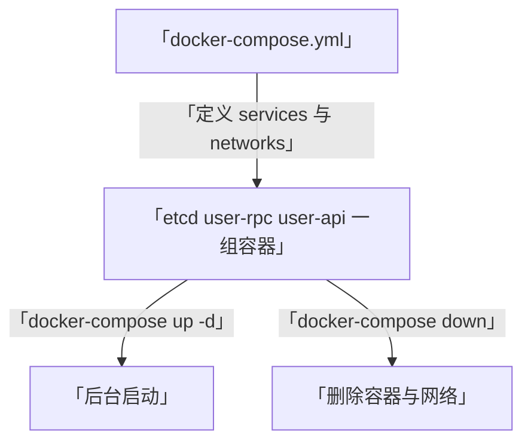

# 4-5-docker-compose编排（下）

## 容器与宿主机共享配置

先看 Dockerfile。在 Dockerfile 中已经指定了要运行的配置文件，并且指定了这个配置文件的目录，在 etc 下面。也就是说，只需要将这个 etc 目录在启动时候通过 `-v` 的方式配置好它与宿主机的目录共享，此时修改这个目录下的配置信息，就可以解决问题。

当然是可以的。但为什么还是要先把配置 COPY 进容器？因为添加到容器中的这个配置，将会作为这个容器的默认配置信息，这样在后期自己运行时就不需要太多操作了。像 Redis 也是这样的一个方式。

接下来重新分别把它们构建好容器，再 `docker ps` 一下。这一次就没有再像刚刚那样运行一下就停止了。然后再访问、请求，没有问题，访问成功，说明整个案例执行成功了。

## 使用 Docker Compose 统一编排

再回想一下整个案例的操作，还是有一些繁琐。繁琐在哪里？容器的创建、网络的创建以及运行，是否过于繁琐？有没有更好的方式？这里可以通过 Docker Compose 来对前面所做的事情进行管理。

它的特点可以说是一个配置文件加一个程序的组合。配置文件是指，可以根据容器去定义 Docker Compose 的配置文件，在这个配置中描述了要创建哪些容器、怎么创建、里面的信息怎么定义，比如说网络怎么定义、IP 怎么定义、容器名等等，这些东西都可以写在 Docker Compose 中。

Docker Compose 可以理解为：它就是一个通过程序加配置文件组成的东西，程序就是 docker-compose，配置文件是自己定义的。一般会定义一个叫 docker-compose.yml 的配置文件，在这个配置中会写自己当前会用到的容器，比如 user-rpc、user-api，甚至是 etcd、redis、mysql 等等，这一系列都可以在 Docker Compose 中定义好。程序就会根据这个配置文件所定义的每一个镜像容器、每个配置信息，去构建好具体的容器对象，或者去停止这些容器对象。它其实就是帮助管理这一组容器服务的。



这里准备好了一个 Docker Compose 的下载。因为下载源在国外，过程会有点缓慢，所以提前下载好了，将它拷贝一下，然后放到 user-rpc 的系统里面。放置后要注意给它进行执行权限，这样 docker-compose 就能看到它的版本信息，看到之后确定是安装好了，就没问题了。

Docker Compose 安装完之后，接下来进到自己的程序中使用它。首先在项目的根目录下面创建一个 docker-compose.yml 的文件，这就是接下来要定义的配置文件。在这个配置中要写好希望管理的服务对象，比如 user-rpc、user-api、etcd。首先写的是 etcd 的服务。

当前要写的内容其实比较多，但比较简单，这里提前写好了，复制一份。内容并不复杂，仔细看看里面的参数。整体来说它分为两大块：一个是 version，还有一个是网络。上面是对 Docker Compose 的一个版本定义；networks 主要是管理当前服务中的网络信息；而 services 是管理当前这个服务中的容器对象。

首先提一下的第一个字段就是服务名。这个服务名只针对当前 Docker Compose 起效果，创建容器镜像时是不会使用到这个服务名的，因此它可以随意取。然后是这个服务本身它自己会用到的镜像，在这里定好。这个镜像如果本地没有，就会根据下面的 build 去构建对应的镜像。镜像构建时还有：容器的名称（container_name）、容器绑定的端口（ports）、容器内部自己的环境变量参数（environment），以及数据卷（volumes）就是设置容器与宿主机的共享目录的地址，当前是宿主机目录和容器目录进行配置。然后再定义这一个容器要使用的网络段（networks）。

docker-compose.yml 的内容如下：

```yaml
version: '3.3'
services:
  etcd:
    image: etcd
    build:
      context: .
      dockerfile: dockerfile_etcd
    container_name: etcd
    ports:
      - 「2379:2379」
      - 「2380:2380」
    environment:
      ETCD_ENABLE_V2: true
      ALLOW_NONE_AUTHENTICATION: yes
      ETCD_ADVERTISE_CLIENT_URLS: http://etcd:2379
      ETCD_LISTEN_CLIENT_URLS: http://0.0.0.0:2379
      ETCD_NAME: etcd
    volumes:
      - ./etcd/data:/bitnami/etcd/data
      - ./etcd/logs:/bitnami/etcd/logs
    networks:
      - user
  user-rpc:
    image: user-rpc
    networks:
      - user
  user-api:
    image: user-api
    networks:
      - user
networks:
  user:
    driver: bridge
```

下面是 user-rpc 和 user-api，和上面的区别在于它们多了一个命令（depends_on）。这条命令的作用是：在 Docker Compose 中，容器的启动顺序不能确定，可能最后一个先执行，也可能中间的先执行，顺序是不一定的。但目前需要的是：API 服务必须在 RPC 服务和 etcd 服务启动之后再执行，因为需要它们俩；而 RPC 需要 etcd 服务先执行。因此就需要通过这种方式，保证服务的启动顺序。

目前来说整体并没有什么特别复杂的，但需要修改一个地方：这里的网络信息没有指定网络段。在没有指定网络的情况下，Docker Compose 会自己创建一个网络信息，此时就会造成一个问题，可能和预期的不符。所以这里就不用它自己创建的，需要自己定义一个：首先定义好网络名，就是在 networks 中定义当前的网络名，然后再引用这个网络配置。这里引用的是名为 user 的网络名称。引用完之后，在每个服务中去使用当前要引用的网络。

而在 etcd 中，还需要给网络定义好它启动所要分配的 IP，通过 IPv4 的方式定义，给它分配一个 192.168.10.0.20 的 IP。其实如果没有指定，它会自动分配，那就不需要操心了。

如果手动创建这个网络，可以使用命令：

```bash
docker network create --subnet=175.0.0.0/24 user
```

创建好网络之后，就可以把各个容器都连接到这个自定义网络上。相比之前手动逐个执行的方式：

```bash
docker run --name etcd -p 2379:2379 -p 2380:2380 -d etcd
docker run --name user-rpc -p 8080:8080 --net user -d user-rpc
docker run --name user-api -p 8080:8080 --net user -d user-api
```

现在把它同步到服务器中。同步上来之后，把刚刚所启动的所有容器全部一次性停止：`docker stop $(docker ps -a -q)`，通过 `docker ps -a -q` 查找所有容器，再传给 `docker stop` 去停止它们。然后再删除掉所有的容器对象：`docker rm $(docker ps -a -q)`。删除完之后，再执行 `docker ps`，确保没问题。

然后再进入到项目目录下面，可以先在当前这个目录下面创建一个 etcd 的目录，在其下还创建一个 data 数据目录以及 logs 日志目录，分别加上执行权限。之所以这么做，是因为在 docker-compose.yml 中定义了 etcd 的数据区所设置的共享目录地址，如果不定义，它会报出一个权限不足的错误，使得 etcd 无法启动起来。

现在执行 `docker-compose up -d`：up 就是启动，`-d` 就是让整个启动的程序后台运行，一定要加上 `up -d`。

目前可以看到 etcd 是启动失败了，看一下它的错误。这个错误提示已经设置过了系统环境变量参数。改一下它的镜像，用下面的 Dockerfile_etcd 重新构建镜像：

```dockerfile
FROM bitnami/etcd:latest
# 定义环境变量
ENV ETCD_ENABLE_V2=true
ENV ALLOW_NONE_AUTHENTICATION=yes
ENV ETCD_ADVERTISE_CLIENT_URLS=http://etcd:2379
ENV ETCD_LISTEN_CLIENT_URLS=http://0.0.0.0:2379
ENV ETCD_NAME=etcd
# 设置工作目录
WORKDIR /app
# 复制文件到工作目录
COPY . /app
# 运行命令
CMD [「etcd」]
```

重新执行 `docker-compose up -d`，它就会去拉取镜像、构建好 etcd，然后启动所有的容器。目前是没问题了，启动正常了。再验证一下，没问题。

到此，Docker 的网络模式以及 Docker Compose 的编排就讲完了。如果需要直接全部停止的话，执行 `docker-compose down`，它可以帮助全部删除掉所有容器，包括网络信息，全部清理掉，管理非常迅速。但它只针对 docker-compose.yml 中定义的容器对象，不会影响其他的。这就是 Docker Compose。

## 实践中的注意事项

关于 Docker Compose 以及 Docker 容器的编排，实践中其实有很多小细节需要注意。

**细节一：容器启动的操作容易出错**。当前因为涉及到比较多的容器，操作是容易出现错误的。所以建议在操作的时候，可以先把自己要执行的操作整理成一份文档，提前都写好，这样方便后期查错和查找：查错是指判断操作是否有误，查找是指方便查找之前执行的命令。这是一个经验的分享，建议记录好过程中所执行的命令。看起来是多了一步，但大体上有助于后期对这些命令的执行效率。

**细节二：容器之间相互的访问调用容易出错**。以 user-api 和 user-rpc 为例，它们虽然能正常启动，但是无法相互直接访问。这时就需要去验证自己的配置信息是否有误；如果没有误，那么就去看 Docker Compose 启动的日志来进行分析，因为日志中会记录所启动的对应服务的具体信息。每个服务都可以通过日志的方式查到它所运行的具体信息，就可以通过这个方式去查找是否是自己的配置参数写错了。一般往往都出现在小问题的细节上，大问题一般是很难有的，主要是细节。

本讲内容就介绍到这里。
