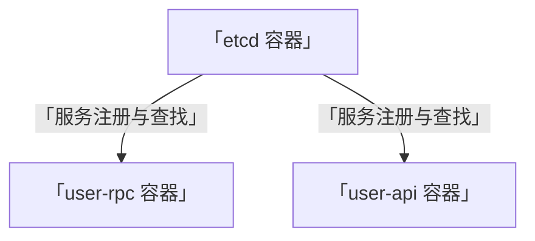

# 4-6-docker-compose编排（中）

## 查看 Docker 网络信息

先进到程序中，可以看一下当前的容器，有之前创建的 Redis、GoZero 这两个容器。然后再看 Docker 的网络信息，可以通过 `docker network` 的命令来进行查看。这个命令主要用于在 Docker 中对网络信息的管理，看它的指令信息：有删除网络、清除网络、查找、网络列表以及网络信息等。

先执行网络的列表 `docker network ls`，查看当前的网络列表，可以看到有三个网络，分别就是前面所讲的桥接（bridge）、host 以及 none。这三种网络模式，都是在 Docker 初始化的时候以及重启的时候创建好的。而桥接之前也讲过，所创建的容器在没有指定网络的情况下，就会使用到桥接来作为它的默认网络信息，然后根据桥接网络来分配它的 IP 网络信息。

在这之前，先要看桥接网络它的具体网络信息。可以通过 `docker inspect bridge` 这个指令来查看 bridge 网络信息。执行完之后就可以看到它的网络详情：网络信息名称、ID 以及创建时间等等，底下就是它的网关以及网络段这些信息。在这里还可以看到，它描述了当前有哪些容器使用了这个网络的信息，根据名称可以看到是 Redis 和 GoZero 这两个容器。

这就符合前面所提到的话题。现在需要通过这两个容器，去看前面所提到的这三种通信方式分别是怎样的。

## 验证容器间的三种通信方式

先来验证第一种：通过宿主机端口绑定的方式来进行访问。这两个容器分别是 GoZero 和 Redis。GoZero 是对外提供的一个 API 服务，当前是与宿主机绑定的 8888 的一个端口，因此在宿主机中直接 curl 该地址，就能访问到 GoZero 的容器，也就是它提供的 API 服务。根据错误信息就可以判断出，当前确实访问到了 GoZero 的容器和它的 API 服务。

然后只需要在 Redis 中通过 curl，以宿主机的端口及 IP 的方式，去访问 GoZero 的容器。进到 Redis 的容器中，进到容器之后就执行 curl 命令。不过在执行前先执行 `apk add curl`，新安装好的 Redis（Alpine 系统）是没有 curl 命令的。如果觉得下载很慢，这里提供了 Alpine 镜像的一个源的地址，使用的是阿里云的源。

在 curl 的信息中，要访问的地址应该是宿主机的地址，也就是 192.168.117.10，然后跟上宿主机的端口，跟上请求的 URL（userinfo）。可以看到也抛出了一个权限不足的错误信息，那么证明前面的方式是没问题的，这一种通信方式就确定了：根据宿主机端口绑定的方式来进行访问。

再来看第二种方式：容器处在同一个网络段下面。当前 GoZero 和 Redis 已经在同一个网络下面了，因为前面已经描述过，都在默认的桥接网络中，分别有各自的 IP：在 Redis 中是这一个 IP，在 GoZero 中是这个 IP。因此直接根据 IP 进行访问，选择 GoZero 的 IP 地址去访问它的端口。根据错误信息的返回，当前也确实访问到了。

第三种是通过 `--link` 命令。这是前面所提到的 link 命令，可以使得容器能通过容器名的方式去访问目标容器。当前可以通过容器名去访问吗？验证一下：`ping go-zero`，发现没有任何反应；然后 ping GoZero 的 IP，是没问题的。因此在当前的情况下，根据容器名直接访问是不行的。

现在把 GoZero 进行停止、删除，然后再重新创建 GoZero，让它与 Redis 连接起来。也就是停止并删除 GoZero，再执行命令 `docker run -p` 指定暴露端口，前面指定好名称，同样还是使用 go-zero 这个名称，`-d` 后台运行，然后 `--link`，link 后面跟上的就是要连接的容器，所以是容器名；当然也可以写容器 ID，一般都填写容器名，这里选 redis。在最后写上它的镜像名，然后就可以创建成功了。

创建完之后，进到 Redis 容器中，再 `ping go-zero`，发现还是不行。这和前面所讲的一样：`--link` 只针对创建这个容器时去连接另一个容器，不是说另一个容器会连接刚刚创建的容器。因此实际上刚刚的操作应该在 GoZero 中生效，因为它设置的对象是 GoZero 这个容器，它并没有对 Redis 这个容器做设置，这个命令只针对当前创建容器去做设置。不过它也确实验证了前面提到的点：通过容器名就可以访问到了。

## 自定义网络

到这里已经通过三种方式验证完了。但是可能还是会存在一个疑问：目前再怎么用都是一个默认网关，那能不能自定义一个网络段呢？当然是可以的。

回到系统中，执行 `docker network create`。这个指令用于创建一个网络，写这个指令去创建网络信息，需要自己指定。网络信息的参数是比较多的，比如说有网络段、网关，指定网络段其实就差不多了。当前就是指定一个网络段，网络段的指定内容是可以自定义的，没有什么限制，这里就给个 168.0.0.0，使用 /24 的一个网络，再跟上网络名称 user。

创建成功之后，再执行 `docker network ls` 去查看，可以看到确实有创建的网络信息。再看一下网络详情（`docker inspect user`），在详情上就可以看到目前指定的一个网络信息，其他的暂时还没有。

接下来需要指定自己创建的这个 user 网络，给容器分配 IP。还是以 GoZero 为例：将 GoZero 停止并进行删除，再重启它。重新创建命令还是用之前的 `docker run` 命令，区别在于增加一个 `--net` 参数，通过 `--net` 指定要使用哪个网络（网络名称），然后再跟上网络名称；按需指定它在运行过程中要分配的 IP（`--ip`），当前网络是 192.168.10.0 网段，那么就给它分配个 10 的 IP。

回车完之后，再 `docker ps` 一下，启动了。再进到容器中，进到容器之后，首先现在所处的网络段是自定义的一个网络段，再去 ping Redis，此时抛出了一个异常。可以看到 `--net` 命令只针对同样的网络段才有效果：Redis 在默认的桥接网络中，而 GoZero 在自定义网络中，两者不在同一网段，所以无法通过容器名或 IP 互通。

到这里，已经了解了 Docker 的三种通信方式以及它的自定义网络。

## 部署 API 与 RPC 服务容器

接下来实践后面的应用：将 API 与 RPC 服务分别通过 Docker 容器进行部署运行，并且与实际项目进行通讯。

在这之前，还是先要做一个事情：将整个程序代码进行调整。先看 API：之前的代码中 API 并没有去使用网络段，GoZero 的一些方法被注释掉了，所以这里要解开，把这个处理的过程解开，然后在业务逻辑代码中使用 RPC API 服务中的信息。调整后的业务逻辑代码如下：

```go
func (l *UserLogic) UserInfo(req *types.UserReq, resp *types.UserResp, err error) {
    //return types.UserResp{
    //    Id: 「666」,
    //    Name: 「木少老师」,
    //    Phone: 「1」,
    //}, err; nil
    // todo: add your logic here and delete this line
    //getUserResp, err := l.svcCtx.User.GetUser(l.ctx, &userclient.GetUserReq{
    //    Id: req.Id,
    //})
    //if err != nil {
    //    return nil, err
    //}
    //return &types.UserResp{
    //    Id: getUserResp.Id,
    //    Name: getUserResp.Name,
    //    Phone: getUserResp.Phone,
    //}, err; nil
}
```

而 RPC 也要稍微处理一下，把数据库的连接操作先注释掉。之所以注释，是因为它在使用数据库的时候会用到 Redis、MySQL，目前还没有下载运行过这些容器，先简化一下。这样简化之后，需要构建的容器就是 API、RPC 以及 ETCD 三个。这三个容器也足以验证前面提到的通讯案例，能够实现相互之间的通信验证。

接下来要怎么构建它们？根据项目的运行依赖来说，无论是 GoZero 还是 API，它们都会依赖 ETCD，都会先从 ETCD 中查找服务或者注册服务，如果 ETCD 不存在，那么肯定是启动失败的。因此首要的对象是先把 ETCD 启动好。



在这里定义一个 ETCD 的 Dockerfile（Dockerfile_etcd），定义完成之后再填写它的信息。信息上面是定义好 ETCD 要用的镜像（`FROM bitnami/etcd`），然后这里是 ETCD 的配置（环境变量），此项先不用做修改。目前这个 ETCD 的 Dockerfile 就写好了。

然后就需要在当前的环境中把 ETCD 构建好容器。先把代码同步到服务器中，同步完成，这里就有一个 Dockerfile_etcd。构建容器通过 `-f` 去指定要运行的 Dockerfile，因为 ETCD 的 Dockerfile 不是直接叫 Dockerfile 这个名称，而是跟上了后缀的，所以如果不用 `-f` 指定，执行的就是 Dockerfile，构建的还是 API 服务。构建成功之后，`docker images` 查看存在 ETCD 的镜像。

接下来再通过 `docker run` 去启动好 ETCD：先指定好它的端口，它的端口是 2379；指定完成了，还有多个端口，那么再指定一个 2380，通过这种方式可以指定多个端口；再定好网络，仍然使用自定义的这个 user 网段，由此给它分配一个 192.168.10.0.20 的 IP；最后定义容器名 etcd。命令比较长，放到文档中记录。

本讲中涉及的主要 Docker 命令如下：

```bash
docker inspect bridge
docker exec -it redis sh
apk add curl
curl http://192.168.117.10:8888/userinfo
docker network COMMAND
docker build -t etcd -f /Dockerfile_etcd .
docker run -d -p 2379:2379 --net user -p 2380:2380 --name etcd etcd
```

构建之后，看一下容器有没有启动好，启动了。那么证明目前 ETCD 准备好了。

再把 API 服务和 RPC 服务分别也部署上来。在这里再定义一个 Dockerfile，这是 RPC 的 Dockerfile，复制 API 服务的 Dockerfile，把信息复制过来，修改里面的 API 描述信息，给它改为 RPC 的。信息确定没有问题之后，再把代码同步到服务器中。

同步完成之后，在这里确定一下，先重新构建 Docker API 服务。首先应该是先把 API 服务和 RPC 服务分别重新编译一下，编译的命令也写好了，复制执行就好了。编译完成后，再把它们分别构建好对应的容器：先构建 API 服务的容器，然后构建 user RPC 服务的容器，最后再分别把它们启动起来，启动的内容复制过来执行即可。

## 容器启动失败的排查

这里出现了一个错误：是 8080 的这个端口已经存在了。这个问题主要是之前有容器在用。先把之前的容器停止，然后删除，不用它了；同时再重新删除一下刚刚构建的 user 容器，因为虽然报错了，但容器仍然还是会被创建出来的。再多 `docker ps` 一下确认。

目前发现一个问题：刚刚明明执行了让 API 服务和 RPC 服务启动，按理论说不应该报错，那为什么报错了？遇到容器启动失败了，应该怎么去排查这个问题？可以通过 Docker 的日志来看，这是在容器启动失败之后应该要做的事情。这也是使用容器的时候经常会出现的情况，注意：出现之后别慌，要通过查看日志的方式去看它为什么出现这样的错误。打印的信息就是容器在启动过程中的信息，可能有很多种，当前打印的就是 user-api 的。

从信息中仔细去看，会发现它是 ETCD 的问题，也就是说它当前连接不上 ETCD。然后会发现它访问的地址不对，不是所期望的地址。怎么办？问题就在于还没改配置，所以需要对它们的配置分别去进行修改。在这之前，要先确保之前创建的 ETCD 的 IP 地址，确定完之后给它复制过来。

然后再同步，让它们都上传到服务器上面去；再 `docker stop` 停止刚刚所创建的 user-api、user-rpc，同时删除它们，因为需要重新编译。所以在这里又要重新再次编译一下，把上面的编译命令复制一下。

那么这里可能会抛出一个问题：难道每次修改配置都要重新编译容器吗？这是否很不友好呢？
